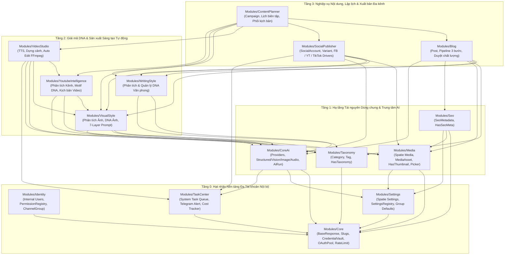

# KẾ HOẠCH TỔNG THỂ & ĐẶC TẢ KIẾN TRÚC HỆ THỐNG (`makerting-app`)

- **Cập nhật lần cuối:** 29/10/2026
- **Kiến trúc nền tảng:** Laravel Modular Monolith (`nwidart/laravel-modules` chuẩn cấu trúc v12/v13 + `wikimedia/composer-merge-plugin`) & Vue 3 Composition API (Vuexy Admin SPA)
- **Dự án tham chiếu gốc:** `makert-temlate`
- **Trạng thái hiện tại:** Đã chốt kiến trúc tổng thể — Sẵn sàng triển khai từ `Phase 0`

---

## Mục lục

1. [Tổng quan Dự án & Định hướng Kiến trúc](#1-tổng-quan-dự-án--định-hướng-kiến-trúc)
2. [Kiến trúc Phân tầng 13 Core Modules (4-Tier Layered Architecture)](#2-kiến-trúc-phân-tầng-13-core-modules-4-tier-layered-architecture)
3. [Đặc tả Kỹ thuật & Schema Database Chi tiết Từng Phân hệ](#3-đặc-tả-kỹ-thuật--schema-database-chi-tiết-từng-phân-hệ)
   - [3.1. Tầng 0: Hạt nhân Hệ thống Đa Tài khoản Nội bộ (`Core`, `Identity`, `Settings`, `TaskCenter`)](#31-tầng-0-hạt-nhân-hệ-thống-đa-tài-khoản-nội-bộ)
   - [3.2. Tầng 1: Hạ tầng Tài nguyên Dùng chung & Trái tim AI (`Taxonomy`, `Media`, `Seo`, `CoreAi`)](#32-tầng-1-hạ-tầng-tài-nguyên-dùng-chung--trái-tim-ai)
   - [3.3. Tầng 2: Bộ Ba Giải mã DNA & Xưởng Dựng Video Tự động (`WritingStyle`, `VisualStyle`, `YoutubeIntelligence`, `VideoStudio`)](#33-tầng-2-bộ-ba-giải-mã-dna--xưởng-dựng-video-tự-động)
   - [3.4. Tầng 3: Sản xuất Nội dung, Lập lịch Plan & Đăng Đa Nền tảng (`Blog`, `ContentPlanner`, `SocialPublisher`)](#34-tầng-3-sản-xuất-nội-dung-lập-lịch-plan--đăng-đa-nền-tảng)
4. [Chuẩn Giao tiếp Liên Module, Chuẩn API, Frontend Vue 3 & Hàng đợi (Queues)](#4-chuẩn-giao-tiếp-liên-module-chuẩn-api-frontend-vue-3--hàng-đợi-queues)
5. [Định hướng Mở rộng Tính năng Phụ trợ bằng Hệ thống `Plugin`](#5-định-hướng-mở-rộng-tính-năng-phụ-trợ-bằng-hệ-thống-plugin)
6. [Lộ trình Triển khai Chi tiết Theo Giai đoạn (Phase 0 → Phase 6)](#6-lộ-trình-triển-khai-chi-tiết-theo-giai-đoạn-phase-0--phase-6)
7. [Quy ước Phát triển Code, Bảo mật & Tiêu chí Nghiệm thu (DoD)](#7-quy-ước-phát-triển-code-bảo-mật--tiêu-chí-nghiệm-thu-dod)

---

## 1. Tổng quan Dự án & Định hướng Kiến trúc

### 1.1. Mục tiêu Hệ thống
Xây dựng nền tảng **Quản trị Sáng tạo Nội dung bằng AI & Tự động hóa Xuất bản Đa kênh Nội bộ** phục vụ vận hành đồng thời **nhiều Fanpage Facebook, nhiều kênh YouTube, nhiều tài khoản TikTok và hệ thống Blog Website**, bao gồm trọn vẹn 8 trụ cột chức năng:

1. **Hệ thống Phân tích Văn phong (`WritingStyle`)**: Trích xuất 16 quy tắc giọng điệu từ bài mẫu, kiểm chứng trích dẫn thật chống AI bịa đặt, tạo bản chụp văn phong không đạo văn.
2. **Hệ thống Phân tích Ảnh, Tạo DNA Ảnh & Sinh Ảnh từ DNA (`VisualStyle`)**: Giải mã ảnh mẫu bằng Vision AI thành cấu trúc DNA nhiếp ảnh, ghép prompt 7 lớp tạo ảnh đồng bộ thương hiệu và đưa thẳng vào thư viện Media.
3. **Hệ thống Category, Tag & Slug dùng chung (`Taxonomy` & `Core`)**: Lưu trữ đa hình tập trung, hỗ trợ phân vùng (`scope`), tự giữ lịch sử slug cũ cho Redirect 301 và gắn thẻ mới do AI đề xuất.
4. **Hệ thống Tham khảo Kênh YouTube, Tạo Motif DNA, Viết Kịch bản AI & Edit Video Tự động (`YoutubeIntelligence` & `VideoStudio`)**: Phân tích kênh nguồn để rút ra công thức mô-típ (Hook, nhịp kể, tiêu đề, DNA Thumbnail), viết kịch bản chia từng phân cảnh và tự động ghép giọng đọc TTS + ảnh DNA/B-Roll + phụ đề nhảy chữ + nhạc nền thành video hoàn chỉnh.
5. **Hệ thống Cài đặt Dùng chung Toàn hệ thống (`Settings`)**: Dựa trên `spatie/laravel-settings` kết hợp `SettingsRegistry` động, có khóa chống ghi đè, che thông tin nhạy cảm và hỗ trợ cấu hình mặc định theo nhóm kênh.
6. **Hệ thống Lập lịch Plan & Đăng Tự động Đa Nền tảng (`ContentPlanner` & `SocialPublisher`)**: Lên kế hoạch nội dung bài viết/video theo lịch ngày–tuần–tháng, phê duyệt chất lượng và đăng tự động lên **Facebook (Page Feed & Reels), YouTube (Video dài & Shorts), TikTok**.
7. **Hệ thống Quản lý Media & Asset (`Media`)**: Dựa trên `spatie/laravel-medialibrary` theo mô hình sở hữu 2 lớp (`MediaAsset` + `media_asset_usages`), cung cấp Popup quản lý/chọn/tạo ảnh AI dùng chung toàn hệ thống.
8. **Hệ thống Trung tâm Phân tích AI (`CoreAi`)**: Trạm điều phối AI duy nhất (Text/JSON Schema, Vision, Image, Audio TTS/STT), chuẩn hóa đầu vào/đầu ra cho mọi module.

### 1.2. Các Quyết định Kiến trúc Cốt lõi (Đã chốt)
- **Không làm SaaS, loại bỏ hoàn toàn `Customer`**: Hệ thống phục vụ đội ngũ quản trị nội bộ vận hành mạng lưới nhiều tài khoản/nhiều kênh. Nhờ bỏ cô lập `tenant_id` kiểu SaaS, toàn bộ kho `MediaAsset`, `WritingStyle`, `VisualStyle` và `ChannelMotifDna` được dùng chung và tái sử dụng chéo giữa các kênh, đồng thời phân loại gọn gàng qua **`ChannelGroup` (Nhóm kênh / Ngách nội dung)**.
- **13 Core Modules là Hạ tầng Xương sống Luôn Bật (`Always-On Modules`)**: Không xây dựng chức năng tắt/bật đối với 13 module cơ bản để giữ code hạ tầng gọn sạch, tốc độ truy vấn Eloquent `eager loading` tối ưu và không phải gánh lớp đệm kiểm tra tắt/bật rườm rà.
- **Tính năng phụ trợ tương lai phát triển dưới dạng `Plugin` (`Plugins/<Name>`)**: Các tính năng mở rộng nhẹ về sau (thêm mạng xã hội phụ, săn trend, rút gọn link, bot thông báo...) sẽ gắn qua cổng `Registry` / `Event` có sẵn và có thể bật/tắt độc lập mà không chạm vào hạ tầng code lõi.
- **Tương thích `nwidart/laravel-modules` (chuẩn v12/v13)**:
  - Trên **PHP 8.2 + Laravel 12** hiện tại: dùng `nwidart/laravel-modules:^12.0` (có cấu trúc thư mục `Modules/<Name>/app/` và cơ chế tự gộp autoload `wikimedia/composer-merge-plugin` giống hệt 100% bản v13).
  - Sẵn sàng nâng thẳng lên `nwidart/laravel-modules:^13.0` khi môi trường chạy **PHP 8.3+ & Laravel 13** mà không phải đổi cấu trúc thư mục.

### 1.3. Đối chiếu Kế thừa & Cải tiến từ `makert-temlate`

| Phân hệ | Điểm mạnh kế thừa từ `makert-temlate` | Điểm nghẽn cũ & Cải tiến mới tại `makerting-app` |
| :--- | :--- | :--- |
| **Writing Style** | 16 `RULE_KEYS`, kiểm chứng `str_contains` chống bịa `evidence`, tự loại bỏ `evidence` khỏi prompt sinh bài mới. | Tách khỏi truy vấn cứng bảng `settings` bằng Domain Event; dùng chung bộ tải URL chống SSRF của `Core`. |
| **Visual Style** | `VisualStyleDnaDefinition` (5 nhóm bắt buộc + `VisualStyleShot` + 7 lớp `VisualPromptBuilder`), gắn metadata AI vào Spatie Media. | Xóa bỏ hoàn toàn `ImageProfileService` phẳng cũ và các cột dư thừa (`reference_path`, `reference_hash`); nối 100% luồng Thumbnail, Social và Video Scene vào DNA Engine. |
| **Taxonomy & Slug** | Bảng slug tập trung giữ lịch sử 301 redirect; `syncTaxonomyWithNew()` nhận cả ID sẵn có và tên mới do AI gợi ý. | Đổi tên bảng `slugable` (sai chính tả) thành `slugs`; thêm cột `scope` cho `categories`/`tags`; dùng `TaxonomyRegistry` thay vì viết cứng quan hệ ngược trong `Category`. |
| **Media & Asset** | Sở hữu file 2 tầng (`MediaAsset` vật lý + `media_asset_usages` đa hình), kiểm tra magic bytes, quét ZIP an toàn. | Thay `enum MediaAssetField` đóng cứng bằng `MediaSlotRegistry` động; tách rõ Trait `HasThumbnail`, `HasGallery`, `HasVideoAsset`; xóa phụ thuộc ngược vào model nghiệp vụ. |
| **Settings** | Khóa lạc quan `version` (HTTP 409), che secret, cache trong phạm vi HTTP request. | Thay hằng số `ProjectSettingsService::CLASSES` cứng bằng `SettingsRegistry` để từng module tự đăng ký. |
| **Core AI & Queue** | `AiProviderClient` ghim DNS chống SSRF, kiểm định JSON Schema đầu ra, Popup theo dõi tiến trình ngầm. | Chuẩn hóa `ai_imports` cũ thành `ai_runs` + `ai_run_steps`; bổ sung `AnthropicDriver` (`claude-*`), cổng TTS/STT; đưa `TaskCenter` xuống Tầng 0 dùng chung cho cả AI, Render Video và Upload MXH. |

---

## 2. Kiến trúc Phân tầng 13 Core Modules (4-Tier Layered Architecture)

### 2.1. Sơ đồ Phụ thuộc Một chiều (Không Phụ thuộc Vòng)
Quy tắc bắt buộc: **Module ở tầng trên chỉ được gọi dịch vụ/DTO của tầng dưới; tầng dưới giao tiếp ngược lên thông qua `Registry` (đăng ký lúc `boot`) hoặc `Domain Event`.**



### 2.2. Cấu trúc Thư mục Chuẩn của Dự án & Từng Module

```text
makerting-app/
├── app/                          # Khung khởi động tối giản của Laravel Host
├── config/
│   └── modules.php               # Cấu hình nwidart/laravel-modules
├── docs/                         # Tài liệu kiến trúc, kế hoạch và API contracts
│   ├── README.md
│   └── PLAN.md
├── Modules/                      # 13 Core Modules luôn bật
│   └── <ModuleName>/
│       ├── app/
│       │   ├── Actions/          # Các ca nghiệp vụ thay đổi dữ liệu (1 class = 1 nhiệm vụ)
│       │   ├── Contracts/        # Interface công khai cho module tầng trên sử dụng
│       │   ├── DTOs/             # Readonly DTO đầu vào / đầu ra chuẩn hóa
│       │   ├── Enums/            # PHP Backed Enums của riêng module
│       │   ├── Events/           # Sự kiện phát ra khi hoàn tất nghiệp vụ
│       │   ├── Http/
│       │   │   ├── Controllers/  # Chỉ điều phối HTTP -> Action/Service -> BaseResponse
│       │   │   ├── Requests/     # FormRequest tách riêng Create / Update
│       │   │   └── Resources/    # JsonResource định hình dữ liệu trả về
│       │   ├── Jobs/             # Queue Jobs bất đồng bộ, idempotent
│       │   ├── Models/           # Eloquent Models + Scopes + Relations
│       │   ├── Policies/         # Kiểm tra phân quyền cấp bản ghi
│       │   ├── Providers/        # <ModuleName>ServiceProvider & RouteServiceProvider
│       │   ├── Registries/       # Cổng đăng ký mở rộng (nếu là module hạ tầng)
│       │   ├── Services/         # Dịch vụ điều phối nghiệp vụ / tích hợp
│       │   ├── Settings/         # Class Spatie Settings của module (nếu có)
│       │   └── Traits/           # Shared Traits cung cấp cho module khác (nếu có)
│       ├── config/
│       ├── database/
│       │   ├── factories/
│       │   ├── migrations/
│       │   └── seeders/
│       ├── resources/
│       │   └── js/               # Giao diện Vue 3 của riêng module
│       │       ├── pages/        # Tự động nạp vào unplugin-vue-router
│       │       ├── views/        # Form, Table, Dialog con của module
│       │       ├── services/     # Hàm gọi API unwrap BaseResponse
│       │       ├── stores/       # Pinia stores của module
│       │       └── navigation.js # Khai báo mục menu vào Sidebar Admin
│       ├── routes/
│       │   ├── api.php           # Prefix chuẩn: /api/v1/admin/...
│       │   └── web.php
│       ├── tests/
│       │   ├── Feature/
│       │   └── Unit/
│       ├── composer.json         # Autoload PSR-4 riêng, tự gộp qua composer-merge-plugin
│       └── module.json           # Metadata của module
├── Plugins/                      # Thư mục dự phòng cho các Plugin phụ trợ bật/tắt sau này
└── resources/
    └── js/                       # App Shell Vuexy & Bộ Component dùng chung toàn hệ thống
```

---

## 3. Đặc tả Kỹ thuật & Schema Database Chi tiết Từng Phân hệ

### 3.1. Tầng 0: Hạt nhân Hệ thống Đa Tài khoản Nội bộ

#### Module 1: `Modules/Core`
- **Trách nhiệm:** Chuẩn hóa HTTP JSON (`BaseResponse`), xử lý ngoại lệ an toàn, hệ thống `Slug` toàn cục, chống gọi đúp (`Idempotency`), tải nội dung từ URL chống SSRF, mã hóa bí mật và điều tiết tần suất gọi API cho dàn nhiều tài khoản mạng xã hội.
- **Bảng Database:**
  1. `slugs`:
     - `id` (bigint PK), `sluggable_type` (varchar 64), `sluggable_id` (bigint), `slug` (varchar 250), `locale` (varchar 16, default `'vi'`), `is_primary` (boolean, default `true`), `timestamps`.
     - Unique: `(sluggable_type, slug, locale)`; Index: `(sluggable_type, sluggable_id, is_primary)`.
  2. `oauth_client_apps` *(Phục vụ quản lý nhiều kênh YouTube/Fanpage/TikTok vượt giới hạn quota 1 App)*:
     - `id`, `platform` (`'facebook' | 'youtube' | 'tiktok'`), `name` (varchar 160), `client_id` (varchar 255), `client_secret_encrypted` (text), `redirect_uri` (varchar 500), `scopes_json` (json), `daily_quota_limit` (int nullable), `daily_quota_used` (int default 0), `quota_reset_at` (timestamp nullable), `is_active` (bool default `true`), `timestamps`.
  3. `idempotency_keys`:
     - `key` (varchar 128 PK), `user_id` (bigint nullable), `route_signature` (varchar 191), `request_hash` (char 64), `response_status` (smallint nullable), `response_body_json` (json nullable), `locked_until` (timestamp), `expires_at` (timestamp, indexed), `timestamps`.
- **Thành phần cung cấp:**
  - `BaseResponse`: `success()`, `created()`, `error()`, `validation()`, `paginated()`, `dataTable()`, `noContent()`, `fromException()`.
  - Trait `HasSlug` + `SlugService` + `SlugRegistry`: Tự sinh slug khi tạo/đổi cột nguồn, giữ slug cũ (`is_primary = false`) phục vụ Redirect 301, khóa `lockForUpdate` chống đụng độ.
  - `SafeRemoteFetcher`: Chặn IP nội bộ/metadata cloud (`127.0.0.0/8`, `10.0.0.0/8`, `169.254.169.254`...), ghim DNS (`CURLOPT_RESOLVE`) chống DNS Rebinding.
  - `AccountRateLimiter` & `JitterScheduler`: Khóa tuần tự theo từng tài khoản (`WithoutOverlapping`) và cộng độ trễ ngẫu nhiên có kiểm soát (`jitter_seconds`) khi lên lịch hàng loạt tài khoản.

#### Module 2: `Modules/Identity`
- **Trách nhiệm:** Xác thực nhân sự nội bộ (`Sanctum` guard `admin`), phân quyền động (`spatie/laravel-permission` + `PermissionRegistry`), và phân cụm quản lý kênh qua **`ChannelGroup`** (không có bảng `customers`).
- **Bảng Database:**
  1. `users` + các bảng chuẩn của `Sanctum` & `Spatie Permission`.
  2. `channel_groups` *(Nhóm kênh / Ngách nội dung — giúp quản lý hàng chục Fanpage/YouTube/TikTok ngăn nắp)*:
     - `id`, `name` (varchar 160 — ví dụ: *"Cụm Kênh Sức Khỏe"*, *"Cụm Kênh Review Công Nghệ"*), `code` (varchar 60 unique), `color` (varchar 20), `description` (text nullable), `defaults_json` (json: `default_writing_profile_id`, `default_visual_style_id`, `default_motif_profile_id`, `default_tts_voice`, `watermark_media_id`, `brand_cta_text`), `is_active` (bool default `true`), `created_by`, `timestamps`.
  3. `channel_group_user` *(Phân quyền nhân sự phụ trách từng cụm kênh nếu cần)*:
     - `channel_group_id`, `user_id`, `role_in_group` (`'manager' | 'editor' | 'reviewer'`), unique `(channel_group_id, user_id)`.

#### Module 3: `Modules/Settings` *(Yêu cầu #5)*
- **Trách nhiệm:** Quản lý cấu hình toàn hệ thống trên nền `spatie/laravel-settings` thông qua `SettingsRegistry`.
- **Bảng Database:** Bảng `settings` chuẩn của Spatie (`id`, `group`, `name`, `locked`, `payload`, `timestamps`).
- **Cơ chế hoạt động:**
  - Mỗi module tự định nghĩa class kế thừa `Spatie\LaravelSettings\Settings` và implement `ModularSettingsContract` (`group()`, `defaults()`, `validationRules()`, `secretProperties()`, `managePermission()`).
  - Hỗ trợ kiểm tra khóa phiên bản `version` (trả `409 Conflict` nếu 2 admin lưu đè nhau), tự che các trường bí mật thành cờ `*_configured: bool` khi trả ra API, cache trong phạm vi 1 HTTP request và ghi nhận lịch sử thay đổi qua `spatie/laravel-activitylog`.

#### Module 4: `Modules/TaskCenter`
- **Trách nhiệm:** Theo dõi tập trung mọi tiến trình chạy ngầm toàn hệ thống (AI, Render Video, Upload mạng xã hội), gửi cảnh báo sức khỏe tài khoản về Telegram/Chuông Admin và thống kê chi phí vận hành AI theo kênh.
- **Bảng Database:**
  1. `system_task_runs`:
     - `id` (uuid PK), `dedupe_key` (varchar 191 unique), `module` (varchar 50), `task_type` (varchar 80), `title` (varchar 255), `status` (`'queued' | 'running' | 'completed' | 'partial' | 'failed' | 'cancelled'`), `progress` (tinyint unsigned 0..100), `channel_group_id` (FK nullable), `taskable_type` (varchar 64), `taskable_id` (varchar 64), `initiated_by` (FK `users.id`), `meta_json` (json), `error_code` (varchar 80 nullable), `error_message` (text nullable), `started_at`, `completed_at`, `timestamps`.
  2. `ai_usage_logs` *(Thống kê chi phí nội bộ theo Kênh/Chiến dịch)*:
     - `id`, `ai_run_id` (uuid nullable), `channel_group_id` (FK nullable), `social_account_id` (bigint nullable), `provider` (varchar 60), `model` (varchar 120), `capability` (`'text' | 'vision' | 'image' | 'tts' | 'stt'`), `input_units` (bigint default 0), `output_units` (bigint default 0), `estimated_cost_usd` (decimal 12,6 nullable), `created_at`.
  3. `system_alerts` *(Cảnh báo hết hạn Token Fanpage/YT/TikTok, lỗi quota, lỗi render)*:
     - `id`, `severity` (`'info' | 'warning' | 'critical'`), `category` (varchar 60), `title` (varchar 255), `message` (text), `context_json` (json), `telegram_sent_at` (timestamp nullable), `read_at` (timestamp nullable), `timestamps`.

---

### 3.2. Tầng 1: Hạ tầng Tài nguyên Dùng chung & Trái tim AI

#### Module 5: `Modules/Taxonomy` *(Yêu cầu #3)*
- **Bảng Database:**
  1. `categories`: `id`, `parent_id` (self-FK `nullOnDelete`), `scope` (varchar 40 nullable — `null` dùng chung hoặc `'blog'`, `'visual_style'`, `'youtube'`, `'campaign'`), `name` (varchar 160), `description` (text nullable), `status` (`'active' | 'inactive'`), `sort_order` (int default 0), `show_on_menu` (bool default `false`), `timestamps`, `softDeletes`. Dùng `HasSlug` và `HasThumbnail`.
  2. `tags`: `id`, `scope` (varchar 40 nullable), `name` (varchar 120), `description` (text nullable), `status` (`'active' | 'inactive'`), `timestamps`, `softDeletes`. Dùng `HasSlug`.
  3. `categorizables`: `id`, `category_id` (FK cascade), `categorizable_type` (varchar 64), `categorizable_id` (bigint), `sort_order` (int default 0), `timestamps`. Unique `(category_id, categorizable_type, categorizable_id)`.
  4. `taggables`: `id`, `tag_id` (FK cascade), `taggable_type` (varchar 64), `taggable_id` (bigint), `timestamps`. Unique `(tag_id, taggable_type, taggable_id)`.
- **Trait cung cấp:** `HasTaxonomy` (`categories()`, `tags()`, `syncTaxonomyWithNew(['categories' => [...], 'new_categories' => [...], 'tags' => [...], 'new_tags' => [...]])`).

#### Module 6: `Modules/Media` *(Yêu cầu #7)*
- **Kiến trúc 2 lớp với `spatie/laravel-medialibrary`:**
  1. `media_assets` (Model `MediaAsset implements HasMedia`):
     - `id`, `channel_group_id` (FK `channel_groups.id` nullable — hỗ trợ lọc nhanh media theo nhóm kênh nhưng vẫn cho phép dùng chéo), `folder` (varchar 60 default `'root'`), `kind` (`'image' | 'video' | 'audio' | 'document' | 'archive'`), `title` (varchar 255), `alt_text` (varchar 255 nullable), `visibility` (`'public' | 'private'`), `width` (int nullable), `height` (int nullable), `duration_ms` (int nullable), `checksum_sha256` (char 64 indexed), `created_by` (FK `users.id`), `timestamps`, `softDeletes`.
     - Bảng `media` của Spatie đính kèm vào `MediaAsset` (collection `'library'`), tự sinh conversions cho ảnh (`thumb` 320×240, `featured` 1200×675 WebP, `og` 1200×630 WebP) và trích frame poster cho video; lưu `custom_properties['ai_generation']` khi file tạo từ AI.
  2. `media_asset_usages`:
     - `id`, `media_asset_id` (FK cascade), `linkable_type` (varchar 64), `linkable_id` (bigint), `slot` (varchar 80 — ví dụ `'post.thumbnail'`, `'post.gallery'`, `'social_variant.media'`, `'video_project.output'`), `sort_order` (unsigned int default 0), `timestamps`.
     - Unique `(media_asset_id, linkable_type, linkable_id, slot)`; Index `(linkable_type, linkable_id, slot, sort_order)`.
- **Thành phần cung cấp:**
  - `MediaSlotRegistry`: Cho phép từng module đăng ký quy tắc khe cắm (`allowedKinds`, `maxItems`, `visibility`).
  - Bộ Shared Traits: **`HasMediaSlots`**, **`HasThumbnail`**, **`HasGallery`**, **`HasVideoAsset`**.
  - Dịch vụ đọc/ghi chuẩn hóa: `UploadMediaAssetAction`, `MediaUsageService` (khóa dòng theo thứ tự ID tăng dần chống deadlock), trả dữ liệu qua `MediaItemDto` và cung cấp `openReadStream(int $mediaAssetId)` để bộ đăng bài mạng xã hội hoặc FFmpeg đọc file mà không phụ thuộc đường dẫn ổ đĩa/S3.
  - Giao diện dùng chung: `<MediaPickerDialog />` và `<MediaSlotField />` gồm 3 tab ngay trong Popup: **Thư viện Media**, **Tải lên từ máy**, **Tạo ảnh mới bằng AI từ DNA**.

#### Module 7: `Modules/Seo`
- **Bảng Database:** `seo_metadata`:
  - `id`, `seoable_type` (varchar 64), `seoable_id` (bigint), `focus_keyword` (varchar 160 nullable), `seo_title` (varchar 255 nullable), `seo_description` (varchar 500 nullable), `canonical_url` (varchar 2048 nullable), `robots_index` (bool default `true`), `robots_follow` (bool default `true`), `og_title` (varchar 255 nullable), `og_description` (varchar 500 nullable), `og_image_id` (FK `media_assets.id` nullOnDelete), `schema_org_json` (json nullable), `timestamps`. Unique `(seoable_type, seoable_id)`.
- **Trait cung cấp:** `HasSeoMeta` — chỉ lưu các trường người dùng chủ động ghi đè; khi render/trả API tự động bù giá trị trống từ `title`, `slug` (`HasSlug`), `thumbnail` (`HasThumbnail`) và mẫu tiêu đề chung trong `SeoSettings`.

#### Module 8: `Modules/CoreAi` *(Yêu cầu #8 — Trung tâm Phân tích & Xử lý AI)*
- **Nguyên tắc:** Không một module nghiệp vụ nào được tự gọi HTTP tới OpenAI, Gemini, Anthropic hay ElevenLabs. Tất cả bắt buộc đi qua `CoreAiGatewayContract`.
- **Bảng Database:**
  1. `ai_providers`: `id`, `key` (unique), `name`, `kind` (`'official' | 'gateway'`), `driver` (`'openai' | 'gemini' | 'anthropic' | 'openai-compatible' | 'elevenlabs'`), `base_url`, `api_key_encrypted` (text), `extra_keys_json` (json encrypted nullable — xoay vòng nhiều key khi chạm giới hạn RPM), `config_json` (json), `request_timeout` (int default 120), `is_active` (bool), `test_status`, `last_tested_at`, `timestamps`.
  2. `ai_models`: `id`, `ai_provider_id` (FK cascade), `remote_model_id` (varchar 191), `label`, `capabilities_json` (json: `'text_generation'`, `'structured_output'`, `'vision'`, `'image_generation'`, `'tts'`, `'stt'`), `pricing_json` (json nullable), `is_enabled` (bool), `is_available` (bool), `timestamps`. Unique `(ai_provider_id, remote_model_id)`.
  3. `ai_runs`: `id` (uuid PK), `parent_id` (uuid nullable), `session_id` (uuid indexed), `module` (varchar 50), `operation` (varchar 80), `generation_no` (uint default 1), `status` (`'queued' | 'running' | 'ready' | 'partial' | 'applied' | 'failed' | 'cancelled' | 'expired'`), `progress` (tinyint 0..100), `connection_snapshot_json` (json — không chứa API key), `input_json` (json), `output_json` (json nullable), `diagnostics_json` (json nullable), `error_code`, `error_message`, `initiated_by` (FK `users.id`), `expires_at` (timestamp nullable), `timestamps`.
  4. `ai_run_steps`: `id`, `ai_run_id` (uuid FK cascade), `step_key` (varchar 60), `input_hash` (char 64), `status`, `output_json` (json nullable), `diagnostics_json` (json nullable), `latency_ms` (uint nullable), `timestamps`. Unique `(ai_run_id, step_key, input_hash)`.
  5. `ai_provenances`: `id`, `target_type` (varchar 64), `target_id` (bigint), `field_name` (varchar 80), `ai_run_id` (uuid FK nullOnDelete), `value_hash` (char 64 — đối chiếu xem nội dung AI đã được người biên tập sửa lại hay chưa), `applied_by` (FK `users.id`), `timestamps`.
- **Hợp đồng Trung tâm (`CoreAiGatewayContract`):**
  - `executeStructured(AiStructuredRequest $req): AiStructuredResponse` (hỗ trợ cả Text & Vision đính kèm ảnh base64, kiểm tra đầu ra khớp JSON Schema 100%).
  - `generateImage(AiImageRequest $req): AiImageResponse` (hỗ trợ prompt, negative prompt, tỷ lệ khung hình, ảnh tham chiếu chủ thể/DNA).
  - `synthesizeSpeech(AiSpeechRequest $req): AiSpeechResponse` (trả về audio binary + mảng mốc thời gian từng từ/câu `WordTimingDto[]` phục vụ dựng phụ đề video).
  - `transcribeAudio(AiTranscribeRequest $req): AiTranscribeResponse` (chuyển âm thanh video mẫu thành văn bản có mốc thời gian).
- **Trait cung cấp:** `HasAiProvenance`.

---

### 3.3. Tầng 2: Bộ Ba Giải mã DNA & Xưởng Dựng Video Tự động

#### Module 9: `Modules/WritingStyle` *(Yêu cầu #1 — Hệ thống Phân tích Văn phong)*
- **Bảng Database:**
  1. `writing_profiles` (dùng `HasTaxonomy`): `id`, `name` (varchar 160), `description` (text nullable), `rules_json` (json — 16 khóa văn phong: `tone`, `pronouns`, `emotion`, `opening`, `sentence_rhythm`, `paragraph_rhythm`, `transitions`, `vocabulary`, `technical_terms`, `structure_patterns`, `headings`, `bullets`, `examples`, `ending`, `avoid`, `uncertainties`), `evidence_json` (json nullable), `style_instructions` (text `<= 10000` ký tự), `origin` (`'manual' | 'reference'`), `source_hash` (char 64 nullable), `analysis_metadata_json` (json nullable), `version` (uint default 1), `status` (`'draft' | 'active'`), `is_enabled` (bool default `true`), `created_by`, `timestamps`.
  2. `writing_profile_analyses`: `id` (uuid PK), `created_by`, `name`, `source_type` (`'paste' | 'url' | 'file'`), `source_url` (text nullable), `reference_text` (longText), `source_hash` (char 64), `status`, `ai_run_id` (uuid nullable), `result_json` (json nullable), `draft_profile_id` (FK `writing_profiles.id` nullOnDelete), `error_code`, `error_message`, `expires_at`, `timestamps`.
- **Bảo chứng chất lượng:**
  - Bộ kiểm định `WritingProfileDefinition::validateEvidence()` chuẩn hóa khoảng trắng/HTML và bắt buộc mọi câu trích dẫn trong `evidence_json[].excerpt` phải xuất hiện nguyên văn (`str_contains`) trong văn bản mẫu.
  - Dịch vụ `WritingProfileSnapshotService` khi cấp dữ liệu cho `Blog`, `YoutubeIntelligence`, `SocialPublisher` sẽ **tự động loại bỏ trường `evidence_json`** để AI học đúng cách hành văn nhưng không bao giờ chép lại câu chữ từ bài mẫu.

#### Module 10: `Modules/VisualStyle` *(Yêu cầu #2 — Phân tích Ảnh, Tạo DNA Ảnh & Sinh Ảnh từ DNA)*
- **Bảng Database:**
  1. `visual_styles` (dùng `HasSlug`, `HasTaxonomy`, `HasMediaSlots` cho `'visual_style.reference'`):
     - `id`, `name` (varchar 160), `description` (text nullable), `reference_media_id` (FK `media_assets.id` nullOnDelete), `dna_json` (json), `schema_version` (varchar 16 default `'1.0'`), `compiled_prompt_preview` (text nullable), `negative_prompt` (text nullable), `version` (uint default 1), `status` (`'draft' | 'analyzing' | 'analyzed' | 'active' | 'archived' | 'failed'`), `is_enabled` (bool default `true`), `analyzed_at`, `created_by`, `updated_by`, `timestamps`.
  2. `visual_style_shots` *(Công thức góc chụp con thuộc 1 DNA)*:
     - `id`, `visual_style_id` (FK cascade), `code` (varchar 60), `name` (varchar 160), `description` (text nullable), `composition_override_json` (json nullable), `camera_override_json` (json nullable), `prompt_suffix` (text nullable), `suggested_aspect_ratio` (varchar 16 default `'16:9'`), `sort_order` (uint default 0), `is_active` (bool default `true`), `timestamps`. Unique `(visual_style_id, code)`.
- **Cấu trúc `dna_json` & Pipeline 7 Lớp Prompt:**
  - `dna_json` gồm 5 nhóm enum bắt buộc (`composition`, `camera`, `lighting`, `environment`, `color_mood`) + quy tắc bảo toàn chủ thể (`subject_rules`: giữ logo, hình dáng, chữ...) + `style_constraints` + điểm tự tin `confidence` + gợi ý `taxonomy_suggestion`.
  - Khi sinh ảnh (cho Thumbnail bài viết, Gallery Facebook, hoặc Cảnh minh họa Video), `VisualPromptBuilder` lắp ghép 7 lớp (`SubjectIdentity` → `StyleDna` → `CategoryAdaptation` → `ShotRecipe` → `UserInstructions` → `PreservationConstraint` + `NegativeLayer`) thành câu lệnh nhiếp ảnh tự nhiên -> gọi `CoreAi::generateImage()` -> đẩy qua `UploadMediaAssetAction` lưu thẳng vào `Modules/Media` (`MediaAsset`) kèm `custom_properties['ai_generation']`.

#### Module 11: `Modules/YoutubeIntelligence` *(Yêu cầu #4a — Tham khảo Kênh YouTube, Motif DNA & Kịch bản AI)*
- **Bảng Database:**
  1. `youtube_ref_channels` *(Kênh YouTube mẫu đưa vào nghiên cứu)*:
     - `id`, `external_channel_id` (varchar 64 unique), `handle` (varchar 120 nullable), `title` (varchar 255), `description` (text nullable), `subscriber_count` (bigint default 0), `video_count` (int default 0), `view_count` (bigint default 0), `avatar_url` (varchar 1000 nullable), `thumbnail_visual_style_id` (FK `visual_styles.id` nullOnDelete — DNA ảnh bìa trích từ kênh mẫu), `raw_meta_json` (json), `last_synced_at`, `timestamps`.
  2. `youtube_ref_videos` *(Các video tiêu biểu lấy từ kênh nguồn để giải mã mô-típ)*:
     - `id`, `youtube_ref_channel_id` (FK cascade), `external_video_id` (varchar 32 unique), `title` (varchar 500), `description` (text nullable), `duration_sec` (uint), `view_count` (bigint), `like_count` (bigint), `comment_count` (bigint), `published_at` (timestamp), `thumbnail_url` (varchar 1000), `transcript_source` (`'youtube_captions' | 'ai_stt' | 'none'`), `transcript_segments_json` (longText/json nullable — lưu từng câu kèm mốc giây), `timestamps`.
  3. `channel_motif_profiles` *(DNA Mô-típ Kênh đúc kết từ kênh nguồn — dùng `HasTaxonomy`)*:
     - `id`, `youtube_ref_channel_id` (FK nullOnDelete), `name` (varchar 160), `target_format` (`'long_form' | 'shorts_vertical' | 'both'`), `motif_dna_json` (json), `evidence_json` (json — trích đoạn lời thoại thật từ `youtube_ref_videos` có kiểm chứng `str_contains`), `script_system_prompt` (longText — prompt mô-típ đã biên dịch để sinh kịch bản tương tự kênh nguồn), `default_visual_style_id` (FK `visual_styles.id` nullOnDelete), `version` (uint default 1), `status` (`'draft' | 'analyzing' | 'active' | 'failed'`), `is_enabled` (bool default `true`), `created_by`, `timestamps`.
     - **Cấu trúc `motif_dna_json`:**
       - `hook_formula`: Kiểu mở đầu 5–15 giây đầu (câu hỏi nghịch lý, con số gây sốc, xem trước kết quả...), độ dài trung bình câu Hook.
       - `narrative_arc`: Cấu trúc chia hồi (ví dụ: *Hook → Đặt vấn đề → Giải mã sai lầm → 3 Luận điểm chính → Twist/Tổng kết → CTA*).
       - `pacing_profile`: Tốc độ đọc ước tính (`words_per_minute`), độ dài trung bình mỗi phân cảnh (`avg_scene_sec`: ví dụ 3–5s cho Shorts, 8–12s cho Video dài), tần suất đổi hình ảnh.
       - `retention_triggers`: Kỹ thuật giữ chân người xem (Open loops, câu chuyển đoạn kích thích tò mò, điểm nhấn cảm xúc).
       - `title_and_thumbnail_patterns`: Công thức đặt tiêu đề (từ khóa cảm xúc, độ dài ký tự) + quy tắc chữ ngắn trên Thumbnail.
  4. `video_scripts` *(Kịch bản video do AI sinh ra từ Motif DNA + Chủ đề mới)*:
     - `id`, `channel_group_id` (FK nullable), `channel_motif_profile_id` (FK nullOnDelete), `writing_profile_id` (FK nullOnDelete), `visual_style_id` (FK nullOnDelete), `title` (varchar 255), `topic_brief` (text), `target_format` (`'youtube_16_9' | 'shorts_9_16'`), `target_duration_sec` (uint), `hook_text` (text nullable), `summary_meta_json` (json: gợi ý tiêu đề YouTube/TikTok, mô tả, tags, chữ trên Thumbnail), `status` (`'generating' | 'draft' | 'approved' | 'archived' | 'failed'`), `ai_run_id` (uuid nullable), `version` (uint default 1), `created_by`, `approved_by`, `approved_at`, `timestamps`.
  5. `video_script_scenes` *(Từng phân cảnh chi tiết phục vụ Edit Video Tự động)*:
     - `id`, `video_script_id` (FK cascade), `scene_no` (uint), `section_type` (`'hook' | 'intro' | 'body' | 'climax' | 'cta' | 'outro'`), `est_duration_sec` (decimal 6,2), `narration_text` (text — lời đọc voiceover), `voice_emotion` (varchar 40 nullable), `on_screen_text` (varchar 255 nullable — chữ highlight trên màn hình), `visual_mode` (`'ai_image_dna' | 'stock_broll' | 'media_library'`), `visual_prompt` (text nullable — mô tả cảnh để `VisualStyle` vẽ ảnh), `visual_shot_id` (FK `visual_style_shots.id` nullOnDelete), `broll_keywords_json` (json nullable), `selected_media_asset_id` (FK `media_assets.id` nullOnDelete), `transition_effect` (varchar 40 default `'fade'`), `sfx_cue` (varchar 80 nullable), `timestamps`. Unique `(video_script_id, scene_no)`.

#### Module 12: `Modules/VideoStudio` *(Yêu cầu #4b — Hệ thống Edit & Render Video Tự động)*
- **Bảng Database:**
  1. `video_projects` (dùng `HasThumbnail` cho ảnh bìa video & `HasVideoAsset` cho file `.mp4` thành phẩm):
     - `id`, `video_script_id` (FK nullOnDelete), `channel_group_id` (FK nullable), `title` (varchar 255), `aspect_ratio` (`'16:9' | '9:16' | '1:1'`), `resolution` (`'1920x1080' | '1080x1920' | '1080x1080'`), `fps` (tinyint default 30), `tts_provider` (varchar 60), `tts_voice_id` (varchar 120), `tts_speed` (decimal 3,2 default `1.00`), `subtitle_style_preset` (varchar 60 default `'hormozi_pop'`), `bgm_media_asset_id` (FK `media_assets.id` nullOnDelete), `bgm_volume_db` (smallint default `-18`), `watermark_media_asset_id` (FK `media_assets.id` nullOnDelete), `timeline_manifest_json` (longText/json — bản thiết kế timeline hoàn chỉnh từng mili-giây), `output_media_asset_id` (FK `media_assets.id` nullOnDelete), `thumbnail_media_asset_id` (FK `media_assets.id` nullOnDelete), `status` (`'draft' | 'preparing_assets' | 'rendering' | 'ready' | 'failed' | 'cancelled'`), `error_message` (text nullable), `created_by`, `timestamps`.
- **Quy trình Render Tự động 4 Bước (chạy trên hàng đợi chuyên biệt `video-render`):**
  1. **Voiceover & Word-Timing Step**: Gọi `CoreAi::synthesizeSpeech()` cho từng `video_script_scenes` -> lưu độ dài âm thanh thực tế (`actual_duration_ms`) và sinh file phụ đề động định dạng `.ass` (hiệu ứng highlight nhảy từng từ theo giọng đọc).
  2. **Visual Asset Generation Step**: Với các scene chưa có `selected_media_asset_id`, tự động gọi `VisualStyle` vẽ ảnh theo đúng tỷ lệ `16:9` hoặc `9:16` (hoặc lấy B-Roll từ kho `Media`), gắn vào scene; đồng thời gọi `VisualStyle` tạo luôn ảnh Thumbnail video nếu cần.
  3. **Timeline Compilation & FFmpeg Render (`VideoRendererContract` -> `FfmpegTimelineRenderer`)**:
     - Tạo chuyển động máy quay mượt cho ảnh tĩnh (Ken Burns zoom-in / zoom-out / pan nhẹ tránh nhàm chán).
     - Đồng bộ độ dài từng cảnh khớp khít độ dài file thoại của cảnh đó + hiệu ứng chuyển cảnh (`xfade`).
     - Trộn nhạc nền kèm bộ lọc `sidechaincompress` / hạ âm lượng tự động (audio ducking) khi có giọng đọc.
     - Đốt phụ đề `.ass` (tuỳ chọn bật/tắt cho YouTube dài hoặc bật cứng cho Shorts/TikTok/Reels) và đóng góc Logo/Watermark của `ChannelGroup`.
  4. **Media Registration Step**: Đẩy file `.mp4` hoàn chỉnh qua `UploadMediaAssetAction` vào `Modules/Media` (`MediaAsset` loại `video`), gắn vào `output_media_asset_id` để sẵn sàng lên lịch đăng tự động.

---

### 3.4. Tầng 3: Sản xuất Nội dung, Lập lịch Plan & Đăng Đa Nền tảng

#### Module 13a: `Modules/Blog`
- **Bảng Database:**
  1. `posts`: `id`, `channel_group_id` (FK nullable), `title` (varchar 255), `excerpt` (text nullable), `content` (longText — HTML đã lọc XSS qua `ContentHtmlSanitizer`), `status` (`'draft' | 'pending_review' | 'published' | 'rejected' | 'archived'`), `published_at` (timestamp nullable), `created_by`, `updated_by`, `reviewed_by`, `timestamps`, `softDeletes`.
  2. `ai_article_evaluations` & `ai_article_archives`: Kế thừa từ `makert-temlate` để chấm điểm chất lượng bài AI (ngưỡng duyệt `> 4.0/5` + kiểm chứng số liệu/dữ kiện bám sát nguồn) và lưu kho đối chiếu lâu dài.
- **Lắp ghép chuẩn trên `Post` Model:**
  `use HasSlug, HasThumbnail, HasGallery, HasTaxonomy, HasSeoMeta, HasAiProvenance;`
  - Nội dung AI chạy qua pipeline 3 bước (`AnalyzerPlannerAgent` → `WriterAgent` → `EditorAgent`) gọi vào `CoreAi` kèm `WritingStyleSnapshot`.
  - Ảnh đại diện chọn từ `<MediaPickerDialog />` (có thể tạo trực tiếp từ `VisualStyle` DNA ngay trong Popup).

#### Module 13b: `Modules/ContentPlanner` *(Yêu cầu #6a — Lập lịch Plan Bài viết & Video)*
- **Bảng Database:**
  1. `campaigns` (dùng `HasTaxonomy`, `SoftDeletes`):
     - `id`, `channel_group_id` (FK nullable), `name` (varchar 180), `objective` (text nullable), `key_message` (text nullable), `starts_at`, `ends_at`, `timezone` (varchar 60 default `'Asia/Ho_Chi_Minh'`), `default_writing_profile_id`, `default_visual_style_id`, `default_motif_profile_id`, `target_platforms_json` (json: `['blog', 'facebook_feed', 'facebook_reels', 'youtube_video', 'youtube_shorts', 'tiktok']`), `schedule_rules_json` (json — tần suất, khung giờ vàng, tự động gửi duyệt), `status` (`'draft' | 'active' | 'paused' | 'completed'`), `created_by`, `timestamps`, `softDeletes`.
  2. `content_plan_slots` *( Từng ô lịch trên Bảng Kế hoạch Ngày/Tuần/Tháng )*:
     - `id`, `campaign_id` (FK nullOnDelete), `channel_group_id` (FK nullable), `planned_date` (date indexed), `scheduled_at` (timestamp indexed), `content_Format` (`'article' | 'social_image_post' | 'short_video' | 'long_video'`), `pillar_name` (varchar 120 nullable), `topic_title` (varchar 255), `content_brief` (text nullable), `writing_profile_id` (FK nullOnDelete), `visual_style_id` (FK nullOnDelete), `motif_profile_id` (FK nullOnDelete), `blog_post_id` (FK `posts.id` nullOnDelete), `video_project_id` (FK `video_projects.id` nullOnDelete), `social_post_id` (FK `social_posts.id` nullOnDelete), `status` (`'planned' | 'generating' | 'ready_for_review' | 'approved' | 'scheduled' | 'published' | 'failed'`), `created_by`, `timestamps`.

#### Module 13c: `Modules/SocialPublisher` *(Yêu cầu #6b — Đăng Tự động Facebook, YouTube, TikTok)*
- **Bảng Database:**
  1. `social_accounts` *(Quản lý nhiều Fanpage, nhiều kênh YouTube, nhiều tài khoản TikTok)*:
     - `id`, `channel_group_id` (FK `channel_groups.id` nullOnDelete), `oauth_client_app_id` (FK `oauth_client_apps.id` nullOnDelete), `platform` (`'facebook' | 'youtube' | 'tiktok'`), `account_type` (`'facebook_page' | 'youtube_channel' | 'tiktok_creator'`), `external_account_id` (varchar 128), `display_name` (varchar 255), `handle_or_url` (varchar 500 nullable), `avatar_url` (varchar 1000 nullable), `access_token_encrypted` (text), `refresh_token_encrypted` (text nullable), `token_expires_at` (timestamp nullable, indexed), `scopes_json` (json nullable), `proxy_config_json` (json encrypted nullable), `status` (`'active' | 'token_expiring' | 'reauth_required' | 'disabled'`), `last_health_check_at`, `last_error_message` (text nullable), `timestamps`. Unique `(platform, external_account_id)`.
  2. `social_posts` *(Bản ghi gốc điều phối 1 đợt đăng mạng xã hội — giữ 3 máy trạng thái độc lập)*:
     - `id`, `channel_group_id` (FK nullable), `campaign_id` (FK nullOnDelete), `video_project_id` (FK `video_projects.id` nullOnDelete), `title` (varchar 255 nullable), `generation_status` (`'pending' | 'generating' | 'ready' | 'partial' | 'failed'`), `review_status` (`'draft' | 'pending_review' | 'approved' | 'rejected'`), `publication_status` (`'pending' | 'scheduled' | 'publishing' | 'published' | 'partial_failed' | 'failed'`), `generation_no` (uint default 1 — chặn worker cũ ghi đè bản mới), `scheduled_at` (timestamp nullable, indexed), `created_by`, `reviewed_by`, `reviewed_at`, `timestamps`, `softDeletes`.
  3. `social_post_variants` *(Nội dung & Media chuẩn hóa riêng cho từng nền tảng — dùng `HasMediaSlots` cho `'social_variant.media'`)*:
     - `id`, `social_post_id` (FK cascade), `platform_format` (`'facebook_feed' | 'facebook_reels' | 'youtube_video' | 'youtube_shorts' | 'tiktok_video'`), `content_json` (json — cấu trúc riêng theo nền tảng: `title`, `caption/description`, `hashtags[]`, `cta`, `privacy_status`, `youtube_category_id`, `made_for_kids`, `allow_comments`, `cover_timestamp_ms`), `generation_status`, `review_status`, `snapshots_json` (json), `current_version_no` (uint default 1), `timestamps`. Unique `(social_post_id, platform_format)`.
  4. `social_post_targets` *(Ánh xạ Variant tới từng Fanpage / Kênh YouTube / Tài khoản TikTok cụ thể)*:
     - `id`, `social_post_id` (FK cascade), `social_post_variant_id` (FK cascade), `social_account_id` (FK cascade), `scheduled_at_with_jitter` (timestamp nullable — giờ thực thi sau khi cộng độ trễ chống spam), `enabled` (bool default `true`), `status` (`'pending' | 'queued' | 'publishing' | 'published' | 'failed' | 'retryable'`), `timestamps`. Unique `(social_post_variant_id, social_account_id)`.
  5. `social_publications` *(Lịch sử giao dịch đẩy API thật & Chống đăng trùng)*:
     - `id`, `social_post_target_id` (FK cascade), `idempotency_key` (varchar 160 unique), `external_post_id` (varchar 191 nullable), `external_post_url` (varchar 1000 nullable), `attempts` (tinyint unsigned default 0), `status`, `response_meta_json` (json nullable), `error_code` (varchar 80 nullable), `error_message` (text nullable), `published_at` (timestamp nullable), `timestamps`.
- **Bộ 3 Platform Drivers (`SocialPlatformDriverContract`):**
  1. `FacebookGraphDriver`: Hỗ trợ đăng bài nhiều ảnh (upload ảnh `published=false` lấy danh sách `media_fbid` rồi tạo feed post), đăng Video thường và đăng **Facebook Reels** (resumable upload session).
  2. `YoutubeDataDriver`: Hỗ trợ **Resumable Upload** lên YouTube Data API v3 cho cả Video dài và **YouTube Shorts** (`#Shorts` + khung dọc `<= 60s/180s`), tự động gắn ảnh bìa Thumbnail tùy chỉnh từ `MediaAsset`, gán playlist/tags/publishAt, và lấy `oauth_client_apps` còn quota.
  3. `TiktokContentDriver`: Tích hợp **TikTok Content Posting API v2** (`post/publish/video/init` + chunked upload), kiểm tra `creator_info` (quyền riêng tư, bật/tắt comment/duet/stitch, độ dài video tối đa của tài khoản) trước khi đẩy file.

---

## 4. Chuẩn Giao tiếp Liên Module, Chuẩn API, Frontend Vue 3 & Hàng đợi (Queues)

### 4.1. Năm Quy tắc Giao tiếp Liên Module Bắt buộc
1. **Shared Traits cho Quan hệ Đa hình Dùng chung:** Mọi Model cần đường dẫn, ảnh/video, danh mục/tag, SEO hoặc truy vết AI đều lắp ghép từ bộ Trait chuẩn (`HasSlug`, `HasThumbnail`, `HasGallery`, `HasVideoAsset`, `HasTaxonomy`, `HasSeoMeta`, `HasAiProvenance`), **tuyệt đối không tự tạo cột `slug`, `category_id`, `thumbnail_path` riêng lẻ**.
2. **DTO-In / DTO-Out qua Service Contract:** Khi gọi dịch vụ xuyên module (ví dụ `Blog` gọi `CoreAi`, `VideoStudio` gọi `VisualStyle`, `SocialPublisher` đọc file từ `Media`), chỉ truyền `readonly class` DTO hoặc ID nguyên thủy; không truyền trực tiếp Eloquent Model của module này sang làm biến nội bộ của module khác.
3. **Stream-based File Access cho Media:** Module khác cần đọc nội dung vật lý của ảnh/video (để FFmpeg dựng phim hoặc để upload lên Facebook/YouTube/TikTok) bắt buộc gọi `MediaUsageService::openReadStream($mediaAssetId)` thay vì ghép cứng đường dẫn `storage_path()`.
4. **Registry Pattern tại lúc `boot()`:** Các module hạ tầng (`Settings`, `Taxonomy`, `Media`, `CoreAi`, `TaskCenter`, `SocialPublisher`) mở cổng `Registry`; các module nghiệp vụ tự đăng ký cấu hình/slot/driver của mình trong `ModuleServiceProvider::boot()`.
5. **Domain Events cho Phản ứng Phụ:** Dùng Laravel Events cho các tác động chéo lỏng (ví dụ: khi xóa vĩnh viễn một tài nguyên, khi một ảnh AI tạo xong, khi một video render hoàn tất, hoặc khi một token mạng xã hội sắp hết hạn).

### 4.2. Chuẩn API Backend cho Frontend Sử dụng
- **Tiền tố chuẩn:** `/api/v1/admin/<module-prefix>/...` (bảo vệ bằng `auth:sanctum` guard `admin` + middleware quyền Spatie).
- **Envelope thống nhất (`BaseResponse`):**
  ```json
  {
    "success": true,
    "message": "Thao tác thành công",
    "data": {},
    "errors": [],
    "meta": {}
  }
  ```
  - Bảng dữ liệu lớn cho Vuetify `VDataTableServer` dùng `BaseResponse::dataTable()` trả `data: { items: [...], itemsLength: 120 }` kèm `meta.pagination`.
- **Chuẩn Endpoint `/options` liên module:** Mọi tài nguyên được module khác chọn trong dropdown (`ChannelGroup`, `Category`, `Tag`, `WritingProfile`, `VisualStyle`, `ChannelMotifProfile`, `SocialAccount`, `AiModel`) đều cung cấp endpoint nhẹ `GET /api/v1/admin/<resource>/options` chỉ trả các trường tối thiểu cần hiển thị.

### 4.3. Kiến trúc Frontend Vue 3 trên Nền Vuexy
- **`resources/js/` (App Shell & Shared UI Components):**
  - Quản lý Layout Vuexy, Router tổng, Pinia, bộ gọi API `utils/api.js` (tự động bóc `data` từ `BaseResponse` và chuyển lỗi 422 về từng ô form).
  - Cung cấp các Component dùng chung toàn hệ thống:
    - `<AppDialogLayout />` (header & footer cố định, chỉ phần thân ở giữa cuộn, xóa state tại `@after-leave`).
    - `<MediaPickerDialog />` & `<MediaSlotField />` (chọn file từ thư viện, tải lên mới, hoặc chuyển sang tab **"Tạo ảnh AI theo DNA"** ngay trong cùng một Popup rồi chọn gắn thẳng vào bài viết/kịch bản).
    - `<TaxonomyField />` (chọn Category/Tag có lọc theo `scope` và hỗ trợ thêm nhanh Tag do AI gợi ý).
    - `<SeoMetaCard />` (khối cấu hình SEO dùng chung).
    - `<SystemTaskQueuePopup />` (khay theo dõi trực tiếp mọi tiến trình AI, dựng video, đăng bài ở góc dưới bên phải màn hình).
- **`Modules/<ModuleName>/resources/js/`:**
  - Chứa `pages/`, `views/`, `stores/`, `services/` và `navigation.js` của riêng từng module, được cấu hình quét tự động trong `vite.config.js`.

### 4.4. Phân tách 5 Hàng đợi (Queue Workers) Vật lý
Để tác vụ dựng video nặng hoặc tải file lớn không bao giờ làm treo Web Admin hay nghẽn lệnh gọi AI:
1. `default` — tác vụ hệ thống nhẹ, gửi thông báo Telegram/Email, dọn file tạm.
2. `ai-text` — phân tích văn phong, phân tích mô-típ kênh YouTube, viết bài, sinh kịch bản (`timeout = 300s`).
3. `ai-media` — phân tích ảnh Vision, tạo ảnh từ DNA, đọc giọng nói TTS, bóc băng STT (`timeout = 300s`).
4. `video-render` — chạy FFmpeg ghép cảnh, phụ đề động, âm thanh (`timeout = 1800s`, giới hạn số worker song song theo số nhân CPU).
5. `social-publish` — đẩy bài viết/video lên Facebook, YouTube, TikTok và tự động gia hạn OAuth token (`timeout = 900s`).

---

## 5. Định hướng Mở rộng Tính năng Phụ trợ bằng Hệ thống `Plugin`

Sau khi 13 Core Modules đi vào vận hành ổn định, các tiện ích mở rộng phát hành thêm về sau sẽ đặt tại thư mục `Plugins/<PluginName>/` (ví dụ: `Plugins/ThreadsPublisher`, `Plugins/ZaloOaPublisher`, `Plugins/TrendHunter`, `Plugins/AffiliateShortener`):
- Plugin chỉ kết nối vào hệ thống thông qua các `Registry` và `Domain Events` đã mở sẵn ở 13 Core Modules, không sửa bảng dữ liệu lõi.
- Lúc đó việc bổ sung một trang **Quản lý Bật/Tắt Plugin** sẽ cực kỳ gọn nhẹ, an toàn và không ảnh hưởng tới hạ tầng cốt lõi.

---

## 6. Lộ trình Triển khai Chi tiết Theo Giai đoạn (`Phase 0` → `Phase 6`)

### Phase 0: Khởi tạo Hạ tầng Modular, Packages & Cấu hình Vite
- [ ] **`P0-01` — Cài đặt Composer Packages cốt lõi:** Cài `nwidart/laravel-modules` + cấu hình `wikimedia/composer-merge-plugin`, `laravel/sanctum`, `laravel/socialite`, `spatie/laravel-permission`, `spatie/laravel-settings`, `spatie/laravel-medialibrary`, `spatie/laravel-activitylog`.
- [ ] **`P0-02` — Khởi tạo Khung 13 Core Modules:** Chạy `module:make` và chuẩn hóa cấu trúc thư mục `app/`, `composer.json`, `module.json` cho cả 13 module theo đúng 4 tầng; kích hoạt sẵn trong `module_statuses.json`.
- [ ] **`P0-03` — Cấu hình Vite & Vue Shell Modular:** Cập nhật `vite.config.js` để `unplugin-vue-router`, `unplugin-vue-components`, `unplugin-auto-import` và Sidebar Navigation tự động gom tài nguyên từ `Modules/*/resources/js/`; tắt MSW mock khi chạy với backend thật; dựng sẵn `<AppDialogLayout />` và `utils/api.js`.
- [ ] **`P0-04` — Cấu hình Queue, Disk Storage & Kiểm tra nền:** Khai báo disk `media_public`, `media_private`, `temp_processing`, cấu hình 5 tên queue và kiểm chứng `composer dump-autoload`, `php artisan test`, `npm run build` xanh 100%.

### Phase 1: Xây dựng Tầng 0 & Các Module Hạ tầng Dùng chung (`Core`, `Identity`, `Settings`, `TaskCenter`, `Taxonomy`, `Media`, `Seo`)
- [ ] **`P1-01` — `Modules/Core`:** Triển khai `BaseResponse` + Exception Handler JSON, bảng `slugs` + `HasSlug` + `SlugService` + API preview slug, `SafeRemoteFetcher` (chống SSRF + DNS Pinning), `IdempotencyMiddleware`, `CredentialVault` & bảng `oauth_client_apps`, `AccountRateLimiter` & `JitterScheduler`.
- [ ] **`P1-02` — `Modules/Identity`:** Triển khai đăng nhập Admin (`Sanctum` guard `admin`), `PermissionRegistry`, quản lý Vai trò/Quyền và CRUD **`ChannelGroup` (Nhóm kênh / Ngách nội dung)** cả Backend lẫn giao diện Vue.
- [ ] **`P1-03` — `Modules/Settings`:** Triển khai `SettingsRegistry`, `ModularSettingsContract`, các nhóm cài đặt nền (`SiteSettings`, `SecuritySettings`, `MailSettings`), khóa phiên bản `version` (409), che secret và trang Admin Settings nhiều tab.
- [ ] **`P1-04` — `Modules/TaskCenter`:** Triển khai bảng `system_task_runs`, `TaskRunRegistry`, `ai_usage_logs`, `system_alerts` (kèm kênh bắn thông báo Telegram) và component `<SystemTaskQueuePopup />` góc dưới bên phải Admin.
- [ ] **`P1-05` — `Modules/Taxonomy`:** Triển khai `categories` (cây cha–con + `scope`), `tags` (`scope`), `categorizables`, `taggables`, trait `HasTaxonomy` (`syncTaxonomyWithNew`), API CRUD + `/options` và component `<TaxonomyField />`.
- [ ] **`P1-06` — `Modules/Media`:** Triển khai `MediaAsset` (`Spatie MediaLibrary`), `media_asset_usages`, `MediaSlotRegistry`, bộ Trait `HasMediaSlots`, `HasThumbnail`, `HasGallery`, `HasVideoAsset`, `UploadMediaAssetAction` (kiểm tra MIME/checksum/scan), `openReadStream()`, trang Quản lý Media 3 cột chuẩn PerfectScrollbar và `<MediaPickerDialog />` + `<MediaSlotField />`.
- [ ] **`P1-07` — `Modules/Seo`:** Triển khai bảng `seo_metadata`, trait `HasSeoMeta`, `SeoMetadataService` (kế thừa fallback từ `title`, `HasSlug`, `HasThumbnail`), `SeoSettings` và component `<SeoMetaCard />`.

### Phase 2: Trung tâm `CoreAi` & Hai Hệ thống Giải mã DNA (`WritingStyle`, `VisualStyle`)
- [ ] **`P2-01` — `Modules/CoreAi`:** Triển khai `ai_providers`, `ai_models`, `ai_runs`, `ai_run_steps`, `ai_provenances` (`HasAiProvenance`), `AiProviderClient` (HTTPS + ghim DNS), `ModelResolver` (hỗ trợ xoay vòng nhiều API Key), và `CoreAiGatewayContract` với các driver `OpenAiDriver`, `GeminiDriver`, `AnthropicDriver`, `OpenAiCompatibleDriver` + trang cấu hình AI Providers/Models.
- [ ] **`P2-02` — `Modules/WritingStyle` *(Yêu cầu #1)*:** Triển khai `writing_profiles`, `writing_profile_analyses`, `WritingProfileDefinition` (16 `RULE_KEYS` + kiểm chứng `str_contains` chống bịa trích dẫn), job phân tích bất đồng bộ nối với `TaskCenter`, `WritingProfileSnapshotService` (tự lọc bỏ `evidence`) và giao diện Quản lý/Phân tích Văn phong trên Vue.
- [ ] **`P2-03` — `Modules/VisualStyle` *(Yêu cầu #2)*:** Triển khai `visual_styles`, `visual_style_shots`, `VisualStyleDnaDefinition` (5 nhóm DNA bắt buộc + quy tắc giữ chủ thể + độ tự tin), Vision Analyzer Job, `VisualPromptBuilder` 7 lớp, dịch vụ sinh ảnh từ DNA lưu thẳng vào `Modules/Media` kèm metadata `ai_generation`.
- [ ] **`P2-04` — Tích hợp Tạo Ảnh từ DNA ngay trong `<MediaPickerDialog />`:** Hoàn thiện tab **"Tạo ảnh bằng AI"** bên trong Popup Quản lý Media (nhận ngữ cảnh từ form đang mở, chọn DNA Ảnh + Góc chụp -> chạy sinh ảnh -> ảnh mới tự động xuất hiện và cho phép bấm chọn ngay).

### Phase 3: Module `Blog` — Kiểm chứng Thực tế Toàn bộ Chuẩn Kết nối
- [ ] **`P3-01` — Backend `Modules/Blog`:** Triển khai bảng `posts`, `ai_article_evaluations`, `ai_article_archives`; lắp ghép `Post` với đầy đủ `HasSlug + HasThumbnail + HasGallery + HasTaxonomy + HasSeoMeta + HasAiProvenance`; xây dựng quy trình duyệt/xuất bản và bộ lọc HTML an toàn.
- [ ] **`P3-02` — Pipeline Viết Bài AI 3 Bước & Chấm điểm Chất lượng:** Chuyển hóa và làm sạch pipeline `AnalyzerPlannerAgent → WriterAgent → EditorAgent` gọi qua `CoreAi` + `WritingStyleSnapshot`, kiểm chứng dữ kiện và cổng điểm chất lượng `> 4.0/5`.
- [ ] **`P3-03` — Giao diện Admin `Blog`:** Xây dựng danh sách bài viết, trang Thêm/Sửa chuẩn bố cục 2 cột (`md="8"` nội dung + `md="4"` cấu hình), nối mượt mà với AI Viết bài, `<MediaSlotField />` (chọn/tạo Thumbnail từ DNA), `<TaxonomyField />` và `<SeoMetaCard />`.

### Phase 4: Phân tích Kênh YouTube, Motif DNA & Hệ thống Edit Video Tự động (`YoutubeIntelligence` & `VideoStudio`)
- [ ] **`P4-01` — Thu thập Kênh & Phụ đề YouTube (`YoutubeIntelligence`):** Triển khai `youtube_ref_channels`, `youtube_ref_videos`, kết nối YouTube Data API v3 (qua `oauth_client_apps`/API key pool), bộ lấy phụ đề `TimedText` kèm fallback chuyển giọng nói thành chữ qua `CoreAi::transcribeAudio()`, và gửi bộ ảnh bìa kênh nguồn sang `VisualStyle` để trích **Thumbnail DNA**.
- [ ] **`P4-02` — Giải mã `ChannelMotifDna` & Sinh Kịch bản Phân cảnh (`VideoScript`):** Xây dựng schema `ChannelMotifDefinition` (phân tích Hook 5–15s, cấu trúc hồi, nhịp độ WPM, Open Loops, mẫu tiêu đề + kiểm chứng trích đoạn transcript thật) và dịch vụ sinh kịch bản chia sẵn từng phân cảnh (`video_scripts` + `video_script_scenes`), kèm giao diện chỉnh sửa/duyệt từng cảnh trên Vue.
- [ ] **`P4-03` — Tích hợp TTS & Word-Level Subtitle (`CoreAi` + `VideoStudio`):** Triển khai adapter giọng đọc TTS (OpenAI Audio / Gemini / ElevenLabs / ViettelAI-Vbee tùy cấu hình), bóc mốc thời gian từng từ và bộ sinh file phụ đề động `.ass` nhiều phong cách (Shorts/TikTok/YouTube).
- [ ] **`P4-04` — Engine Dựng Video Tự động (`FfmpegTimelineRenderer`):** Triển khai `video_projects`, tự động chuẩn bị ảnh minh họa từng cảnh từ `VisualStyle` DNA (hoặc B-Roll từ `Media`), ghép chuyển động Ken Burns, chuyển cảnh `xfade`, trộn nhạc nền hạ âm lượng tự động (audio ducking), đốt phụ đề `.ass`, đóng logo `ChannelGroup`, xuất file `.mp4` (`16:9` và `9:16`) lưu thẳng vào `Modules/Media` trên queue `video-render`.

### Phase 5: Lập lịch Plan & Đăng Tự động Đa Kênh (`ContentPlanner` & `SocialPublisher`)
- [ ] **`P5-01` — Quản lý Đa Tài khoản MXH & Sức khỏe Token (`SocialPublisher`):** Triển khai `social_accounts` nối với `oauth_client_apps` và `channel_groups` cho **Facebook Pages, YouTube Channels, TikTok Accounts**; luồng kết nối OAuth2, cronjob tự động làm mới token trước khi hết hạn và bắn cảnh báo Telegram nếu tài khoản tuột quyền.
- [ ] **`P5-02` — Lõi `SocialPost`, Biến thể Đa nền tảng & 3 Platform Drivers:** Triển khai `social_posts`, `social_post_variants`, `social_post_targets`, `social_publications` (khóa `idempotency_key` + giãn cách `JitterScheduler`) và 3 bộ đăng thật:
  - `FacebookGraphDriver` (Feed nhiều ảnh, Video, Reels).
  - `YoutubeDataDriver` (Resumable Upload Video dài & Shorts + gắn Thumbnail từ `MediaAsset`).
  - `TiktokContentDriver` (TikTok Content Posting API v2 + kiểm tra `creator_info`).
- [ ] **`P5-03` — Lịch Nội dung Tổng thể (`ContentPlanner`):** Triển khai `campaigns`, `content_plan_slots`, scheduler tự động khởi tạo nháp Bài viết (`Blog`), Bài mạng xã hội (`SocialPost`) và Dự án Video (`VideoStudio`) theo cặp DNA của chiến dịch/nhóm kênh; xây dựng giao diện Lịch (Calendar View) trực quan trên Vue 3 để xem trước, duyệt và theo dõi kết quả lên sóng của hàng chục kênh trên một màn hình.

### Phase 6: Kiểm thử Tích hợp Toàn trình (E2E), Tối ưu Hiệu năng & Tài liệu Vận hành
- [ ] **`P6-01` — Kiểm thử Tích hợp Liên Module (Feature & Pipeline Tests):** Viết bộ test tự động kiểm chứng toàn bộ luồng khép kín: *(1) Phân tích Văn phong & DNA Ảnh → Viết Blog + Tạo Thumbnail → Lưu Media → Xuất bản* và *(2) Phân tích Kênh YouTube → Sinh Kịch bản → Render Video FFmpeg mẫu → Lên lịch → Chạy Mock/Sandbox Publish lên FB/YT/TikTok*.
- [ ] **`P6-02` — Rà soát Bảo mật, Chống Rò rỉ Bộ nhớ Worker & Hướng dẫn Supervisor/Production:** Chuẩn hóa cấu hình chạy 5 nhóm Queue Worker dài hạn, dọn rác file tạm render video định kỳ và hoàn thiện tài liệu vận hành (`docs/operations/`).

---

## 7. Quy ước Phát triển Code, Bảo mật & Tiêu chí Nghiệm thu (DoD)

> Đọc kết hợp với tài liệu quy chuẩn giao diện và code chi tiết tại **[VUEXY_LARAVEL_ARCHITECTURE_GUIDE.md](architecture/VUEXY_LARAVEL_ARCHITECTURE_GUIDE.md)** (Typography scale, bố cục trang `8/4`, `App*` form wrappers, `AppDialogLayout`, `PerfectScrollbar`, `HTTP 202 Accepted` cho queue job và mẫu comment chuẩn).

1. **Chuẩn Comment Tiếng Việt Bắt buộc (Kế thừa từ `makert-temlate`):**
   - Mọi class PHP và method nghiệp vụ phải có block comment tiếng Việt ghi rõ: `CHỨC NĂNG FILE / CHỨC NĂNG`, `INPUT`, `OUTPUT`, `SIDE EFFECT` và `EXCEPTION/TRANSACTION`.
   - Mọi file `.vue` tạo mới hoặc chỉnh sửa phải có block comment đầu file liệt kê chức năng chính, các hàm/computed/watcher quan trọng và hợp đồng `props`/`emits`.
2. **Chuẩn Kiến trúc Backend:**
   - Luồng xử lý thống nhất: `Route → Middleware → FormRequest → Controller → Action/Service → Model/Policy → JsonResource/BaseResponse`.
   - Tuyệt đối không gọi API hãng thứ ba (OpenAI, Gemini, YouTube, Facebook, TikTok) hoặc chạy FFmpeg trực tiếp trong HTTP Request đồng bộ; 100% phải đẩy vào Queue Job sau khi DB Transaction đã commit (`afterCommit()`).
3. **Chuẩn Giao diện Admin Vue 3:**
   - Dùng Vue 3 Composition API (`<script setup>`) và JavaScript đồng nhất với template Vuexy của dự án.
   - Mọi Dialog dùng `<AppDialogLayout />` (header và footer cố định, chỉ phần nội dung ở giữa cuộn).
   - Mọi trang Thêm/Sửa chính tuân theo bố cục 2 cột chuẩn (`VCol md="8"` cho nội dung chính, `VCol md="4"` cho cấu hình/phân loại/media).
4. **Definition of Done (DoD) cho mỗi Task:**
   - Có đầy đủ Migration (kèm khóa ngoại, index và hàm `down()`), Validation, Phân quyền Policy/Permission, Comment chuẩn tiếng Việt, vượt qua `php artisan test`, `eslint` và `npm run build` không phát sinh cảnh báo lỗi.
