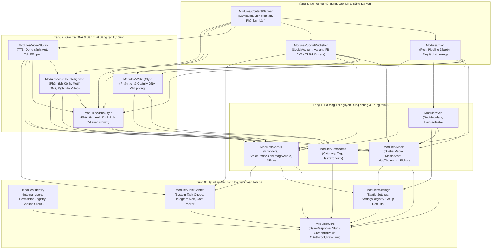

# KIẾN TRÚC TỔNG THỂ HỆ THỐNG (`makerting-app`)

> **Tài liệu tham chiếu:** Đọc kết hợp với [PLAN.md](../PLAN.md) (tiến độ & checklist task) và [VUEXY_LARAVEL_ARCHITECTURE_GUIDE.md](VUEXY_LARAVEL_ARCHITECTURE_GUIDE.md) (chuẩn UI/UX Vuexy & Backend boundary).  
> **Thư mục tài liệu từng module:** Xem tại [docs/modules/](../modules/README.md).

---

## 1. Bức Tranh Tổng Thể (Modular Monolith)

Hệ thống được thiết kế theo mô hình **Modular Monolith** sử dụng gói `nwidart/laravel-modules` (chuẩn cấu trúc v12/v13) kết hợp `wikimedia/composer-merge-plugin`.

### 1.1. Nguyên tắc Phân tầng 4 Lớp (Không Phụ thuộc Vòng)
Mọi phụ thuộc chỉ đi **từ trên xuống dưới**. Tầng dưới tuyệt đối không import class hoặc gọi trực tiếp tầng trên. Tầng dưới giao tiếp ngược lên bằng:
- **Registry Pattern:** Module hạ tầng mở Registry; module nghiệp vụ tự đăng ký lúc `boot()`.
- **Domain Events:** Phát sự kiện qua Event Dispatcher của Laravel khi có thay đổi trạng thái.



---

## 2. Các Chuẩn Giao Tiếp Cốt Lõi Giữa Các Module

### 2.1. Chuẩn Shared Traits cho Domain Models
Các tài nguyên nghiệp vụ (`Post`, `SocialPostVariant`, `VideoProject`, `Category`...) không tự tạo cột đường dẫn, ảnh hay danh mục rời rạc mà kế thừa từ bộ trait chuẩn:
- `HasSlug` (`Modules\Core\Traits\HasSlug`): Quản lý slug duy nhất trên bảng `slugs`, hỗ trợ redirect 301 khi đổi tiêu đề.
- `HasThumbnail` (`Modules\Media\Traits\HasThumbnail`): Cung cấp quan hệ `thumbnail()`, lưu vào `media_asset_usages`.
- `HasGallery` (`Modules\Media\Traits\HasGallery`): Cung cấp quan hệ `gallery()` có thứ tự `sort_order`.
- `HasVideoAsset` (`Modules\Media\Traits\HasVideoAsset`): Quản lý file video thành phẩm kèm metadata thời lượng, độ phân giải.
- `HasTaxonomy` (`Modules\Taxonomy\Traits\HasTaxonomy`): Cung cấp `categories()`, `tags()`, và hàm `syncTaxonomyWithNew()` nhận cả ID sẵn có và tag mới do AI đề xuất.
- `HasSeoMeta` (`Modules\Seo\Traits\HasSeoMeta`): Tự động fallback sang title, slug, thumbnail nếu không nhập tay.
- `HasAiProvenance` (`Modules\CoreAi\Traits\HasAiProvenance`): Truy vết trường nào được sinh từ `ai_run_id` nào và giá trị hash ban đầu.

### 2.2. Chuẩn DTO-In / DTO-Out (Giao tiếp Dịch vụ)
- Không truyền Eloquent Model của module này sang module khác.
- Mọi dữ liệu vào/ra đều đóng gói qua `readonly class` DTO bất biến (ví dụ `AiStructuredRequest`, `AiImageResponse`, `MediaItemDto`, `VideoTimelineManifestDto`).

### 2.3. Chuẩn Truy xuất File Vật lý (Stream Access)
- Không ghép cứng đường dẫn `storage_path(...)` giữa các module.
- Khi cần đọc nội dung file để upload lên Facebook/YouTube/TikTok hoặc đưa vào FFmpeg:
  `$stream = $mediaUsageService->openReadStream($mediaAssetId);`
  Giúp hệ thống đổi disk sang S3/Cloudflare R2 mà không phải sửa code nghiệp vụ.

### 2.4. Chuẩn API Envelope (`BaseResponse`)
100% API trả về một khuôn mẫu cố định:
```json
{
  "success": true,
  "message": "Thao tác thành công",
  "data": {},
  "errors": [],
  "meta": {}
}
```
Với danh sách bảng `VDataTableServer`: `BaseResponse::dataTable($collection)` trả về `data: { items: [...], itemsLength: 120 }` kèm `meta.pagination`.

---

## 3. Quản lý Mạng Lưới Đa Kênh Nội Bộ (Không SaaS)

Hệ thống được tối ưu hóa cho đội ngũ nội bộ quản lý đồng thời nhiều kênh vệ tinh:
1. **`ChannelGroup` (Nhóm kênh / Ngách nội dung):** Gom các Fanpage, Kênh YouTube, Tài khoản TikTok cùng chủ đề. Lưu cấu hình mặc định: Văn phong, DNA Ảnh, Giọng đọc TTS, Watermark Logo, Nhạc nền, Chữ ký CTA.
2. **`CredentialVault` & `OAuthClientPool`:** Hỗ trợ gắn nhiều Google Cloud App / Meta App / TikTok App để xoay vòng, giải quyết bài toán giới hạn quota ngày của YouTube Data API v3.
3. **`AccountRateLimiter` & `JitterScheduler`:** Khóa tuần tự theo tài khoản và rải lệch giờ đăng (jitter) tránh bị mạng xã hội quét spam.
4. **`TaskCenter` & Cảnh báo Sức khỏe Tài khoản:** Theo dõi toàn bộ tiến trình ngầm tại Popup góc màn hình Admin; tự động kiểm tra token định kỳ và bắn cảnh báo về Telegram/Chuông Admin nếu kênh nào bị tuột quyền.

---

## 4. Phân Tách Hàng Đợi (Queues) Tránh Nghẽn Hệ Thống

| Tên Queue | Nhiệm vụ | Worker Timeout | Concurrency đề xuất |
| :--- | :--- | :--- | :--- |
| `default` | Tác vụ nhẹ, gửi thông báo Telegram, dọn file tạm | 60s | 2 - 4 |
| `ai-text` | Phân tích văn phong, motif YouTube, viết bài, sinh kịch bản | 300s | 2 - 4 |
| `ai-media` | Vision AI, tạo ảnh DNA, đọc giọng nói TTS, bóc băng STT | 300s | 2 - 4 |
| `video-render` | Ghép video FFmpeg, hiệu ứng Ken Burns, phụ đề karaoke | 1800s | 1 - 2 (theo nhân CPU) |
| `social-publish` | Upload video/bài viết lên Facebook, YouTube, TikTok | 900s | 2 - 4 |

---

## 5. Quy Chuẩn Đặt Tên & Cấu Trúc Module

- **Tên Module:** `PascalCase` (ví dụ `YoutubeIntelligence`, `SocialPublisher`).
- **Namespace:** `Modules\<ModuleName>\...`
- **Route API:** `/api/v1/admin/<kebab-case-module>/...` (ví dụ `/api/v1/admin/youtube-intelligence/channels`).
- **Thư mục Frontend Vue:** `Modules/<ModuleName>/resources/js/` (chứa `pages/`, `views/`, `services/`, `stores/`, `navigation.js`).
