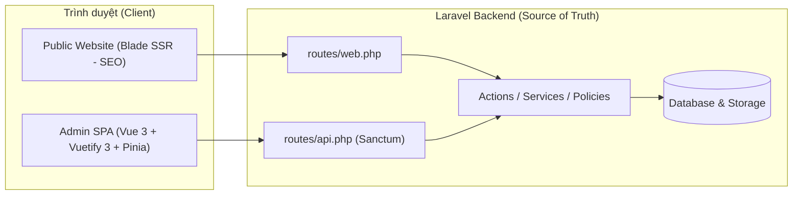

# Kiến trúc Chuẩn: Laravel + Vue 3 (Vuexy / Vuetify 3)

> **Mục đích:** Tài liệu tham chiếu kiến trúc cốt lõi (UI/UX, Typography, Header, Card, Dialog, Viewport và Backend Boundary) dùng để khởi tạo và duy trì chuẩn mực cho project mới sử dụng nền tảng **Laravel + Vue 3 (Vuexy Admin Template)**.

---

## 1. Bức tranh Tổng thể & Nguyên tắc Boundary



### Nguyên tắc cốt lõi:
1. **Laravel là Source of Truth duy nhất** cho: Authentication, Authorization (Spatie Permission/Policy), Validation nghiệp vụ và toàn vẹn dữ liệu.
2. **Frontend Admin (Vue 3):**
   - Sử dụng **Vue 3 Composition API** với `<script setup>` và **JavaScript** thuần nhất.
   - **Page (`../../resources/js/pages`)** chỉ đóng vai trò bề mặt ghép nối (composition surface): đọc route params, gọi Pinia store/service và điều hướng.
   - **Views/Components (`../../resources/js/views`)** chứa form, bảng, bộ lọc, dialog và các khối giao diện chi tiết.
   - **Không gọi API trực tiếp trong `<template>`**; mọi HTTP request đi qua `resources/js/services/<domain>.js` và unwrap dữ liệu tại boundary.

---

## 2. Hệ thống Typography & Font Size Scale (Bắt buộc)

Để tránh tình trạng mỗi trang một cỡ chữ hoặc vỡ giao diện khi chuyển đổi Light/Dark mode, toàn bộ ứng dụng tuân thủ nghiêm ngặt thang đo chữ của Vuexy/Vuetify:

| Cấp độ hiển thị | Class Vuetify chuẩn | Kích thước tương đương | Ngữ cảnh sử dụng |
| :--- | :--- | :--- | :--- |
| **Tiêu đề Trang (Page Header)** | `text-h4 font-weight-medium` | `1.5rem` (~24px) | Tiêu đề chính ở góc trên bên trái mỗi trang Admin |
| **Tiêu đề Card / Section** | `text-subtitle-1 font-weight-medium` *(hoặc `text-body-1`)* | `1rem` (~16px) | Tiêu đề các khối `VCard`, nhóm thông tin trong Dialog |
| **Nội dung chính / Form Label** | `text-body-1` | `0.9375rem` (~15px) | Nhãn input, văn bản chính, tiêu đề dòng chính trong bảng |
| **Nội dung phụ / Helper / Table Cell** | `text-body-2` | `0.875rem` (~14px) | Mô tả dưới tiêu đề, nội dung cột phụ trong bảng, ghi chú |
| **Meta / Badge / Timestamp** | `text-caption` | `0.75rem` (~12px) | Nhãn trạng thái nhỏ, thời gian, bộ đếm ký tự, chú thích phụ |

> [!IMPORTANT]
> **3 Quy tắc cấm kỵ về CSS & Màu sắc:**
> 1. **Không dùng `font-size` inline** (như `style="font-size: 13px"`) hoặc tự tạo class font-size ngẫu nhiên.
> 2. **Không ép cứng màu chữ sang đen/trắng** (như `color: #000` hay `background: #fff`). Luôn dùng biến theme của Vuetify (`text-high-emphasis`, `text-medium-emphasis`, `text-disabled`, `rgb(var(--v-theme-surface))`) để **Dark Mode** hoạt động tự động 100%.
> 3. **Icon đồng bộ:** Sử dụng bộ icon **Tabler (`tabler-*`)** xuyên suốt toàn project; không trộn lẫn `mdi-*` cho các thao tác tìm kiếm, đóng mở hay điều hướng.

---

## 3. Chuẩn Giao diện Trang Admin (Header, Layout & Card)

Mọi trang Thêm/Sửa (Add/Edit) hoặc Chi tiết trong Admin đều lấy cấu trúc chuẩn của trang **eCommerce Product Add** làm nguồn tham chiếu duy nhất.

### 3.1. Cấu trúc Page Header chuẩn
Luôn đặt ở đầu trang, phía trên lưới `VRow`, cách nội dung bên dưới một khoảng `mb-6`:

```vue
<div class="d-flex flex-wrap justify-start justify-sm-space-between gap-y-4 gap-x-6 mb-6">
  <div class="d-flex flex-column justify-center">
    <h4 class="text-h4 font-weight-medium">
      Tiêu đề Trang (VD: Thêm bài viết mới)
    </h4>
    <div class="text-body-1">
      Mô tả ngắn gọn chức năng hoặc ngữ cảnh của trang
    </div>
  </div>

  <div class="d-flex gap-4 align-center flex-wrap">
    <VBtn
      variant="tonal"
      color="secondary"
    >
      Hủy bỏ
    </VBtn>
    <VBtn
      variant="tonal"
      color="primary"
    >
      Lưu nháp
    </VBtn>
    <VBtn
      variant="flat"
      color="primary"
    >
      Xuất bản
    </VBtn>
  </div>
</div>
```

### 3.2. Bố cục Lưới 2 Cột (8 / 4 Grid Layout)
- **Cột chính (`VCol cols="12" md="8"`):** Chứa các thông tin cốt lõi, trình soạn thảo nội dung (Editor), cấu hình chi tiết, bộ sưu tập ảnh.
- **Cột phụ (`VCol cols="12" md="4"`):** Chứa trạng thái xuất bản, phân loại (Category/Tag), cài đặt lịch đăng, thumbnail đại diện.
- **Khoảng cách chuẩn giữa các Card:** Luôn dùng `class="mb-6"`.

### 3.3. Quy chuẩn sử dụng `VCard`
Không tự ý thêm `rounded="xl"`, `elevation="0"`, `border` hoặc đổi màu nền tiêu đề Card trừ khi thiết kế đặc thù yêu cầu.

#### Mẫu 1: Card đơn giản chỉ có tiêu đề
```vue
<VCard
  title="Thông tin chung"
  class="mb-6"
>
  <VCardText>
    <!-- Các trường nhập liệu -->
  </VCardText>
</VCard>
```

#### Mẫu 2: Card có nút thao tác hoặc Badge ở góc phải Header
```vue
<VCard class="mb-6">
  <VCardItem>
    <template #title>
      Cấu hình nâng cao
    </template>
    <template #append>
      <VChip
        size="small"
        color="primary"
        label
      >
        Tự động
      </VChip>
    </template>
  </VCardItem>

  <VCardText>
    <!-- Các trường nhập liệu -->
  </VCardText>
</VCard>
```

### 3.4. Quy chuẩn Form Controls & Segmented Buttons
1. **Ưu tiên dùng Wrapper của Vuexy:**
   - Luôn dùng `AppTextField`, `AppTextarea`, `AppSelect`, `AppCombobox`, `AppDateTimePicker` thay vì `VTextField`, `VSelect` thô.
   - Truyền nhãn trực tiếp qua prop `label="..."` của `App*` component. Chỉ dùng `<VLabel>` rời khi bọc một nhóm control tùy chỉnh không có prop `label`.
2. **Nút chọn chế độ (Segmented Button Group):**
   - Tránh dùng `VBtnToggle` với `variant="outlined"` vì dễ mất màu nền active trong theme Vuexy.
   - Sử dụng cụm nút bọc trong khung viền mảnh với `:variant="isActive ? 'flat' : 'text'"` và `:color="isActive ? 'primary' : 'secondary'"` để hiển thị trạng thái đang chọn rõ ràng nhất.

### 3.5. Checklist Chuẩn hóa Trang Admin nhanh (Áp dụng từ `product/add`)

Phần này là **bản tóm tắt thực chiến** đã áp dụng khi chuẩn hóa trang `Modules/Settings` — dùng lại cho mọi trang Admin mới hoặc refactor trang cũ.

#### a) Cấu trúc khung trang
```vue
<template>
  <div>                                          <!-- KHÔNG bọc VContainer/pa-* -->
    <div class="d-flex flex-wrap justify-start justify-sm-space-between gap-y-4 gap-x-6 mb-6">
      <div class="d-flex flex-column justify-center">
        <h4 class="text-h4 font-weight-medium">Tiêu đề trang</h4>
        <div class="text-body-1">Mô tả ngắn chức năng</div>
      </div>
      <div class="d-flex gap-4 align-center flex-wrap">
        <VBtn variant="tonal" color="secondary">Phụ</VBtn>
        <VBtn>Chính</VBtn>                         <!-- default flat primary, KHÔNG size="small" -->
      </div>
    </div>
    <VRow> ... </VRow>
  </div>
</template>
```

#### b) Quy tắc VCard (bắt buộc)
| Thuộc tính | Giá trị chuẩn | Ghi chú |
| :--- | :--- | :--- |
| `elevation` | **mặc định (6)** | ❌ `elevation="0"` — đổ bóng tự nhiên |
| `border` | **không** | ❌ `border` — card tự có shadow |
| `rounded` | **mặc định (6px)** | ❌ `rounded="xl"`/`"lg"` trên card |
| `padding` | **`VCardText` = 20px** | ❌ `pa-5`/`pa-3` trên card |
| `title`/`subtitle` | prop của VCard | ❌ `<div>` + class thủ công |
| spacing giữa card | `class="mb-6"` | 24px đồng nhất |

#### c) Form & Field
- `label="..."` prop của `App*` → tự render `VLabel` `text-body-2`; ❌ `<label class="text-caption font-weight-bold">` thủ công.
- Bỏ `density="compact"`, `hide-details`, `variant="outlined"` trên `App*` → size **normal**.
- `VIcon` dùng `icon="tabler-x"` prop, ❌ text node `<VIcon>tabler-x</VIcon>`.

#### d) Icon, màu, spacing
- Icon: **chỉ `tabler-*`**, ❌ `mdi-*`.
- Màu: `color="primary"|"secondary"` hoặc `rgba(var(--v-theme-primary), .x)`; ❌ hex cứng `#7367F0`/`#e8e5ff`.
- Spacing: dùng logical `me-*`/`ms-*`/`pe-*`/`ps-*`; ❌ physical `mr-*`/`ml-*`/`pr-*`/`pl-*` (ESLint `vue/no-restricted-class`).
- Nút: `variant="flat"|"tonal"|"outlined"` + `color="primary"|"secondary"`; ❌ `class="text-none rounded-lg px-4 bg-white"` + màu hex.

#### e) Typography
- Page header: `text-h4 font-weight-medium`; subtitle: `text-body-1`.
- Card/section title: `text-subtitle-1 font-weight-medium` hoặc prop `title`.
- Label/field: `text-body-2`; meta/helper: `text-caption`.
- ❌ `style="font-size: Xpx !important"` và `font-weight-bold` trên label/title.

> ✅ **Kiểm nhanh trước khi commit:** `eslint` sạch (0 lỗi) + `npm run build` xanh + không còn `mdi-`, `font-size:`, `elevation="0"`, `density="compact"`, `mr-`/`pr-`, hex `#7367F0`/`#f4f2fe`.

---

## 4. Chuẩn Kiến trúc Dialog 3 Vùng (`AppDialogLayout`)

Mọi Dialog trong ứng dụng (tạo mới, chỉnh sửa, xem chi tiết, xác nhận xóa, chọn media) **bắt buộc** dùng khung 3 vùng cố định:
1. **Header cố định** ở trên cùng.
2. **Nút đóng `DialogCloseBtn` (chữ X)** nổi ở góc ngoài bên phải `VCard` (không bị cắt bởi `overflow: hidden`).
3. **Body ở giữa là vùng duy nhất được cuộn (`overflow-y: auto`)**.
4. **Footer cố định** ở dưới cùng chứa các nút hành động (`Hủy`, `Lưu`, `Xác nhận`). Không bao giờ đặt nút Submit ở đáy một form dài bên trong vùng cuộn.

### 4.1. Mã nguồn Component gốc `components/dialogs/AppDialogLayout.vue`
Copy nguyên file này vào `resources/js/components/dialogs/AppDialogLayout.vue` ở project mới:

```vue
<!--
  =====================================================================
  CHỨC NĂNG FILE: Khung ba vùng bắt buộc cho dialog của ứng dụng.
  =====================================================================
  CÁC HÀM/METHOD TRONG FILE: requestClose() phát yêu cầu đóng nếu không bị khóa.
  INPUT/OUTPUT CỦA CLASS (tổng thể): title/subtitle, header/content/footer slots
  -> header và footer cố định; chỉ body được cuộn trong chiều cao dialog.
  Nút X dùng DialogCloseBtn nổi ngoài góc card; attrs được chuyển vào VCard.
  bodyScroll=false dành cho picker chia panel, scrollbar vẫn nằm trong body.
  OUTPUT: close để caller xử lý trạng thái, cảnh báo bản chưa lưu và lifecycle.
  SIDE EFFECT: không tự đóng, reset form hoặc gọi API.
  =====================================================================
-->
<script setup>
import DialogCloseBtn from '@/@core/components/DialogCloseBtn.vue'

const props = defineProps({
  title: { type: String, default: '' },
  subtitle: { type: String, default: '' },
  closeLabel: { type: String, default: 'Đóng dialog' },
  closeDisabled: { type: Boolean, default: false },
  bodyScroll: { type: Boolean, default: true },
})

const emit = defineEmits(['close'])

defineOptions({ inheritAttrs: false })

function requestClose() {
  if (!props.closeDisabled) emit('close')
}
</script>

<template>
  <DialogCloseBtn
    :aria-label="props.closeLabel"
    :disabled="props.closeDisabled"
    @click="requestClose"
  />
  <VCard
    v-bind="$attrs"
    class="app-dialog-layout"
  >
    <header class="app-dialog-layout__header">
      <div class="app-dialog-layout__heading">
        <slot name="header">
          <VCardItem
            :title="props.title"
            :subtitle="props.subtitle || undefined"
          />
        </slot>
      </div>
    </header>
    <VDivider />
    <div
      class="app-dialog-layout__body"
      :class="{ 'app-dialog-layout__body--panels': !props.bodyScroll }"
    >
      <slot />
    </div>
    <VDivider />
    <footer class="app-dialog-layout__footer">
      <slot name="footer">
        <VCardActions class="justify-end">
          <VBtn
            variant="tonal"
            color="secondary"
            :disabled="props.closeDisabled"
            @click="requestClose"
          >
            Đóng
          </VBtn>
        </VCardActions>
      </slot>
    </footer>
    <slot name="overlay" />
  </VCard>
</template>

<style scoped>
.app-dialog-layout {
  position: relative;
  display: flex;
  flex-direction: column;
  max-block-size: 100%;
  min-block-size: 0;
  overflow: hidden !important;
}

.app-dialog-layout__header,
.app-dialog-layout__footer {
  flex: 0 0 auto;
  min-inline-size: 0;
}

.app-dialog-layout__header {
  display: flex;
  align-items: flex-start;
}

.app-dialog-layout__heading {
  flex: 1 1 auto;
  min-inline-size: 0;
}

.app-dialog-layout__heading :deep(.v-card-title),
.app-dialog-layout__heading :deep(.v-card-subtitle) {
  overflow-wrap: anywhere;
  white-space: normal;
}

.app-dialog-layout__body {
  flex: 1 1 auto;
  min-block-size: 0;
  min-inline-size: 0;
  overflow: hidden auto;
  overscroll-behavior: contain;
}

.app-dialog-layout__body > :deep(.v-card-text) {
  overflow: visible;
}

.app-dialog-layout__body--panels {
  flex: 1 1 0%;
  overflow: hidden;
}

.app-dialog-layout__footer :deep(.v-card-actions) {
  flex-wrap: wrap;
  gap: 12px;
  padding: 16px 24px;
}

.app-dialog-layout__footer :deep(.v-btn) {
  max-inline-size: 100%;
}

.app-dialog-layout__footer :deep(.v-btn__content) {
  white-space: normal;
}
</style>
```

### 4.2. Mẫu sử dụng Dialog chuẩn trong Feature
- Dùng `useId()` liên kết `<VForm :id="formId">` với nút `<VBtn type="submit" :form="formId">` ở `#footer` để giữ nguyên tính năng nhấn phím Enter và kiểm tra validation.
- Chỉ dọn dẹp dữ liệu form ở sự kiện `@after-leave` của `VDialog` để giao diện không bị giật trống rỗng khi hiệu ứng đóng đang chạy.

```vue
<script setup>
import { ref, useId } from 'vue'
import AppDialogLayout from '@/components/dialogs/AppDialogLayout.vue'

const isOpen = defineModel({ type: Boolean, default: false })
const saving = ref(false)
const formId = useId()

function requestClose() {
  if (!saving.value) isOpen.value = false
}

function resetAfterLeave() {
  if (isOpen.value) return
  // Reset form state tại đây sau khi animation đóng đã hoàn tất
}

async function handleSubmit() {
  saving.value = true
  try {
    // Gọi API lưu dữ liệu
    isOpen.value = false
  } finally {
    saving.value = false
  }
}
</script>

<template>
  <VDialog
    v-model="isOpen"
    max-width="680"
    scrollable
    :persistent="saving"
    @after-leave="resetAfterLeave"
  >
    <AppDialogLayout
      title="Tạo dữ liệu mới"
      subtitle="Điền thông tin chi tiết bên dưới"
      :close-disabled="saving"
      @close="requestClose"
    >
      <VCardText>
        <VForm
          :id="formId"
          @submit.prevent="handleSubmit"
        >
          <!-- Các trường AppTextField, AppSelect... -->
        </VForm>
      </VCardText>

      <template #footer>
        <VCardActions class="justify-end">
          <VBtn
            variant="tonal"
            color="secondary"
            :disabled="saving"
            @click="requestClose"
          >
            Hủy
          </VBtn>
          <VBtn
            type="submit"
            :form="formId"
            variant="flat"
            color="primary"
            :loading="saving"
          >
            Lưu thay đổi
          </VBtn>
        </VCardActions>
      </template>
    </AppDialogLayout>
  </VDialog>
</template>
```

> [!TIP]
> **Mẹo chống tràn chữ ở Sidebar nhiều bước (Wizard Dialog):**
> Khi tạo Dialog có thanh menu bước bên trái (như Wizard 2 cột), luôn đặt `min-inline-size: 0; overflow: hidden;` cho phần tử flex chứa text tiêu đề bước để chữ dài tự động xuống dòng hoặc cắt gọn (`text-truncate`), không bao giờ tràn ra ngoài nền active.

---

## 5. Chuẩn Viewport Cố định & Scrollbar (Cho trang Media / Quản lý File / Chat)

Khi xây dựng các trang ứng dụng có bố cục nhiều cột chạm nhau (như Media Library 3 cột: *Thư mục | Danh sách tệp | Chi tiết tệp*):

1. **Cố định chiều cao Viewport:** Khai báo `definePage({ meta: { layoutWrapperClasses: 'layout-content-height-fixed' } })`.
2. **Hàng cột chạm liền nhau (`no-gutters`):**
   - Dùng `<VRow class="flex-grow-1" align="stretch" no-gutters>`.
   - Chỉ đặt bóng đổ (elevation) ở khung bao ngoài cùng, không đặt shadow riêng cho từng cột con.
   - Ranh giới giữa 2 cột chỉ giữ **1 đường viền duy nhất** (cột kế tiếp bỏ `border-inline-start`), các góc tiếp giáp dùng `rounded-0`.
3. **Thanh cuộn `PerfectScrollbar`:**
   - Chỉ vùng danh sách item ở giữa mới được cuộn; thanh tìm kiếm/bộ lọc và phân trang phải đứng yên bên ngoài vùng cuộn.
   - Luôn cấu hình `:options="{ wheelPropagation: false, suppressScrollX: true }"` và gọi `ps.update()` bên trong `nextTick()` sau khi thay đổi bộ lọc/trang.
   - Ở màn hình nhỏ (`< 960px`), trả chiều cao về `auto` để cuộn tự nhiên theo trang, tránh kẹt cuộn lồng nhau trên mobile.

---

## 6. Kiến trúc Backend Laravel & Chuẩn API Response

### 6.1. Luồng xử lý Request
```text
Route (routes/api.php)
  → Middleware (auth:sanctum, account.active, permission:...,admin)
  → FormRequest (XCreateRequest / XUpdateRequest - chặn enum & kiểu dữ liệu ở cổng HTTP)
  → Controller (Chỉ điều phối HTTP, không chứa logic nghiệp vụ dài)
  → Action / Service (Chứa business logic, quản lý DB::transaction & lockForUpdate)
  → Repository / Model (Eloquent scopes, relations, casts)
  → JsonResource & BaseResponse
```

### 6.2. Chuẩn Envelope JSON (`BaseResponse`)
Tất cả API trả về một cấu trúc JSON đồng nhất duy nhất để Frontend Service dễ dàng xử lý:

```json
{
  "success": true,
  "message": "Cập nhật thành công",
  "data": {
    "items": [],
    "itemsLength": 0
  },
  "errors": [],
  "meta": {
    "pagination": {
      "current_page": 1,
      "per_page": 15,
      "total": 0
    }
  }
}
```
- **Với bảng `VDataTableServer`:** Sử dụng `BaseResponse::dataTable($paginator)` trả về `data.items` và `data.itemsLength`.
- **Chống ghi đè đồng thời (Optimistic Locking):** Với các bản ghi quan trọng (Settings, Roles, Nội dung biên tập), gửi kèm `expected_version` (hoặc `version`) và trả về `HTTP 409 Conflict` nếu dữ liệu đã bị người khác sửa trước đó.
- **Tác vụ nặng / AI / Xử lý ZIP:** Luôn đẩy vào Queue, trả về `HTTP 202 Accepted` kèm Tracker ID/UUID để Frontend polling trạng thái.

### 6.3. Tái sử dụng Hệ thống Đa hình (Polymorphic Foundation)
Khi xây dựng project mới có nhiều loại tài nguyên (Bài viết, Sản phẩm, Template, Dự án...):
- **Slug tập trung:** Dùng chung 1 bảng `slugable` + trait `HasSlug` + `SlugService` (giữ `is_primary = true` cho slug hiện hành, giữ slug cũ `is_primary = false` để tự động Redirect 301 bảo toàn SEO).
- **Danh mục & Thẻ tập trung:** Dùng chung bảng `categories`, `tags` và nối qua bảng trung gian đa hình `categorizables`, `taggables` bằng trait `HasTaxonomy`. Không tạo cột `category_id` rời rạc trên từng bảng.
- **Quản lý Media tập trung:** Dùng bảng `media_assets` + `media_asset_usages` kèm trait `HasMediaAssets` để kiểm soát tập trung việc đính kèm ảnh/file, quét mã độc, tạo ảnh thu nhỏ và tránh xóa nhầm file đang được sử dụng.

---

## 7. Chuẩn Comment Bắt buộc cho Developer và AI Agent

Đây là quy định bắt buộc của repository. Mọi developer, code reviewer và AI agent phải đọc và tuân thủ trước khi tạo hoặc chỉnh sửa code.

### 7.1. Phạm vi áp dụng (Backend PHP)

- Mỗi class phải có comment mô tả ở ngay phía trên khai báo class.
- Mỗi method/function nằm trong class phải có comment mô tả ở ngay phía trên method.
- Comment phải mô tả đúng behavior hiện tại của code, không mô tả ý định chưa triển khai.
- Khi thay đổi input, output, side effect, exception hoặc transaction boundary, phải cập nhật comment trong cùng pull request.
- Không được xóa comment chỉ để làm diff ngắn hơn.
- Comment của method phải ghi rõ nếu method yêu cầu transaction, lock, authenticated user, policy hoặc quyền cụ thể.
- Comment không thay thế type declaration, Form Request, Policy, test hoặc validation.

### 7.2. Template Comment Chuẩn cho PHP (Class & Method)

Class và method phải dùng block comment theo cấu trúc sau. Có thể thay nội dung bên trong cho đúng class/method, nhưng không được bỏ các nhóm thông tin chính:

```php
/**
 * =====================================================================
 * CHỨC NĂNG FILE: Tăng state_revision của bàn để đánh dấu projection vừa thay đổi
 * =====================================================================
 *
 * Action phụ trợ được gọi ở cuối mọi transaction nghiệp vụ POS (thêm món, thanh
 * toán, mở bàn, phiếu bếp...) để mỗi lần thay đổi dữ liệu bàn phát ra một
 * revision tăng dần. Event PosStateChanged phát sau commit chỉ cần mang revision
 * này, giúp client biết chính xác trạng thái nào đã được lưu thành công.
 *
 * CÁC HÀM/METHOD TRONG FILE:
 * - handle(DiningTable $lockedTable): tăng state_revision lên 1 và trả giá trị mới
 *
 * INPUT/OUTPUT CỦA CLASS (tổng thể):
 * - INPUT : DiningTable đã giữ khóa ghi (lockForUpdate) truyền vào handle() trong transaction của caller
 * - OUTPUT: handle() trả int state_revision mới (refresh từ DB); side effect: UPDATE cột state_revision
 *           của dining_tables; throw ModelNotFoundException không xảy ra ở đây (bàn phải tồn tại sẵn)
 * =====================================================================
 */
final class IncrementDiningTableRevisionAction
{
    /**
     * =====================================================================
     * CHỨC NĂNG: Tăng state_revision của bàn đã được khóa ghi
     * =====================================================================
     *
     * INPUT:
     * - $lockedTable: DiningTable đã được lockForUpdate() trong transaction của caller
     *
     * OUTPUT:
     * - int: state_revision mới sau khi refresh từ database
     *
     * SIDE EFFECT:
     * - UPDATE state_revision của dining_tables
     *
     * EXCEPTION/TRANSACTION:
     * - Không tự mở transaction; caller chịu trách nhiệm transaction và lock
     * =====================================================================
     */
    public function handle(DiningTable $lockedTable): int
    {
        // implementation
    }
}
```

### 7.3. Quy tắc viết Comment chi tiết

- `CHỨC NĂNG FILE` mô tả trách nhiệm chính của file/class trong một câu.
- Phần mô tả class phải giải thích context nghiệp vụ, nơi class được gọi và lý do tồn tại.
- `CÁC HÀM/METHOD TRONG FILE` phải liệt kê toàn bộ public method, protected method và private method quan trọng.
- Comment method phải ghi `INPUT`, `OUTPUT`, `SIDE EFFECT` và `EXCEPTION/TRANSACTION` khi có liên quan.
- **Với query/list method:** ghi rõ filter, sort, pagination và quan hệ được eager load.
- **Với action/mutation:** ghi rõ transaction boundary, lock, event/job được phát và dữ liệu bị thay đổi.
- **Với upload/download:** ghi rõ disk, collection, authorization, temporary URL và rate limit.
- **Với OAuth/authentication:** ghi rõ guard, provider, session và identity linking rule.
- Không đưa secret, access token, password hoặc dữ liệu cá nhân thật vào comment.
- Nếu method quá đơn giản nhưng vẫn là method của class, vẫn phải có comment ngắn theo cùng cấu trúc.

### 7.4. Cấu trúc Comment Bắt buộc cho Frontend (Vue SFC & JS)

#### a) Đầu file `.vue`
Mọi file `.vue` mới hoặc được chỉnh sửa phải có block comment ở đầu file, đặt trước `<script setup>` hoặc `<template>`. Comment viết bằng tiếng Việt và giữ đủ cấu trúc sau:

```vue
<!--
  =====================================================================
  CHỨC NĂNG FILE: <trách nhiệm chính của component/page>
  =====================================================================

  <Mô tả context nghiệp vụ, nơi component được sử dụng và lý do tồn tại>

  CÁC HÀM/COMPUTED/WATCHER TRONG FILE:
  - loadData(): <chức năng>
  - visibleItems: <computed data>
  - watcher route.params.id: <side effect khi route thay đổi>

  INPUT/OUTPUT CỦA COMPONENT (tổng thể):
  - INPUT : props, route params, store hoặc API data
  - OUTPUT: UI render, emitted events, navigation và side effect
  =====================================================================
-->
<script setup>
```

#### b) Hàm nghiệp vụ trong `<script setup>`, Service, Store hoặc Composable (`.js`)
Các hàm nghiệp vụ cục bộ hoặc hàm export trong `.vue` / `.js` phải có block comment ngay phía trên khai báo:

```js
/**
 * =====================================================================
 * CHỨC NĂNG: Gửi yêu cầu lưu dữ liệu form và đồng bộ danh sách bên ngoài
 * =====================================================================
 *
 * INPUT:
 * - formPayload (Object): dữ liệu đã qua kiểm tra validation trên UI
 *
 * OUTPUT:
 * - Promise<void>: đóng dialog và emit sự kiện 'saved' khi API thành công
 *
 * SIDE EFFECT:
 * - Gọi POST /api/admin/items, bật/tắt trạng thái saving, hiển thị thông báo lỗi nếu thất bại
 *
 * EXCEPTION:
 * - Lỗi 422/409/500 được bắt trong khối catch và gán vào errorMessage
 * =====================================================================
 */
async function submitForm(formPayload) {
  // implementation
}
```

#### c) Quy tắc áp dụng cho Vue & JS:
- Liệt kê props/emits, hàm, computed và watcher quan trọng; nếu không có thì ghi rõ `Không có`.
- Hàm nghiệp vụ cục bộ phải có comment gần khai báo, ghi rõ `INPUT`, `OUTPUT`, `SIDE EFFECT` và `EXCEPTION` khi có liên quan.
- Không cần comment riêng cho import, ref hoặc phép gán hiển nhiên; comment phải giải thích behavior thay vì lặp lại cú pháp.
- Không ghi secret, access token, password hoặc dữ liệu cá nhân thật trong comment.
- File Vue cũ chỉ bắt buộc chuẩn hóa khi task có chỉnh sửa file đó; không mass-edit ngoài phạm vi task.

### 7.5. Quy tắc Bắt buộc cho AI Agent

AI agent chỉ được tạo hoặc sửa class/method/component sau khi:
1. Đọc phần comment đầu file hiện tại.
2. Giữ nguyên cấu trúc comment và cập nhật nội dung nếu behavior thay đổi.
3. Thêm comment cho class/method/hàm mới trước khi viết implementation.
4. Kiểm tra `INPUT/OUTPUT`, side effect, exception và transaction có khớp code thực tế.
5. Báo trong review nếu file cũ chưa có comment chuẩn và task có chạm vào file đó.

> **Definition of Done:** Pull request hoặc task thiếu comment bắt buộc hoặc comment không còn khớp behavior thực tế sẽ không đạt Definition of Done.

---

## 8. Checklist Khởi tạo Nhanh cho Project Mới

Khi bắt đầu dựng project mới từ Vuexy + Laravel, bạn chỉ cần copy sang các thành phần hạt nhân sau:
- [ ] Copy `resources/js/components/dialogs/AppDialogLayout.vue` và `@core/components/DialogCloseBtn.vue`.
- [ ] Copy bộ form wrappers trong `../../resources/js/@core/components/app-form-elements` (`AppTextField`, `AppSelect`, `AppTextarea`, `AppDateTimePicker`, `AppCombobox`).
- [ ] Copy `app/Http/Responses/BaseResponse.php` và đăng ký exception rendering trong `../../bootstrap/app.php`.
- [ ] Copy `../../resources/js/utils/api.js` (cấu hình `$api` tự động gắn Bearer token và xử lý lỗi 401/422/409).
- [ ] Đặt file kiến trúc này vào `docs/architecture/DEVELOPMENT_GUIDELINES.md` của project mới để làm quy chuẩn chung ngay từ ngày đầu tiên.
