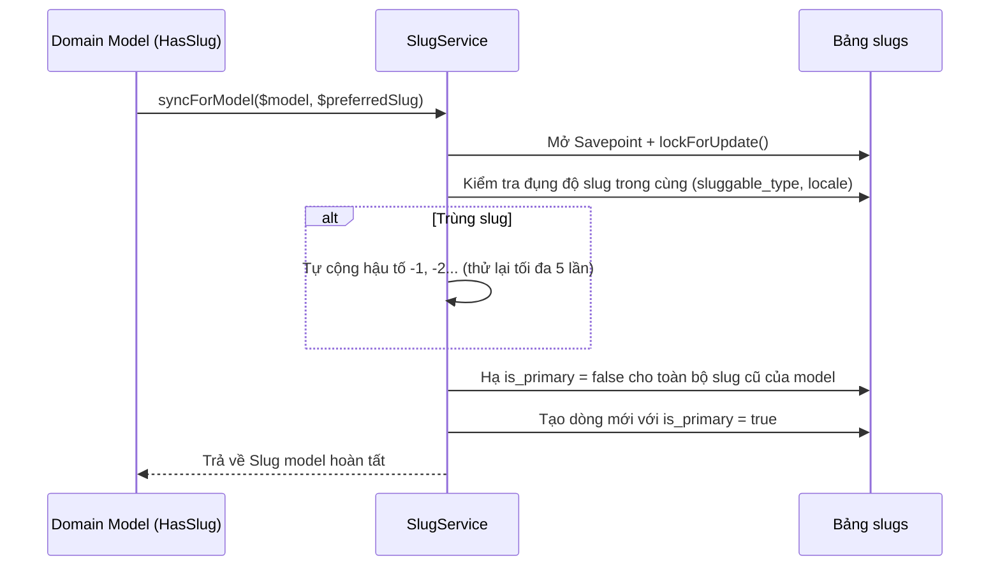

# Module: Core (`Modules/Core`)

- **Tầng kiến trúc:** Tầng 0 (Hạt nhân nền tảng)
- **Trách nhiệm chính:** Cung cấp chuẩn JSON API (`BaseResponse`), xử lý exception tập trung, hệ thống `slugs` toàn cục kèm lịch sử Redirect 301, cào URL chống SSRF, bộ khóa chống trùng `Idempotency`, lưu trữ token mã hóa `CredentialVault`, và bộ điều tiết tần suất gọi API `AccountRateLimiter`.
- **Phụ thuộc vào các module:** Không có (độc lập tuyệt đối).
- **Cung cấp cho các module:** Tất cả các module khác trong hệ thống.

---

## 1. Cấu Trúc File & Thư Mục

```text
Modules/Core/
├── app/
│   ├── Contracts/
│   │   ├── SafeRemoteFetcherContract.php
│   │   └── SlugServiceContract.php
│   ├── DTOs/
│   │   ├── RemoteFetchResultDto.php
│   │   └── SlugResolveResultDto.php
│   ├── Http/
│   │   ├── Middleware/
│   │   │   └── IdempotencyMiddleware.php
│   │   └── Responses/
│   │       └── BaseResponse.php
│   ├── Models/
│   │   ├── IdempotencyKey.php
│   │   ├── OAuthClientApp.php
│   │   └── Slug.php
│   ├── Providers/
│   │   └── CoreServiceProvider.php
│   ├── Registries/
│   │   └── SlugRegistry.php
│   ├── Services/
│   │   ├── AccountRateLimiter.php
│   │   ├── CredentialVault.php
│   │   ├── JitterScheduler.php
│   │   ├── SafeRemoteFetcher.php
│   │   └── SlugService.php
│   └── Traits/
│       ├── HasAuditTrail.php
│       └── HasSlug.php
├── database/
│   └── migrations/
│       ├── 2026_10_29_000001_create_slugs_table.php
│       ├── 2026_10_29_000002_create_oauth_client_apps_table.php
│       └── 2026_10_29_000003_create_idempotency_keys_table.php
└── routes/
    └── api.php
```

---

## 2. Thiết Kế Cơ Sở Dữ Liệu (Database Schema)

### 2.1. Bảng `slugs`
Quản lý slug duy nhất cho mọi tài nguyên có URL công khai (`Post`, `Category`, `Tag`, `VisualStyle`...).
- `id` (bigint PK)
- `sluggable_type` (varchar 64) — alias trong morph map (ví dụ `'post'`)
- `sluggable_id` (bigint)
- `slug` (varchar 250)
- `locale` (varchar 16 default `'vi'`)
- `is_primary` (boolean default `true`) — chỉ có 1 slug `true` cho mỗi locale; các slug cũ mang `false` để redirect 301
- `timestamps`
- **Unique:** `(sluggable_type, slug, locale)`
- **Index:** `(sluggable_type, sluggable_id, is_primary)`

### 2.2. Bảng `oauth_client_apps`
Lưu trữ các bộ ứng dụng OAuth (Google Cloud Console Apps, Meta Developer Apps, TikTok Developer Apps) để chia tải quota ngày.
- `id` (bigint PK)
- `platform` (`'facebook' | 'youtube' | 'tiktok'`)
- `name` (varchar 160)
- `client_id` (varchar 255)
- `client_secret_encrypted` (text)
- `redirect_uri` (varchar 500)
- `scopes_json` (json)
- `daily_quota_limit` (int nullable) — ví dụ 10,000 units cho YouTube
- `daily_quota_used` (int default 0)
- `quota_reset_at` (timestamp nullable)
- `is_active` (bool default `true`)
- `timestamps`

### 2.3. Bảng `idempotency_keys`
- `key` (varchar 128 PK)
- `user_id` (bigint nullable)
- `route_signature` (varchar 191)
- `request_hash` (char 64)
- `response_status` (smallint nullable)
- `response_body_json` (json nullable)
- `locked_until` (timestamp)
- `expires_at` (timestamp indexed)
- `timestamps`

---

## 3. Các Luồng Xử Lý Chính

### 3.1. Luồng Sinh Slug Tự Động & Chống Đụng Độ (`SlugService::syncForModel`)


### 3.2. Luồng Kiểm Tra và Khóa Trùng Lặp (`IdempotencyMiddleware`)
- Nhận header `Idempotency-Key` từ Client khi thực hiện các tác vụ tốn tiền (AI run, render video, xuất bản mạng xã hội).
- Nếu key đang trong trạng thái xử lý (`locked_until > now()`): trả về `HTTP 409 Conflict` (Yêu cầu đang được xử lý).
- Nếu key đã hoàn thành: trả ngay `response_body_json` đã lưu mà không chạy lại controller.
- Nếu key mới: chạy controller, lưu response và mở khóa.
