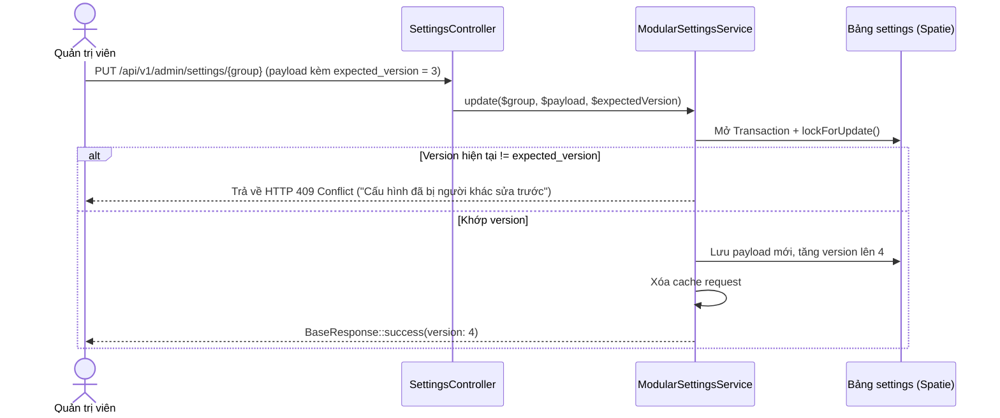

# Module: Settings (`Modules/Settings`)

- **Tầng kiến trúc:** Tầng 0 (Hạt nhân nền tảng)
- **Trách nhiệm chính:** Quản lý toàn bộ cấu hình hệ thống trên nền gói `spatie/laravel-settings` kết hợp `SettingsRegistry` động; cung cấp giao diện Admin nhiều tab, khóa phiên bản `version` (HTTP 409), che secret key và hỗ trợ giá trị mặc định theo `ChannelGroup`.
- **Phụ thuộc vào các module:** `Modules/Core`, `Modules/Identity`.
- **Cung cấp cho các module:** Tất cả các module cần lưu trữ cấu hình có kiểu (`typed settings`).

---

## 1. Cấu Trúc File & Thư Mục

```text
Modules/Settings/
├── app/
│   ├── Contracts/
│   │   └── ModularSettingsContract.php
│   ├── Http/
│   │   ├── Controllers/
│   │   │   └── SettingsController.php
│   │   └── Requests/
│   │       └── UpdateSettingsRequest.php
│   ├── Providers/
│   │   └── SettingsServiceProvider.php
│   ├── Registries/
│   │   └── SettingsRegistry.php
│   ├── Services/
│   │   └── ModularSettingsService.php
│   └── Settings/
│       ├── GeneralSettings.php
│       ├── MailSettings.php
│       └── SecuritySettings.php
└── routes/
    └── api.php
```

---

## 2. Hợp Đồng `ModularSettingsContract`

Mọi class cấu hình của các module khác đều implement contract này:

```php
namespace Modules\Settings\Contracts;

interface ModularSettingsContract
{
    public static function group(): string;
    public static function defaults(): array;
    public static function validationRules(): array;
    public static function secretProperties(): array; // Các trường sẽ bị che thành *_configured = true
    public static function permission(): string;
}
```

---

## 3. Các Luồng Xử Lý Chính

### 3.1. Luồng Đăng Ký Cấu Hình Từ Các Module
Trong `ModuleServiceProvider::boot()` của từng module:
```php
$settingsRegistry->register(AiSettings::class);
$settingsRegistry->register(MediaSettings::class);
$settingsRegistry->register(SeoSettings::class);
$settingsRegistry->register(YoutubeSettings::class);
```
Trang Admin Settings tự động sinh các tab tương ứng dựa trên danh sách class đã đăng ký.

### 3.2. Luồng Kiểm Tra Khóa Phiên Bản (Optimistic Concurrency Lock)

