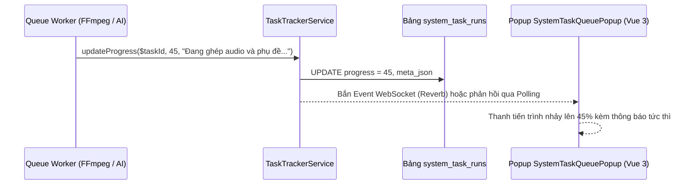

# Module: TaskCenter (`Modules/TaskCenter`)

- **Tầng kiến trúc:** Tầng 0 (Hạt nhân nền tảng)
- **Trách nhiệm chính:** Quản lý tập trung tiến trình chạy ngầm toàn hệ thống (`system_task_runs`) phục vụ popup Task Queue góc màn hình Admin, theo dõi chi phí AI theo Kênh (`ai_usage_logs`), và bắn cảnh báo sức khỏe tài khoản/lỗi render về Telegram/Chuông Admin.
- **Phụ thuộc vào các module:** `Modules/Core`, `Modules/Identity`.
- **Cung cấp cho các module:** Tất cả các module có tác vụ ngầm (`CoreAi`, `WritingStyle`, `VisualStyle`, `YoutubeIntelligence`, `VideoStudio`, `SocialPublisher`).

---

## 1. Cấu Trúc File & Thư Mục

```text
Modules/TaskCenter/
├── app/
│   ├── Contracts/
│   │   ├── TaskRunAdapterContract.php
│   │   └── TaskTrackerContract.php
│   ├── DTOs/
│   │   ├── CreateTaskRunDto.php
│   │   └── TaskProgressUpdateDto.php
│   ├── Http/
│   │   ├── Controllers/
│   │   │   ├── SystemAlertController.php
│   │   │   └── TaskRunController.php
│   │   └── Resources/
│   ├── Models/
│   │   ├── AiUsageLog.php
│   │   ├── SystemAlert.php
│   │   └── SystemTaskRun.php
│   ├── Providers/
│   │   └── TaskCenterServiceProvider.php
│   ├── Registries/
│   │   └── TaskRunAdapterRegistry.php
│   └── Services/
│       ├── AccountHealthAlertService.php
│       ├── TelegramNotificationService.php
│       └── TaskTrackerService.php
├── database/
│   └── migrations/
│       ├── 2026_10_29_000006_create_system_task_runs_table.php
│       ├── 2026_10_29_000007_create_ai_usage_logs_table.php
│       └── 2026_10_29_000008_create_system_alerts_table.php
├── resources/
│   └── js/
│       ├── components/
│       │   └── SystemTaskQueuePopup.vue
│       └── stores/
│           └── taskCenter.js
└── routes/
    └── api.php
```

---

## 2. Thiết Kế Cơ Sở Dữ Liệu

### 2.1. Bảng `system_task_runs`
- `id` (uuid PK)
- `dedupe_key` (varchar 191 unique) — chống enqueue trùng
- `module` (varchar 50) — e.g. `'CoreAi'`, `'VideoStudio'`, `'SocialPublisher'`
- `task_type` (varchar 80) — e.g. `'visual_style_generate'`, `'video_render'`, `'youtube_publish'`
- `title` (varchar 255) — Tiêu đề hiển thị cho người dùng
- `status` (`'queued' | 'running' | 'completed' | 'partial' | 'failed' | 'cancelled'`)
- `progress` (tinyint unsigned 0..100)
- `channel_group_id` (bigint nullable FK)
- `taskable_type` (varchar 64), `taskable_id` (varchar 64) — Đa hình trỏ tới Job/Model gốc
- `initiated_by` (FK `users.id`)
- `meta_json` (json)
- `error_code` (varchar 80 nullable), `error_message` (text nullable)
- `started_at`, `completed_at`, `timestamps`

### 2.2. Bảng `ai_usage_logs`
- `id` (bigint PK)
- `ai_run_id` (uuid nullable)
- `channel_group_id` (bigint nullable FK)
- `social_account_id` (bigint nullable FK)
- `provider` (varchar 60)
- `model` (varchar 120)
- `capability` (`'text' | 'vision' | 'image' | 'tts' | 'stt'`)
- `input_units` (bigint default 0) — tokens hoặc ký tự hoặc số giây
- `output_units` (bigint default 0)
- `estimated_cost_usd` (decimal 12,6 nullable)
- `created_at`

---

## 3. Các Luồng Xử Lý Chính

### 3.1. Luồng Cập Nhật Tiến Trình Từ Worker Lên Popup Admin

