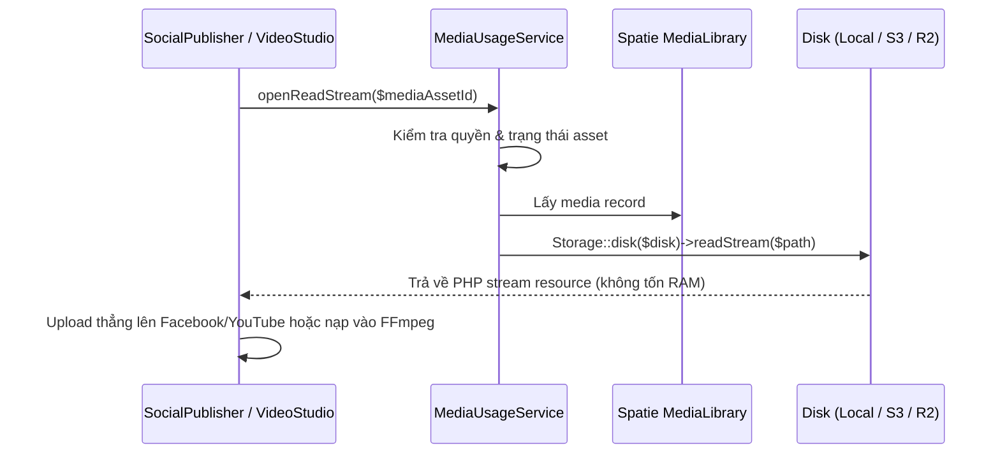

# Module: Media (`Modules/Media`)

- **Tầng kiến trúc:** Tầng 1 (Hạ tầng dùng chung)
- **Trách nhiệm chính:** Quản lý toàn bộ tài sản file/ảnh/video trên nền `spatie/laravel-medialibrary` theo mô hình sở hữu 2 tầng (`MediaAsset` vật lý + `media_asset_usages` đa hình), cung cấp `MediaSlotRegistry`, bộ Shared Traits (`HasThumbnail`, `HasGallery`, `HasVideoAsset`), và Popup chọn/upload/tạo ảnh AI dùng chung.
- **Phụ thuộc vào các module:** `Modules/Core`, `Modules/Identity`, `Modules/Settings`.
- **Cung cấp cho các module:** Tất cả các module cần đính kèm file, ảnh hoặc video (`Blog`, `VisualStyle`, `VideoStudio`, `SocialPublisher`, `Taxonomy`).

---

## 1. Cấu Trúc File & Thư Mục

```text
Modules/Media/
├── app/
│   ├── Actions/
│   │   ├── CalculateMediaChecksumAction.php
│   │   ├── ScanMediaSecurityAction.php
│   │   └── UploadMediaAssetAction.php
│   ├── Contracts/
│   │   └── MediaUsageServiceContract.php
│   ├── DTOs/
│   │   ├── MediaItemDto.php
│   │   ├── MediaSlotRule.php
│   │   └── StoreGeneratedMediaDto.php
│   ├── Http/
│   │   ├── Controllers/
│   │   │   └── MediaAssetController.php
│   │   ├── Requests/
│   │   └── Resources/
│   │       └── MediaAssetResource.php
│   ├── Models/
│   │   ├── MediaAsset.php
│   │   └── MediaAssetUsage.php
│   ├── Providers/
│   │   └── MediaServiceProvider.php
│   ├── Registries/
│   │   └── MediaSlotRegistry.php
│   ├── Services/
│   │   └── MediaUsageService.php
│   └── Traits/
│       ├── HasGallery.php
│       ├── HasMediaSlots.php
│       ├── HasThumbnail.php
│       └── HasVideoAsset.php
├── database/
│   └── migrations/
│       ├── 2026_10_29_000013_create_media_assets_table.php
│       └── 2026_10_29_000014_create_media_asset_usages_table.php
├── resources/
│   └── js/
│       ├── components/
│       │   ├── MediaGalleryField.vue
│       │   ├── MediaPickerDialog.vue
│       │   └── MediaSlotField.vue
│       ├── pages/
│       │   └── media/
│       └── stores/
│           └── mediaAsset.js
└── routes/
    └── api.php
```

---

## 2. Thiết Kế Cơ Sở Dữ Liệu (Two-Layer Ownership)

### 2.1. Bảng `media_assets` (Tầng Vật Lý)
Model `MediaAsset implements HasMedia` (gắn collection `'library'` của Spatie).
- `id` (bigint PK)
- `channel_group_id` (bigint nullable FK)
- `folder` (varchar 60 default `'root'`) — e.g. `'images'`, `'videos'`, `'broll'`, `'avatars'`
- `kind` (`'image' | 'video' | 'audio' | 'document' | 'archive'`)
- `title` (varchar 255)
- `alt_text` (varchar 255 nullable)
- `visibility` (`'public' | 'private'`)
- `width` (int nullable), `height` (int nullable)
- `duration_ms` (int nullable) — cho audio/video
- `checksum_sha256` (char 64 indexed) — chống upload trùng
- `created_by` (FK `users.id`)
- `timestamps`, `softDeletes`

### 2.2. Bảng `media_asset_usages` (Tầng Liên Kết Nghiệp Vụ)
- `id` (bigint PK)
- `media_asset_id` (FK `media_assets.id` cascade)
- `linkable_type` (varchar 64) — alias morph (e.g. `'post'`, `'social_variant'`, `'video_project'`)
- `linkable_id` (bigint)
- `slot` (varchar 80) — e.g. `'post.thumbnail'`, `'social_variant.facebook_media'`, `'video_project.output'`
- `sort_order` (unsigned int default 0)
- `timestamps`
- Unique: `(media_asset_id, linkable_type, linkable_id, slot)`
- Index: `(linkable_type, linkable_id, slot, sort_order)`

---

## 3. Các Luồng Xử Lý Chính

### 3.1. Luồng Mở Stream Cho Driver Xuất Bản / FFmpeg Đọc File


### 3.2. Luồng Popup Media 3 Trong 1 (`MediaPickerDialog.vue`)
- **Tab 1: Thư viện:** Duyệt, lọc theo thư mục, nhóm kênh, loại media, tìm kiếm theo tên.
- **Tab 2: Tải lên:** Kéo thả file, kiểm tra dung lượng/định dạng, upload tức thì và tự chọn.
- **Tab 3: Tạo bằng AI:** Chọn DNA Ảnh (`VisualStyle`) + Góc chụp -> bấm tạo -> ảnh mới tự nạp vào thư viện và tự động được chọn để điền vào form đang mở!
