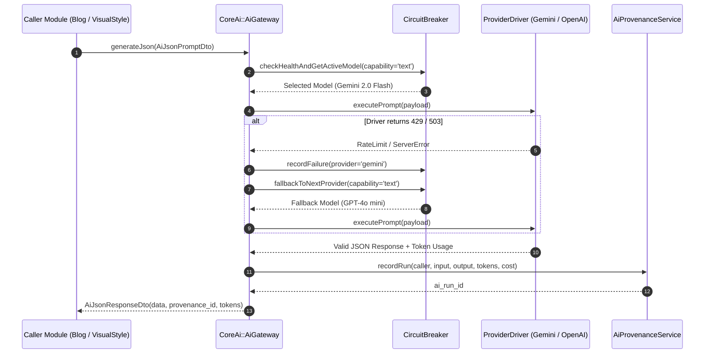

# Module Specification: CoreAi (`Modules/CoreAi`)

## 1. Tổng quan Module (Overview)
- **Tên Module:** `CoreAi`
- **Namespace:** `Modules\CoreAi`
- **Vị trí tầng:** Tầng 1 (Domain Enabler)
- **Mục đích:** Trung tâm điều phối và trừu tượng hóa toàn bộ tác vụ AI trong hệ thống (LLM text, structured JSON, vision, image generation, audio/TTS, embeddings). Toàn bộ module tầng 2 & 3 (`WritingStyle`, `VisualStyle`, `YoutubeIntelligence`, `VideoStudio`, `Blog`) **bắt buộc** phải gọi qua `CoreAi` gateway thay vì gọi trực tiếp SDK bên ngoài. Module quản lý token usage, rate-limit fallback, retry circuit breaker và kiểm toán AI provenance (nguồn gốc dữ liệu AI).

---

## 2. Cấu trúc thư mục (Directory Structure)
```
Modules/CoreAi/
├── app/
│   ├── Contracts/
│   │   ├── AiGatewayContract.php
│   │   ├── TextProviderContract.php
│   │   ├── ImageProviderContract.php
│   │   └── TtsProviderContract.php
│   ├── DTOs/
│   │   ├── AiTextPromptDto.php
│   │   ├── AiTextResponseDto.php
│   │   ├── AiJsonPromptDto.php
│   │   ├── AiJsonResponseDto.php
│   │   ├── AiImagePromptDto.php
│   │   ├── AiImageResponseDto.php
│   │   ├── AiTtsPromptDto.php
│   │   └── AiTtsResponseDto.php
│   ├── Drivers/
│   │   ├── GeminiDriver.php
│   │   ├── OpenAiDriver.php
│   │   ├── ClaudeDriver.php
│   │   ├── ReplicateFluxDriver.php
│   │   └── ElevenLabsDriver.php
│   ├── Enums/
│   │   ├── AiCapability.php        // text, vision, image, tts, embedding
│   │   ├── AiRunStatus.php         // pending, running, completed, failed
│   │   └── ProviderHealth.php      // healthy, degraded, down
│   ├── Events/
│   │   ├── AiRunStarted.php
│   │   ├── AiRunCompleted.php
│   │   └── AiRunFailed.php
│   ├── Http/
│   │   └── Controllers/
│   │       ├── AiModelController.php
│   │       ├── AiStreamController.php
│   │       └── AiAuditController.php
│   ├── Models/
│   │   ├── AiProvider.php
│   │   ├── AiModel.php
│   │   ├── AiRun.php
│   │   ├── AiRunStep.php
│   │   └── AiProvenance.php
│   ├── Services/
│   │   ├── AiGateway.php
│   │   ├── AiCircuitBreaker.php
│   │   └── AiTokenCostCalculator.php
│   └── Providers/
│       ├── CoreAiServiceProvider.php
│       └── RouteServiceProvider.php
├── config/
│   └── core-ai.php
├── database/
│   └── migrations/
│       ├── 2026_10_29_000001_create_ai_providers_table.php
│       ├── 2026_10_29_000002_create_ai_models_table.php
│       ├── 2026_10_29_000003_create_ai_runs_table.php
│       ├── 2026_10_29_000004_create_ai_run_steps_table.php
│       └── 2026_10_29_000005_create_ai_provenances_table.php
├── resources/
│   └── js/
│       ├── components/
│       │   ├── AiModelSelector.vue
│       │   ├── AiPromptStreamer.vue
│       │   └── AiProvenanceBadge.vue
│       ├── views/
│       │   ├── AiDashboard.vue
│       │   └── AiAuditLog.vue
│       └── routes.js
└── module.json
```

---

## 3. Database Schema (Bảng dữ liệu & Quan hệ)

### `ai_providers`
| Column | Type | Nullable | Mô tả |
| :--- | :--- | :--- | :--- |
| `id` | bigIncrements | No | Khóa chính |
| `code` | string(50) | No | Unique (`gemini`, `openai`, `anthropic`, `replicate`, `elevenlabs`) |
| `name` | string(100) | No | Tên hiển thị ("Google Gemini", "OpenAI") |
| `driver_class` | string(255) | No | Class FQCN driver |
| `base_url` | string(255) | Yes | Custom proxy hoặc local URL |
| `api_key_encrypted` | text | Yes | API Key mã hóa qua `Crypt` |
| `is_active` | boolean | No | Bật / Tắt provider (Default `true`) |
| `priority` | integer | No | Ưu tiên fallback (1 cao nhất) |
| `status` | string(20) | No | `healthy`, `degraded`, `down` |

### `ai_models`
| Column | Type | Nullable | Mô tả |
| :--- | :--- | :--- | :--- |
| `id` | bigIncrements | No | Khóa chính |
| `provider_id` | foreignId | No | FK `ai_providers.id` cascade |
| `code` | string(100) | No | Tên model API (`gemini-2.0-flash`, `gpt-4o`, `flux-1.1-pro`) |
| `name` | string(100) | No | Tên thân thiện hiển thị trên UI |
| `capability` | string(30) | No | Enum: `text`, `vision`, `image`, `tts`, `embedding` |
| `context_window` | integer | No | Số token context window |
| `input_price_per_1m` | decimal(10,4) | No | Giá USD trên 1 triệu token input |
| `output_price_per_1m`| decimal(10,4) | No | Giá USD trên 1 triệu token output |
| `is_default` | boolean | No | Model mặc định cho capability tương ứng |
| `is_active` | boolean | No | Trạng thái bật/tắt |

### `ai_runs` & `ai_run_steps`
- `ai_runs`: Ghi nhận 1 phiên thực thi AI lớn. Gồm `caller_type`, `caller_id` (ví dụ `Post`, `VideoScript`), `purpose` (`write_outline`, `generate_scene_image`), `total_tokens`, `total_cost_usd`, `latency_ms`, `status`.
- `ai_run_steps`: Ghi log từng bước con (prompt sent, raw response text, JSON parse validation, retry count).

### `ai_provenances`
Gắn nhãn bất kỳ field dữ liệu nào trong hệ thống do AI tạo ra:
- `subject_type` (morph)
- `subject_id` (morph)
- `field_name` (ví dụ `content`, `seo_title`, `script_draft`)
- `ai_run_id` (FK tới `ai_runs`)
- `prompt_snapshot` (nội dung prompt đã gửi)
- `model_code` (model đã sinh ra)

---

## 4. Contract & Trait Specifications

### `AiGatewayContract`
```php
namespace Modules\CoreAi\Contracts;

use Modules\CoreAi\DTOs\{AiTextPromptDto, AiTextResponseDto, AiJsonPromptDto, AiJsonResponseDto, AiImagePromptDto, AiImageResponseDto, AiTtsPromptDto, AiTtsResponseDto};

interface AiGatewayContract
{
    /**
     * CHỨC NĂNG: Gửi prompt text tự do, hỗ trợ system prompt, temperature, few-shots
     */
    public function generateText(AiTextPromptDto $prompt): AiTextResponseDto;

    /**
     * CHỨC NĂNG: Yêu cầu AI sinh structured output tuân thủ strict JSON Schema
     */
    public function generateJson(AiJsonPromptDto $prompt): AiJsonResponseDto;

    /**
     * CHỨC NĂNG: Sinh ảnh từ prompt (hỗ trợ FLUX, Recraft, DALL-E)
     */
    public function generateImage(AiImagePromptDto $prompt): AiImageResponseDto;

    /**
     * CHỨC NĂNG: Chuyển văn bản thành audio (ElevenLabs / OpenAI TTS)
     */
    public function generateTts(AiTtsPromptDto $prompt): AiTtsResponseDto;
}
```

---

## 5. Flow Sequence Diagram (Luồng xử lý điển hình)



---

## 6. API Endpoints

| Method | Endpoint | Quyền hạn | Mô tả |
| :--- | :--- | :--- | :--- |
| `GET` | `/api/v1/core-ai/providers` | `ai.settings.view` | Danh sách các AI provider và health status |
| `POST` | `/api/v1/core-ai/providers/{id}/test` | `ai.settings.manage` | Kiểm tra kết nối API Key của provider |
| `GET` | `/api/v1/core-ai/models` | `ai.models.view` | Danh sách model đang khả dụng theo capability |
| `POST` | `/api/v1/core-ai/stream` | `ai.prompt.execute` | Server-Sent Events (SSE) streaming output cho UI |
| `GET` | `/api/v1/core-ai/runs` | `ai.audit.view` | Lịch sử gọi AI, thống kê token và chi phí hàng tháng |

---

## 7. Frontend UI Specs (Vuetify 3 / Vuexy)
- **`AiModelSelector.vue`**: Dropdown component tái sử dụng hiển thị các model khả dụng theo filter `capability` (ví dụ `text` hoặc `image`). Hiển thị badge giá token và icon nhà cung cấp (Google, OpenAI, Anthropic).
- **`AiPromptStreamer.vue`**: Vùng hiển thị text gõ chữ dạng typewriter trực tiếp từ Server-Sent Events, có nút "Dừng tạo" (`AbortController`) và "Thử lại".
- **`AiProvenanceBadge.vue`**: Icon robot nhỏ kế bên các trường input (như Content bài viết, Mô tả SEO). Khi bấm vào mở popup xem chi tiết model nào đã tạo, prompt gốc là gì, chi phí bao nhiêu.

---

## 8. Chuẩn Comment & Quy ước Code
Toàn bộ service driver trong `Modules/CoreAi` tuân thủ:
```php
/**
 * CHỨC NĂNG FILE: Driver tương tác API Google Gemini 2.0.
 *
 * INPUT: AiTextPromptDto chứa system_instruction, user_content, media_inline_data.
 * OUTPUT: AiTextResponseDto chuẩn hóa text phản hồi và số token tiêu thụ.
 * SIDE EFFECT: Tự động ghi nhận thời gian phản hồi vào CircuitBreaker.
 * EXCEPTION/TRANSACTION: Ném AiProviderException nếu quota hết hoặc API trả mã lỗi 4xx/5xx.
 */
```
Path: [08-core-ai.md](file:///e:/Web/makerting-app/docs/modules/08-core-ai.md)
