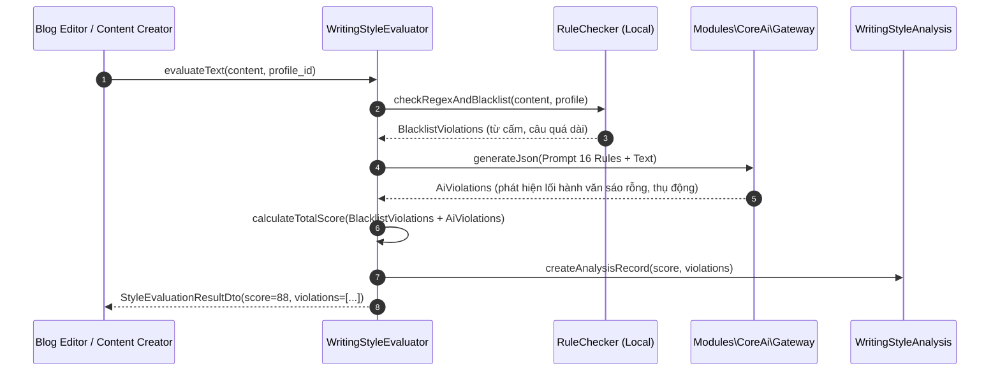

# Module Specification: WritingStyle (`Modules/WritingStyle`)

## 1. Tổng quan Module (Overview)
- **Tên Module:** `WritingStyle`
- **Namespace:** `Modules\WritingStyle`
- **Vị trí tầng:** Tầng 2 (Domain Engines)
- **Mục đích:** Hệ thống chuẩn hóa, phân tích và trích xuất văn phong bài viết (Tone of Voice). Cung cấp 16 quy tắc viết văn nghiêm ngặt (chống sáo rỗng, nhịp điệu ngắt nghỉ, từ ngữ cấm kỵ, cấu trúc mở bài/kết bài tương phản). Cho phép phân tích các bài viết mẫu để reverse-engineer ra hồ sơ văn phong (`WritingProfile`), biên dịch thành System Prompt để đưa vào `CoreAi`, và chấm điểm đánh giá bài viết đã soạn thảo trước khi xuất bản.

---

## 2. Cấu trúc thư mục (Directory Structure)
```
Modules/WritingStyle/
├── app/
│   ├── Actions/
│   │   ├── CompileWritingPromptAction.php
│   │   ├── ExtractProfileFromSamplesAction.php
│   │   └── EvaluateTextQualityAction.php
│   ├── Contracts/
│   │   └── WritingStyleEvaluatorContract.php
│   ├── DTOs/
│   │   ├── CompiledStylePromptDto.php
│   │   ├── StyleEvaluationResultDto.php
│   │   └── StyleViolationDto.php
│   ├── Enums/
│   │   ├── RuleCategory.php         // vocabulary, cadence, hook, clarity, tone
│   │   ├── RuleSeverity.php         // hint, warning, blocking
│   │   └── ToneArchetype.php        // storytelling, thought_leader, direct_response, casual_buddy
│   ├── Http/
│   │   ├── Controllers/
│   │   │   ├── WritingProfileController.php
│   │   │   ├── WritingRuleController.php
│   │   │   └── WritingAnalyzeController.php
│   │   └── Requests/
│   │       ├── StoreWritingProfileRequest.php
│   │       └── AnalyzeTextRequest.php
│   ├── Models/
│   │   ├── WritingProfile.php
│   │   ├── WritingRule.php
│   │   └── WritingStyleAnalysis.php
│   ├── Services/
│   │   ├── WritingStyleCompiler.php
│   │   ├── WritingRuleChecker.php
│   │   └── StyleScoreCalculator.php
│   └── Providers/
│       ├── WritingStyleServiceProvider.php
│       └── RouteServiceProvider.php
├── config/
│   └── writing-style.php
├── database/
│   ├── migrations/
│   │   ├── 2026_10_29_000010_create_writing_rules_table.php
│   │   ├── 2026_10_29_000011_create_writing_profiles_table.php
│   │   ├── 2026_10_29_000012_create_writing_profile_rule_table.php
│   │   └── 2026_10_29_000013_create_writing_style_analyses_table.php
│   └── seeders/
│       └── DefaultSixteenWritingRulesSeeder.php
├── resources/
│   └── js/
│       ├── components/
│       │   ├── WritingProfileCard.vue
│       │   ├── WritingScoreGauge.vue
│       │   ├── StyleViolationsList.vue
│       │   └── ProfileReverseEngineerDialog.vue
│       ├── views/
│       │   ├── WritingProfileList.vue
│       │   └── WritingProfileEdit.vue
│       └── routes.js
└── module.json
```

---

## 3. Database Schema (Bảng dữ liệu & Quan hệ)

### `writing_rules`
Chứa định nghĩa 16 quy tắc cốt lõi của hệ thống:
| Column | Type | Nullable | Mô tả |
| :--- | :--- | :--- | :--- |
| `id` | bigIncrements | No | Khóa chính |
| `code` | string(50) | No | Unique (vd: `no_corporate_cliche`, `hook_open_loop`, `punchy_cadence`) |
| `name` | string(100) | No | Tên quy tắc (vd: "Không dùng sáo rỗng doanh nghiệp") |
| `category` | string(30) | No | Enum: `vocabulary`, `cadence`, `hook`, `clarity`, `closing` |
| `instruction` | text | No | Hướng dẫn chi tiết nạp cho LLM prompt |
| `negative_patterns`| json | Yes | Mảng regex hoặc cụm từ vi phạm (vd: `["trong bối cảnh", "vượt bậc"]`) |
| `severity` | string(20) | No | `hint`, `warning`, `blocking` |
| `is_active` | boolean | No | Bật / Tắt quy tắc |

### `writing_profiles`
Hồ sơ văn phong đại diện cho một thương hiệu, KOL hoặc kênh truyền thông:
| Column | Type | Nullable | Mô tả |
| :--- | :--- | :--- | :--- |
| `id` | bigIncrements | No | Khóa chính |
| `name` | string(100) | No | Tên hồ sơ (vd: "Giọng điệu Chuyên gia Tài chính Thực chiến") |
| `slug` | string(100) | No | Unique slug |
| `archetype` | string(50) | No | Enum `ToneArchetype` |
| `target_audience` | text | Yes | Đối tượng độc giả mục tiêu (nỗi đau, mong muốn, xưng hô) |
| `vocabulary_whitelist` | json | Yes | Cụm từ chuyên môn ưu tiên dùng |
| `vocabulary_blacklist` | json | Yes | Từ ngữ cấm tiệt sử dụng |
| `sample_texts` | json | Yes | 3-5 đoạn văn mẫu chuẩn phong cách |
| `compiled_system_prompt` | text | Yes | Chuỗi prompt đã compile sẵn để inject nhanh |
| `is_default` | boolean | No | Default profile cho các bài viết mới |

### `writing_style_analyses`
Lịch sử chấm điểm chất lượng văn phong của các đối tượng (Post, SocialPost, VideoScript):
- `subject_type`, `subject_id` (polymorphic)
- `writing_profile_id` (FK tới `writing_profiles`)
- `overall_score` (0 - 100)
- `readability_score` (Flesch-Kincaid adapted for VN)
- `violations` (JSON array các đoạn văn bị cảnh báo)
- `analyzed_at` (datetime)

---

## 4. Danh sách 16 Quy tắc Viết Văn Cốt Lõi (The 16 Rules)

1. **`no_corporate_cliche`**: Cấm sáo rỗng ("trong kỷ nguyên số", "giải pháp toàn diện", "bước tiến vượt bậc").
2. **`active_voice_dominance`**: Tối thiểu 85% câu dùng thể chủ động, loại bỏ lối hành văn bị động gián tiếp.
3. **`cadence_alternation`**: Nhịp điệu câu xen kẽ: 1 câu siêu ngắn (dưới 7 từ), theo sau bởi 1-2 câu giải thích cụ thể.
4. **`concrete_proof_points`**: Không dùng tính từ mơ hồ ("rất nhiều", "cực kỳ tốt") -> Bắt buộc thay bằng con số hoặc case study cụ thể.
5. **`consistent_persona_pronouns`**: Xưng hô nhất quán tuyệt đối xuyên suốt bài viết (vd: "Tôi - Bạn" hoặc "Mình - Các bạn").
6. **`conversational_flow`**: Hành văn như đang nói chuyện trực tiếp 1-1 tại quán cà phê, không viết văn hàn lâm.
7. **`hook_curiosity_gap`**: Mở bài bằng 1 nghịch lý, câu hỏi gây sốc hoặc tình huống thực tế, tạo khoảng trống tò mò (open loop).
8. **`micro_paragraphs`**: Đoạn văn không quá 3 dòng trên màn hình điện thoại (khoảng 1-3 câu/đoạn).
9. **`emotional_power_verbs`**: Sử dụng động từ mạnh, giàu cảm xúc thay vì chuỗi tính từ ghép.
10. **`sensory_vocabulary`**: Sử dụng từ ngữ kích thích giác quan (thấy, nghe, chạm, cảm giác chân thật).
11. **`objection_preemption`**: Nêu và giải quyết phản biện của độc giả trước khi họ kịp tự đặt câu hỏi.
12. **`seamless_transitions`**: Chuyển đoạn tự nhiên theo logic câu chuyện, cấm dùng từ nối máy móc ("Mặt khác", "Hơn thế nữa").
13. **`micro_anecdotes`**: Minh họa lý thuyết trừu tượng bằng 1 mẩu chuyện ngắn có thật (15-30 từ).
14. **`value_before_pitch`**: Cung cấp giá trị giải pháp trọn vẹn trước khi đưa ra bất kỳ lời kêu gọi hành động nào.
15. **`skimmable_formatting`**: Sử dụng định dạng in đậm cụm từ chốt ý và gạch đầu dòng để độc giả lướt nhanh vẫn nắm được 80% ý.
16. **`loop_closure_outro`**: Kết bài khép lại câu hỏi hoặc nghịch lý đã đặt ra ở phần Hook mở đầu.

---

## 5. Flow Sequence Diagram (Luồng phân tích & chấm điểm văn phong)



---

## 6. API Endpoints

| Method | Endpoint | Quyền hạn | Mô tả |
| :--- | :--- | :--- | :--- |
| `GET` | `/api/v1/writing-style/profiles` | `writing.profile.view` | Danh sách hồ sơ văn phong |
| `POST` | `/api/v1/writing-style/profiles` | `writing.profile.create` | Tạo mới hồ sơ văn phong |
| `POST` | `/api/v1/writing-style/profiles/reverse-engineer` | `writing.profile.create` | AI phân tích 3 bài mẫu để tự sinh Writing Profile |
| `POST` | `/api/v1/writing-style/evaluate` | `writing.evaluate` | Chấm điểm văn phong và trả về danh sách vi phạm |
| `GET` | `/api/v1/writing-style/rules` | `writing.rule.view` | Danh sách 16 quy tắc và cấu hình |

---

## 7. Frontend UI Specs (Vuetify 3 / Vuexy)
- **`WritingScoreGauge.vue`**: Đồng hồ bán nguyệt đo điểm văn phong từ 0 đến 100 điểm. Màu sắc tự động đổi: Đỏ (<60), Vàng (60-79), Xanh lá (>=80).
- **`StyleViolationsList.vue`**: Danh sách các điểm cần chỉnh sửa được gắn tag `blocking` (đỏ), `warning` (cam), `hint` (xanh). Khi click vào vi phạm, tự động highlight đoạn văn tương ứng trong trình soạn thảo.
- **`ProfileReverseEngineerDialog.vue`**: Hộp thoại cho phép người dùng dán vào 3 đường link hoặc 3 đoạn văn bản mẫu. Sau khi bấm "Phân tích văn phong", AI sẽ tự động chiết xuất Tone, Archetype, Whitelist từ vựng và lưu thành profile mới.

---

## 8. Chuẩn Comment & Quy ước Code
```php
/**
 * CHỨC NĂNG FILE: Đánh giá chất lượng văn bản dựa trên hồ sơ văn phong và 16 quy tắc cốt lõi.
 *
 * INPUT: EvaluateTextQualityAction nhận chuỗi text và WritingProfile.
 * OUTPUT: StyleEvaluationResultDto gồm điểm số (0-100), mảng vi phạm chi tiết từng dòng.
 * SIDE EFFECT: Lưu kết quả phân tích vào bảng writing_style_analyses.
 * EXCEPTION/TRANSACTION: Không ném Exception khi điểm thấp, chỉ ghi log lỗi kết nối AI nếu CoreAi gián đoạn.
 */
```
Path: [09-writing-style.md](file:///e:/Web/makerting-app/docs/modules/09-writing-style.md)
