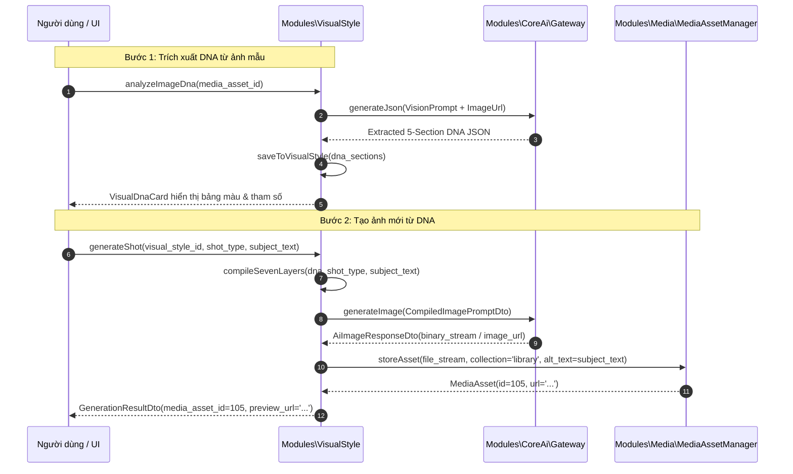

# Module Specification: VisualStyle (`Modules/VisualStyle`)

## 1. Tổng quan Module (Overview)
- **Tên Module:** `VisualStyle`
- **Namespace:** `Modules\VisualStyle`
- **Vị trí tầng:** Tầng 2 (Domain Engines)
- **Mục đích:** Hệ thống phân tích thị giác, trích xuất cấu trúc DNA hình ảnh và tái sinh hình ảnh chuẩn DNA nhất quán theo thương hiệu. Cho phép tải lên bất kỳ ảnh tham chiếu nào để AI Vision "mổ xẻ" ra 5 phần tử DNA cốt lõi. Cung cấp bộ biên dịch Prompt 7 lớp (7-Layer Prompt Engine) để tạo ảnh thumbnail, hero banner hoặc cảnh quay video với độ đồng nhất cao, sau đó tự động lưu vào kho `MediaAsset`.

---

## 2. Cấu trúc thư mục (Directory Structure)
```
Modules/VisualStyle/
├── app/
│   ├── Actions/
│   │   ├── AnalyzeImageDnaAction.php
│   │   ├── CompileSevenLayerPromptAction.php
│   │   └── GenerateImageFromDnaAction.php
│   ├── Contracts/
│   │   └── VisualStyleCompilerContract.php
│   ├── DTOs/
│   │   ├── ImageDnaDto.php
│   │   ├── CompiledImagePromptDto.php
│   │   └── GenerationResultDto.php
│   ├── Enums/
│   │   ├── ShotType.php             // thumbnail, hero_banner, portrait, b_roll, texture
│   │   ├── AspectRatio.php          // 16_9, 9_16, 1_1, 4_5
│   │   └── LightingTone.php         // warm_golden, moody_cinematic, neon_cyberpunk, studio_clean
│   ├── Http/
│   │   ├── Controllers/
│   │   │   ├── VisualStyleController.php
│   │   │   ├── VisualShotController.php
│   │   │   └── ImageDnaAnalyzeController.php
│   │   └── Requests/
│   │       ├── StoreVisualStyleRequest.php
│   │       └── GenerateDnaImageRequest.php
│   ├── Models/
│   │   ├── VisualStyle.php
│   │   ├── VisualStyleShot.php
│   │   └── ImageDnaAnalysis.php
│   ├── Services/
│   │   ├── VisualDnaExtractor.php
│   │   ├── SevenLayerPromptBuilder.php
│   │   └── DnaImageGenerator.php
│   └── Providers/
│       ├── VisualStyleServiceProvider.php
│       └── RouteServiceProvider.php
├── config/
│   └── visual-style.php
├── database/
│   ├── migrations/
│   │   ├── 2026_10_29_000020_create_visual_styles_table.php
│   │   ├── 2026_10_29_000021_create_visual_style_shots_table.php
│   │   └── 2026_10_29_000022_create_image_dna_analyses_table.php
│   └── seeders/
│       └── DefaultVisualStylesSeeder.php
├── resources/
│   └── js/
│       ├── components/
│       │   ├── VisualDnaCard.vue
│       │   ├── PromptLayerPreview.vue
│       │   ├── ImageDnaUploader.vue
│       │   └── DnaImageGeneratorDialog.vue
│       ├── views/
│       │   ├── VisualStyleList.vue
│       │   └── VisualStyleEdit.vue
│       └── routes.js
└── module.json
```

---

## 3. Database Schema (Bảng dữ liệu & Quan hệ)

### `visual_styles`
Bảng lưu trữ hồ sơ phong cách thị giác (Image DNA):
| Column | Type | Nullable | Mô tả |
| :--- | :--- | :--- | :--- |
| `id` | bigIncrements | No | Khóa chính |
| `name` | string(100) | No | Tên phong cách (vd: "Cinematic Neo-Noir", "Clean Minimalist Tech") |
| `slug` | string(100) | No | Unique slug |
| `description` | text | Yes | Mô tả tổng quan phong cách |
| `dna_sections` | json | No | Cấu trúc 5 phần tử DNA thị giác (xem chi tiết mục 4) |
| `negative_prompt_master` | text | Yes | Negative prompt mặc định chống biến dạng/xấu |
| `is_active` | boolean | No | Bật / Tắt phong cách |
| `is_default` | boolean | No | Phong cách mặc định khi tạo mới |

### `visual_style_shots`
Các góc chụp hoặc mẫu prompt chuẩn theo từng mục đích:
| Column | Type | Nullable | Mô tả |
| :--- | :--- | :--- | :--- |
| `id` | bigIncrements | No | Khóa chính |
| `visual_style_id` | foreignId | No | FK `visual_styles.id` cascade |
| `name` | string(100) | No | Tên shot (vd: "YouTube Viral Thumbnail", "Blog Hero Header") |
| `shot_type` | string(50) | No | Enum: `thumbnail`, `hero_banner`, `portrait`, `b_roll` |
| `aspect_ratio` | string(20) | No | Enum: `16:9`, `9:16`, `1:1`, `4:5` |
| `prompt_template` | text | No | Mẫu prompt chứa placeholder như `{subject}`, `{action}`, `{context}` |
| `negative_prompt` | text | Yes | Override negative prompt riêng cho shot này |

### `image_dna_analyses`
Lịch sử phân tích giải mã DNA từ ảnh tham khảo tải lên:
- `id`
- `media_asset_id` (FK tới ảnh đã upload trong `media_assets`)
- `extracted_dna` (JSON chứa 5 phân vùng trích xuất)
- `confidence_score` (Độ tin cậy của AI Vision, 0-100)
- `analyzed_at` (datetime)

---

## 4. Cấu trúc 5 Phân vùng DNA Thị Giác (5 Core DNA Sections)

1. **`color_palette`**: Mã màu chủ đạo (Hex codes), màu tương phản, tông nhiệt độ màu (`warm_3200k`, `daylight_5600k`, `cyber_magenta`).
2. **`composition`**: Góc đặt máy (`low_angle`, `drone_overhead`, `macro`), quy tắc bố cục (Rule of Thirds, Golden Ratio), độ sâu trường ảnh (`shallow_dof`, `bokeh_f1.4`).
3. **`subject_styling`**: Tạo hình nhân vật hoặc sản phẩm, trang phục, biểu cảm khuôn mặt, chất liệu bề mặt (`matte`, `metallic_gloss`, `fabric_texture`).
4. **`mood_atmosphere`**: Không khí điện ảnh, hiệu ứng ánh sáng môi trường (`volumetric_fog`, `lens_flare`, `rim_light`, `dramatic_shadows`).
5. **`negative_prompt_rules`**: Quy tắc loại trừ tuyệt đối: bàn tay biến dạng, chữ ký watermark, hiệu ứng 3D CGI giả tạo, bố cục lệch trọng tâm.

---

## 5. Động cơ Biên dịch Prompt 7 Lớp (7-Layer Prompt Engine)

Khi chuẩn bị sinh ảnh, `SevenLayerPromptBuilder` ghép nối theo thứ tự chuẩn mực:
- **Lớp 1 (Medium & Camera):** `35mm cinematic photograph, shot on Hasselblad H6D-100c, prime lens...`
- **Lớp 2 (Subject & Action):** Biến số người dùng đưa vào: `{subject} engaged in {action}...`
- **Lớp 3 (Environment & Setting):** Không gian bối cảnh: `{setting}, architectural details...`
- **Lớp 4 (Lighting & Shadow):** Ánh sáng từ DNA: `dramatic rim light, golden hour backlight, soft diffusion...`
- **Lớp 5 (Color Grading):** Bảng màu từ DNA: `teal and orange color grade, muted earth tones...`
- **Lớp 6 (Texture & Micro-details):** Chi tiết bề mặt: `intricate skin pores, fabric weave texture, ultra-high resolution...`
- **Lớp 7 (Render Parameters):** Tham số động: `--ar 16:9 --style raw --v 6.1`

---

## 6. Flow Sequence Diagram (Phân tích DNA & Sinh ảnh lưu vào Media)



---

## 7. API Endpoints

| Method | Endpoint | Quyền hạn | Mô tả |
| :--- | :--- | :--- | :--- |
| `GET` | `/api/v1/visual-styles` | `visual.style.view` | Danh sách phong cách thị giác DNA |
| `POST` | `/api/v1/visual-styles` | `visual.style.create` | Tạo mới bộ DNA phong cách |
| `POST` | `/api/v1/visual-styles/analyze-dna` | `visual.style.create` | Upload ảnh tham khảo để AI mổ xẻ trích xuất DNA |
| `POST` | `/api/v1/visual-styles/{id}/generate` | `visual.generate` | Sinh ảnh từ DNA shot và nạp thẳng vào Media |
| `GET` | `/api/v1/visual-styles/{id}/shots` | `visual.style.view` | Danh sách góc chụp/khung hình dựng sẵn của style |

---

## 8. Frontend UI Specs (Vuetify 3 / Vuexy)
- **`VisualDnaCard.vue`**: Thẻ giao diện hiển thị 5 phân vùng DNA: dải màu sắc (Color Swatches), góc máy đại diện, thanh trượt tương phản và badge phong cách.
- **`PromptLayerPreview.vue`**: Cho phép xem trước chuỗi prompt hoàn chỉnh được tách màu theo 7 lớp để người dùng hiểu vì sao ảnh được tạo ra với phong cách như vậy.
- **`DnaImageGeneratorDialog.vue`**: Dialog tạo ảnh nhanh theo chuẩn `AppDialogLayout`: chọn Style -> chọn Shot (16:9 Thumbnail / 1:1 Square) -> nhập Subject -> bấm "Tạo ảnh với AI". Khi hoàn thành, ảnh tự động xuất hiện trong Popup Media Picker để chèn vào bài viết.

---

## 9. Chuẩn Comment & Quy ước Code
```php
/**
 * CHỨC NĂNG FILE: Biên dịch chuỗi Prompt 7 lớp và thực hiện sinh ảnh từ DNA phong cách thị giác.
 *
 * INPUT: GenerateImageFromDnaAction nhận VisualStyle, ShotType, và các biến số ngữ cảnh.
 * OUTPUT: GenerationResultDto chứa MediaAsset instance đã được lưu trữ trong thư viện media trung tâm.
 * SIDE EFFECT: Gọi CoreAi gateway, lưu file ảnh trả về vào disk và gắn polymorphic tag vào MediaAsset.
 * EXCEPTION/TRANSACTION: Chạy trong DB Transaction để đảm bảo tính toàn vẹn bản ghi media asset.
 */
```
Path: [10-visual-style.md](file:///e:/Web/makerting-app/docs/modules/10-visual-style.md)
