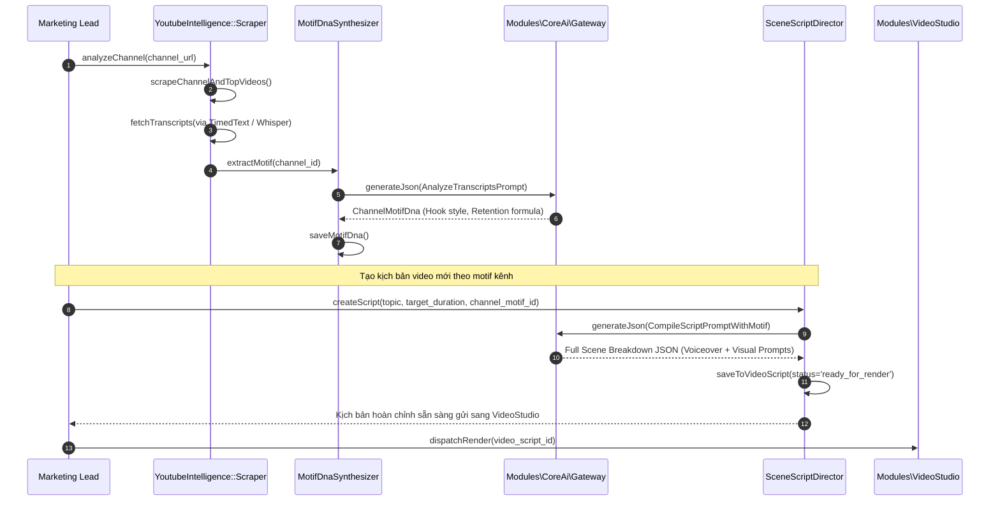

# Module Specification: YoutubeIntelligence (`Modules/YoutubeIntelligence`)

## 1. Tổng quan Module (Overview)
- **Tên Module:** `YoutubeIntelligence`
- **Namespace:** `Modules\YoutubeIntelligence`
- **Vị trí tầng:** Tầng 2 (Domain Engines)
- **Mục đích:** Hệ thống trinh sát và phân tích kênh YouTube đối thủ/nguồn cảm hứng, giải mã mô-típ kịch bản (Hook, Retension reset, Pacing) và Thumbnail DNA. Từ dữ liệu trích xuất, hệ thống tổng hợp ra `ChannelMotifDna`, cho phép AI tự động biên soạn kịch bản video phân cảnh chi tiết (Scene-by-scene script) theo phong cách kênh nguồn và đẩy sang `VideoStudio` để tự động dựng video.

---

## 2. Cấu trúc thư mục (Directory Structure)
```
Modules/YoutubeIntelligence/
├── app/
│   ├── Actions/
│   │   ├── ScrapeChannelMetadataAction.php
│   │   ├── FetchVideoTranscriptAction.php
│   │   ├── ExtractChannelMotifDnaAction.php
│   │   └── GenerateVideoScriptAction.php
│   ├── Contracts/
│   │   ├── YoutubeScraperContract.php
│   │   └── TranscriptFetcherContract.php
│   ├── DTOs/
│   │   ├── ChannelIntelligenceDto.php
│   │   ├── VideoTranscriptDto.php
│   │   ├── ChannelMotifDnaDto.php
│   │   └── VideoScriptSceneDto.php
│   ├── Enums/
│   │   ├── VideoScriptStatus.php    // draft, scripting, ready_for_render, rendering, completed
│   │   ├── SceneType.php            // hook, problem, proof, tip_point, pattern_interrupt, outro_cta
│   │   └── ScrapeStatus.php         // pending, fetching, analyzing, completed, failed
│   ├── Http/
│   │   ├── Controllers/
│   │   │   ├── YoutubeChannelController.php
│   │   │   ├── SourceVideoController.php
│   │   │   └── VideoScriptController.php
│   │   └── Requests/
│   │       ├── ScrapeChannelRequest.php
│   │       └── CreateVideoScriptRequest.php
│   ├── Jobs/
│   │   ├── ScrapeChannelJob.php
│   │   ├── ExtractMotifDnaJob.php
│   │   └── GenerateScriptScenesJob.php
│   ├── Models/
│   │   ├── YoutubeChannel.php
│   │   ├── YoutubeSourceVideo.php
│   │   └── VideoScript.php
│   ├── Services/
│   │   ├── YoutubeApiScraper.php
│   │   ├── TimedTextSubtitleParser.php
│   │   ├── MotifDnaSynthesizer.php
│   │   └── SceneScriptDirector.php
│   └── Providers/
│       ├── YoutubeIntelligenceServiceProvider.php
│       └── RouteServiceProvider.php
├── config/
│   └── youtube-intelligence.php
├── database/
│   └── migrations/
│       ├── 2026_10_29_000030_create_youtube_channels_table.php
│       ├── 2026_10_29_000031_create_youtube_source_videos_table.php
│       └── 2026_10_29_000032_create_video_scripts_table.php
├── resources/
│   └── js/
│       ├── components/
│       │   ├── ChannelRadarCard.vue
│       │   ├── MotifDnaViewer.vue
│       │   ├── SceneScriptEditor.vue
│       │   └── ScriptToRenderDialog.vue
│       ├── views/
│       │   ├── YoutubeScoutDashboard.vue
│       │   ├── VideoScriptList.vue
│       │   └── VideoScriptDetail.vue
│       └── routes.js
└── module.json
```

---

## 3. Database Schema (Bảng dữ liệu & Quan hệ)

### `youtube_channels`
Bảng lưu trữ thông tin kênh được trinh sát và DNA mô-típ đã trích xuất:
| Column | Type | Nullable | Mô tả |
| :--- | :--- | :--- | :--- |
| `id` | bigIncrements | No | Khóa chính |
| `channel_id` | string(100) | No | YouTube Channel ID (`UC...`) unique |
| `title` | string(255) | No | Tên kênh |
| `handle` | string(100) | Yes | @handle của kênh |
| `description` | text | Yes | Mô tả kênh |
| `thumbnail_url` | text | Yes | Ảnh đại diện kênh |
| `subscriber_count`| bigint | Yes | Lượng đăng ký |
| `video_count` | integer | Yes | Tổng số video |
| `motif_dna` | json | Yes | Cấu trúc mô-típ kịch bản trích xuất (JSON) |
| `visual_style_id`| foreignId | Yes | FK `visual_styles.id` liên kết style thumbnail của kênh |
| `last_scraped_at`| timestamp | Yes | Thời điểm trinh sát gần nhất |

### `youtube_source_videos`
Danh sách các video top-performing của kênh được tải phụ đề phục vụ bóc tách DNA:
| Column | Type | Nullable | Mô tả |
| :--- | :--- | :--- | :--- |
| `id` | bigIncrements | No | Khóa chính |
| `youtube_channel_id` | foreignId | No | FK `youtube_channels.id` cascade |
| `video_id` | string(50) | No | YouTube Video ID (`dQw4w9WgXcQ`) |
| `title` | string(255) | No | Tiêu đề video |
| `view_count` | bigint | No | Lượt xem |
| `duration_sec` | integer | No | Độ dài video tính bằng giây |
| `transcript_text`| longText | Yes | Toàn bộ văn bản lời thoại đã ghép |
| `transcript_segments` | json | Yes | Mảng chi tiết từng câu kèm timestamp `[ { start, end, text } ]` |
| `thumbnail_url` | text | Yes | URL thumbnail gốc |

### `video_scripts`
Kịch bản video mới được AI kiến tạo dựa trên mô-típ kênh nguồn:
| Column | Type | Nullable | Mô tả |
| :--- | :--- | :--- | :--- |
| `id` | bigIncrements | No | Khóa chính |
| `youtube_channel_id` | foreignId | Yes | FK kênh nguồn làm mô-típ tham chiếu (nếu có) |
| `title` | string(255) | No | Tiêu đề kịch bản / video dự kiến |
| `slug` | string(255) | No | Unique slug |
| `topic` | text | No | Ý tưởng / Chủ đề bài phân tích |
| `target_duration_sec` | integer | No | Thời lượng mục tiêu (vd: 60s cho Shorts, 480s cho Long-form) |
| `writing_profile_id` | foreignId | Yes | FK `writing_profiles.id` (văn phong lời thoại) |
| `visual_style_id` | foreignId | Yes | FK `visual_styles.id` (phong cách hình ảnh phân cảnh) |
| `status` | string(30) | No | Enum: `draft`, `scripting`, `ready_for_render`, `rendering`, `completed` |
| `scenes` | json | No | Mảng danh sách phân cảnh (Scene Breakdown - xem chi tiết) |
| `total_scenes` | integer | No | Số lượng phân cảnh |
| `estimated_words` | integer | No | Tổng số từ trong kịch bản thoại |

---

## 4. Cấu trúc Phân cảnh Kịch bản (Scene Breakdown JSON Schema)

Trường `scenes` trong `video_scripts` là mảng các đối tượng phân cảnh chuẩn mực:
```json
[
  {
    "scene_index": 1,
    "scene_type": "hook",
    "duration_est_sec": 4.5,
    "voiceover_text": "90% người sáng tạo nội dung đang đốt tiền vô ích vào quảng cáo mà không biết điều này.",
    "screen_text_overlay": "DỪNG ĐỐT TIỀN QUẢNG CÁO!",
    "visual_description": "Cận cảnh bàn tay cầm xấp tiền đô-la bị bốc cháy trên bàn làm việc tối, ánh sáng tương phản cao.",
    "visual_prompt_compiled": "Cinematic close-up of hands holding burning US dollar bills on dark walnut desk, intense fire glow, 35mm photograph, moody atmosphere --ar 16:9",
    "camera_motion": "slow_zoom_in",
    "transition": "glitch_cut",
    "sound_effect": "whoosh_impact"
  },
  {
    "scene_index": 2,
    "scene_type": "pattern_interrupt",
    "duration_est_sec": 3.0,
    "voiceover_text": "Hãy nhìn vào biểu đồ này.",
    "screen_text_overlay": "SỰ THẬT TÀN NHẪN",
    "visual_description": "Biểu đồ đường dốc đứng màu đỏ lao dốc, hiệu ứng đồ họa 3D tương phản cao.",
    "camera_motion": "rapid_pan_right",
    "transition": "flash_white"
  }
]
```

---

## 5. Flow Sequence Diagram (Từ quét kênh YouTube tới sinh kịch bản)



---

## 6. API Endpoints

| Method | Endpoint | Quyền hạn | Mô tả |
| :--- | :--- | :--- | :--- |
| `POST` | `/api/v1/youtube/channels/scout` | `youtube.scout` | Nhập link kênh để bắt đầu tải dữ liệu và phân tích |
| `GET` | `/api/v1/youtube/channels` | `youtube.view` | Danh sách kênh đã trinh sát kèm radar DNA |
| `GET` | `/api/v1/youtube/channels/{id}/motif` | `youtube.view` | Xem cấu trúc mô-típ kịch bản chi tiết của kênh |
| `POST` | `/api/v1/youtube/scripts` | `video.script.create` | Yêu cầu AI viết kịch bản video phân cảnh mới |
| `GET` | `/api/v1/youtube/scripts/{id}` | `video.script.view` | Xem chi tiết kịch bản và danh sách phân cảnh |
| `PUT` | `/api/v1/youtube/scripts/{id}/scenes` | `video.script.edit` | Tinh chỉnh trực tiếp nội dung từng phân cảnh |

---

## 7. Frontend UI Specs (Vuetify 3 / Vuexy)
- **`ChannelRadarCard.vue`**: Thẻ thống kê kênh YouTube trực quan (Subscriber, Tốc độ ra video, Top video viral) kèm Radar Chart biểu thị 5 chỉ số mô-típ (Hook Power, Retention Reset Frequency, Pacing Speed, Storytelling Depth, Call to Action Clarity).
- **`SceneScriptEditor.vue`**: Giao diện soạn kịch bản dạng Timeline phân cảnh kéo thả. Mỗi Card phân cảnh hiển thị: Số thứ tự, Thời lượng ước tính, Lời thoại (Voiceover), Text màn hình, và Nút "Sinh ảnh minh họa cảnh" gọi trực tiếp `VisualStyle`.
- **`ScriptToRenderDialog.vue`**: Hộp thoại xác nhận chuyển giao kịch bản sang `VideoStudio`: Cho phép chọn Giọng đọc AI (Voice ID), Nhạc nền (BGM), Tỉ lệ khung hình (16:9 ngang hay 9:16 dọc TikTok/Shorts) và bấm "Bắt đầu Dựng Video".

---

## 8. Chuẩn Comment & Quy ước Code
```php
/**
 * CHỨC NĂNG FILE: Trích xuất phụ đề video từ YouTube TimedText API hoặc Whisper AI fallback.
 *
 * INPUT: FetchVideoTranscriptAction nhận YouTube Video ID hoặc URL.
 * OUTPUT: VideoTranscriptDto chứa text thô và mảng timestamps chi tiết từng giây.
 * SIDE EFFECT: Lưu vào bảng youtube_source_videos và giải phóng bộ nhớ đệm audio tạm.
 * EXCEPTION/TRANSACTION: Ném TranscriptUnavailableException nếu video không có sub và audio bị khóa.
 */
```
Path: [11-youtube-intelligence.md](file:///e:/Web/makerting-app/docs/modules/11-youtube-intelligence.md)
