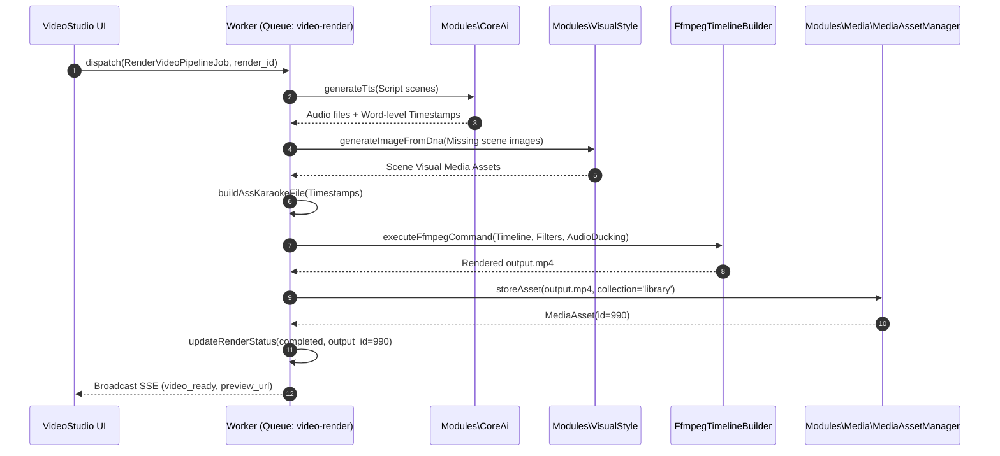

# Module Specification: VideoStudio (`Modules/VideoStudio`)

## 1. Tổng quan Module (Overview)
- **Tên Module:** `VideoStudio`
- **Namespace:** `Modules\VideoStudio`
- **Vị trí tầng:** Tầng 2 (Domain Engines)
- **Mục đích:** Động cơ dựng và xuất bản video tự động hóa (Automated Video Production Pipeline). Nhận kịch bản phân cảnh (`VideoScript`) từ `YoutubeIntelligence`, điều phối tạo giọng đọc lồng tiếng AI (TTS) kèm timestamps từng từ, tạo hoạt họa chuyển động Ken Burns cho hình ảnh từ `VisualStyle`, tự động ghép nhạc nền giảm âm lượng thông minh (Audio Ducking), tạo phụ đề nhảy chữ karaoke (`.ass`), và dùng FFmpeg xuất bản file video `.mp4` hoàn chỉnh lưu vào kho `MediaAsset`.

---

## 2. Cấu trúc thư mục (Directory Structure)
```
Modules/VideoStudio/
├── app/
│   ├── Actions/
│   │   ├── SynthesizeVoiceoverAction.php
│   │   ├── GenerateSceneVisualsAction.php
│   │   ├── BuildAssSubtitleAction.php
│   │   └── RenderFinalVideoAction.php
│   ├── Contracts/
│   │   ├── VideoRendererContract.php
│   │   └── SubtitleGeneratorContract.php
│   ├── DTOs/
│   │   ├── RenderJobConfigDto.php
│   │   ├── AudioTimestampSegmentDto.php
│   │   └── RenderProgressDto.php
│   ├── Enums/
│   │   ├── RenderStatus.php         // queued, tts_synthesis, visual_prep, ffmpeg_render, completed, failed
│   │   ├── VideoAspectRatio.php     // landscape_16_9, portrait_9_16, square_1_1
│   │   └── SubtitleStyle.php        // mrbeast_pop, clean_minimal, cinematic_bottom, karaoke_glow
│   ├── Events/
│   │   ├── VideoRenderProgressUpdated.php
│   │   └── VideoRenderCompleted.php
│   ├── Http/
│   │   ├── Controllers/
│   │   │   ├── VideoRenderController.php
│   │   │   └── RenderAssetController.php
│   │   └── Requests/
│   │       └── StartRenderRequest.php
│   ├── Jobs/
│   │   └── RenderVideoPipelineJob.php  // Queue: video-render (timeout 1800s)
│   ├── Models/
│   │   ├── VideoRender.php
│   │   └── VideoRenderScene.php
│   ├── Services/
│   │   ├── FfmpegTimelineBuilder.php
│   │   ├── AudioDuckingMixer.php
│   │   ├── AssKaraokeFormatter.php
│   │   └── KenBurnsMotionGenerator.php
│   └── Providers/
│       ├── VideoStudioServiceProvider.php
│       └── RouteServiceProvider.php
├── config/
│   └── video-studio.php
├── database/
│   └── migrations/
│       ├── 2026_10_29_000040_create_video_renders_table.php
│       └── 2026_10_29_000041_create_video_render_scenes_table.php
├── resources/
│   └── js/
│       ├── components/
│       │   ├── VideoRenderProgressBar.vue
│       │   ├── VideoPreviewPlayer.vue
│       │   ├── SubtitleStylePicker.vue
│       │   └── AudioDuckingConfig.vue
│       ├── views/
│       │   ├── VideoStudioQueue.vue
│       │   └── VideoRenderDetail.vue
│       └── routes.js
└── module.json
```

---

## 3. Database Schema (Bảng dữ liệu & Quan hệ)

### `video_renders`
Theo dõi tiến độ dựng từng bản video:
| Column | Type | Nullable | Mô tả |
| :--- | :--- | :--- | :--- |
| `id` | bigIncrements | No | Khóa chính |
| `video_script_id` | foreignId | No | FK `video_scripts.id` cascade |
| `title` | string(255) | No | Tên file video xuất bản |
| `aspect_ratio` | string(20) | No | `16:9` (YouTube/Web) hoặc `9:16` (TikTok/Reels/Shorts) |
| `voice_id` | string(100) | No | Mã định danh giọng đọc AI (ElevenLabs / OpenAI) |
| `subtitle_style` | string(50) | No | Enum: `mrbeast_pop`, `clean_minimal`, `karaoke_glow` |
| `bgm_media_asset_id` | foreignId | Yes | FK `media_assets.id` file nhạc nền |
| `output_media_asset_id` | foreignId | Yes | FK `media_assets.id` kết quả file mp4 sau khi render |
| `status` | string(30) | No | Enum `RenderStatus` |
| `progress_percent` | integer | No | Tiến độ render 0 - 100% |
| `render_settings` | json | Yes | Cấu hình ducking, FPS (30/60), bitrate, watermark |
| `error_message` | text | Yes | Log lỗi chi tiết nếu quá trình dựng thất bại |
| `started_at` | timestamp | Yes | Thời điểm bắt đầu render |
| `completed_at` | timestamp | Yes | Thời điểm xuất file thành công |

### `video_render_scenes`
Quản lý tài nguyên media của từng phân cảnh trong timeline dựng:
| Column | Type | Nullable | Mô tả |
| :--- | :--- | :--- | :--- |
| `id` | bigIncrements | No | Khóa chính |
| `video_render_id` | foreignId | No | FK `video_renders.id` cascade |
| `scene_index` | integer | No | Thứ tự phân cảnh (1, 2, 3...) |
| `audio_asset_id` | foreignId | Yes | FK `media_assets.id` file voiceover của cảnh này |
| `visual_asset_id` | foreignId | Yes | FK `media_assets.id` ảnh/clip cảnh này do VisualStyle tạo |
| `duration_sec` | decimal(8,2)| No | Thời lượng thực tế khớp chính xác theo file audio |
| `motion_type` | string(50) | No | `zoom_in`, `zoom_out`, `pan_left`, `pan_right` |
| `status` | string(20) | No | `pending`, `ready`, `rendered` |

---

## 4. Pipeline Dựng Video 5 Bước (The 5-Stage Render Pipeline)

Toàn bộ quy trình diễn ra trong hàng đợi bất đồng bộ `RenderVideoPipelineJob` (Queue: `video-render`):

1. **Bước 1: Tổng hợp Giọng đọc Lồng tiếng (TTS Synthesis):**
   - Gửi văn bản phân cảnh tới `CoreAi::generateTts`.
   - Trích xuất mảng word-level timestamps (`[{ word, start_time, end_time }]`).
   - Lưu file âm thanh voiceover và tính toán thời lượng chính xác từng cảnh.
2. **Bước 2: Chuẩn bị Thị giác Phân cảnh (Visual Asset Preparation):**
   - Với những cảnh chưa có ảnh, tự động gọi `VisualStyle::GenerateImageFromDnaAction` với prompt đã chuẩn hóa ở Lớp 7.
   - Resize ảnh về đúng kích thước chuẩn (1920x1080 cho 16:9 hoặc 1080x1920 cho 9:16).
3. **Bước 3: Biên soạn Phụ đề Nhảy chữ Karaoke (.ass Subtitles):**
   - Từ word timestamps, sinh file phụ đề `.ass` với hiệu ứng màu chữ đổi màu khi MC nói tới (Karaoke glow, font Montserrat Bold, viền đen sắc nét).
4. **Bước 4: Trộn Âm thanh & Audio Ducking:**
   - Hòa trộn track giọng đọc và track nhạc nền (BGM).
   - Tự động hạ âm lượng BGM xuống -18dB khi có giọng đọc, nâng lên -6dB ở các đoạn nghỉ giữa 2 phân cảnh.
5. **Bước 5: Render FFmpeg & Đóng gói MediaAsset:**
   - Áp dụng bộ lọc `zoompan` (Ken Burns effect) tạo chuyển động mượt mà cho ảnh tĩnh.
   - Ghép âm thanh, chuyển cảnh `xfade`, đè phụ đề `.ass` và logo watermark.
   - Xuất file `.mp4` chuẩn `H.264 / AAC`.
   - Đưa file vào `MediaAssetManager::storeAsset(collection='library')` và phát sự kiện `VideoRenderCompleted`.

---

## 5. Flow Sequence Diagram (Quy trình dựng video tự động)



---

## 6. API Endpoints

| Method | Endpoint | Quyền hạn | Mô tả |
| :--- | :--- | :--- | :--- |
| `POST` | `/api/v1/video-studio/renders` | `video.render.start` | Khởi động render video từ VideoScript ID |
| `GET` | `/api/v1/video-studio/renders` | `video.render.view` | Danh sách hàng đợi và tiến độ render |
| `GET` | `/api/v1/video-studio/renders/{id}` | `video.render.view` | Chi tiết tiến độ từng phân cảnh và log |
| `POST` | `/api/v1/video-studio/renders/{id}/retry` | `video.render.start` | Thử lại các cảnh bị lỗi |
| `DELETE`| `/api/v1/video-studio/renders/{id}` | `video.render.delete` | Hủy tiến trình render |

---

## 7. Frontend UI Specs (Vuetify 3 / Vuexy)
- **`VideoRenderProgressBar.vue`**: Thanh tiến độ chi tiết thể hiện 5 chặng: `TTS -> Visuals -> Subtitles -> Audio Mix -> FFmpeg Encode`. Hiển thị % và thời gian còn lại ước tính.
- **`VideoPreviewPlayer.vue`**: Trình phát video chuẩn HTML5 có khả năng toggle bật tắt phụ đề, chuyển đổi nhanh giữa video gốc và thumbnail, hỗ trợ phóng to toàn màn hình.
- **`SubtitleStylePicker.vue`**: Bộ chọn mẫu phụ đề trực quan (MrBeast phong cách chữ vàng viền đen nhảy từng từ, Phong cách Podcast chữ trắng nền đen tối giản, Phong cách Karaoke viền neon).

---

## 8. Chuẩn Comment & Quy ước Code
```php
/**
 * CHỨC NĂNG FILE: Bộ trộn âm thanh tự động giảm âm lượng nhạc nền (Audio Ducking) theo giọng đọc.
 *
 * INPUT: AudioDuckingMixer nhận file voiceover stream và background music stream.
 * OUTPUT: Trả về chuỗi filter complex của FFmpeg `sidechaincompress` hoặc mảng volume keyframes.
 * SIDE EFFECT: Không ghi đè file âm thanh gốc, chỉ tạo stream trung gian cho pipeline render.
 * EXCEPTION/TRANSACTION: Ném AudioProcessingException nếu codec audio không tương thích hoặc thời lượng vượt ngưỡng.
 */
```
Path: [12-video-studio.md](file:///e:/Web/makerting-app/docs/modules/12-video-studio.md)
