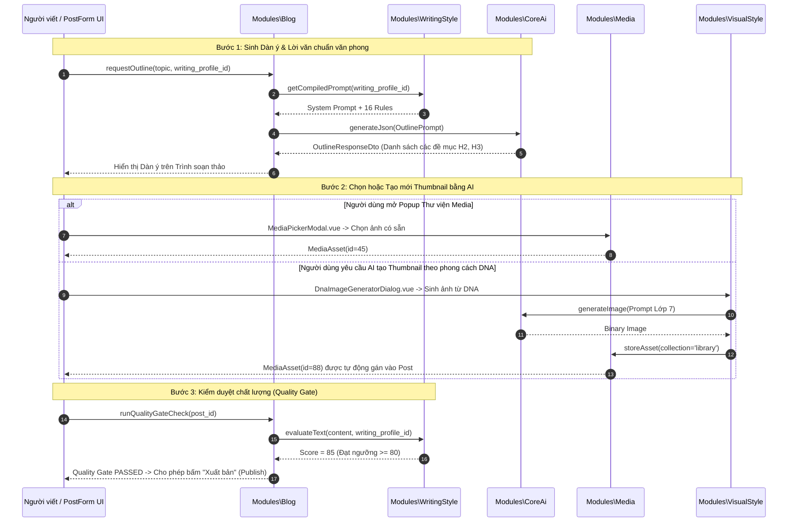

# Module Specification: Blog (`Modules/Blog`)

## 1. Tổng quan Module (Overview)
- **Tên Module:** `Blog`
- **Namespace:** `Modules\Blog`
- **Vị trí tầng:** Tầng 3 (Domain Deliverables & Application)
- **Mục đích:** Quản lý bài viết blog/báo chí chuyên nghiệp. Đóng vai trò là module ứng dụng mẫu mực tích hợp toàn bộ các khả năng dùng chung của hệ thống: sử dụng 6 Shared Traits (`HasSlug`, `HasCategories`, `HasTags`, `HasThumbnail`, `HasSeoMeta`, `HasAiProvenance`), tích hợp quy trình viết bài 3 bước qua `CoreAi` + `WritingStyle`, và kết nối chọn/sinh ảnh đại diện (Thumbnail) trực tiếp từ `Media` và `VisualStyle`.

---

## 2. Cấu trúc thư mục (Directory Structure)
```
Modules/Blog/
├── app/
│   ├── Actions/
│   │   ├── CreatePostAction.php
│   │   ├── UpdatePostAction.php
│   │   ├── GenerateAiOutlineAction.php
│   │   ├── StreamSectionContentAction.php
│   │   └── RunQualityGateCheckAction.php
│   ├── DTOs/
│   │   ├── PostDataDto.php
│   │   ├── OutlineResponseDto.php
│   │   └── QualityCheckResultDto.php
│   ├── Enums/
│   │   ├── PostStatus.php           // draft, pending_review, scheduled, published, archived
│   │   └── PostVisibility.php       // public, private, password_protected
│   ├── Events/
│   │   ├── PostPublished.php
│   │   └── PostArchived.php
│   ├── Http/
│   │   ├── Controllers/
│   │   │   ├── PostController.php
│   │   │   ├── PostAiAssistantController.php
│   │   │   └── PostRevisionController.php
│   │   └── Requests/
│   │       ├── StorePostRequest.php
│   │       └── UpdatePostRequest.php
│   ├── Models/
│   │   ├── Post.php
│   │   └── PostRevision.php
│   ├── Services/
│   │   ├── PostPublishingPipeline.php
│   │   └── ReadingTimeCalculator.php
│   └── Providers/
│       ├── BlogServiceProvider.php
│       └── RouteServiceProvider.php
├── config/
│   └── blog.php
├── database/
│   ├── migrations/
│   │   ├── 2026_10_29_000050_create_posts_table.php
│   │   └── 2026_10_29_000051_create_post_revisions_table.php
│   └── seeders/
│       └── BlogSampleSeeder.php
├── resources/
│   └── js/
│       ├── components/
│       │   ├── PostAiWritingAssistant.vue
│       │   ├── PostQualityGateAlert.vue
│       │   ├── PostPublishingSidebar.vue
│       │   └── PostRevisionDrawer.vue
│       ├── views/
│       │   ├── PostList.vue
│       │   └── PostForm.vue
│       └── routes.js
└── module.json
```

---

## 3. Database Schema (Bảng dữ liệu & Quan hệ)

### `posts`
Bảng bài viết chứa các trường lõi, các trường mở rộng (Slug, SEO, Category, Tag, Media) được kết nối qua Shared Traits:
| Column | Type | Nullable | Mô tả |
| :--- | :--- | :--- | :--- |
| `id` | bigIncrements | No | Khóa chính |
| `title` | string(255) | No | Tiêu đề bài viết |
| `summary` | text | Yes | Tóm tắt / Teaser ngắn |
| `content` | longText | Yes | Nội dung bài viết (HTML / Markdown) |
| `status` | string(30) | No | Enum: `draft`, `pending_review`, `scheduled`, `published`, `archived` |
| `author_id` | foreignId | No | FK `users.id` |
| `writing_profile_id` | foreignId | Yes | FK `writing_profiles.id` (văn phong áp dụng cho bài) |
| `style_score` | integer | Yes | Điểm văn phong gần nhất được chấm (0-100) |
| `featured_media_asset_id`| foreignId | Yes | FK `media_assets.id` ảnh đại diện chính |
| `reading_time_minutes` | integer | No | Thời gian đọc ước tính (mặc định tính từ số từ) |
| `views_count` | bigint | No | Lượt xem tích lũy (Default `0`) |
| `published_at` | timestamp | Yes | Thời điểm xuất bản lên web |

### `post_revisions`
Lịch sử phiên bản bài viết (Undo / So sánh chênh lệch Diff):
- `id`, `post_id`, `title`, `summary`, `content`, `revision_number`, `created_by`, `created_at`.

---

## 4. Đặc tả Model `Post` & 6 Shared Traits

Model `Post` kế thừa chuẩn mực từ các module nền tảng:
```php
namespace Modules\Blog\Models;

use Illuminate\Database\Eloquent\Model;
use Illuminate\Database\Eloquent\SoftDeletes;
use Modules\Taxonomy\Traits\HasSlug;
use Modules\Taxonomy\Traits\HasCategories;
use Modules\Taxonomy\Traits\HasTags;
use Modules\Media\Traits\HasThumbnail;
use Modules\Seo\Traits\HasSeoMeta;
use Modules\CoreAi\Traits\HasAiProvenance;

class Post extends Model
{
    use SoftDeletes,
        HasSlug,             // Tự động tạo slug duy nhất từ title
        HasCategories,       // Gắn danh mục đa cấp (categories)
        HasTags,             // Gắn thẻ tag
        HasThumbnail,        // Quan hệ với MediaAsset làm thumbnail chính
        HasSeoMeta,          // Quản lý thẻ Meta Title, Description, OpenGraph
        HasAiProvenance;     // Đánh dấu đoạn văn nào do AI tạo & audit log

    protected $fillable = [
        'title',
        'summary',
        'content',
        'status',
        'author_id',
        'writing_profile_id',
        'style_score',
        'featured_media_asset_id',
        'reading_time_minutes',
        'published_at',
    ];
}
```

---

## 5. Quy trình Soạn thảo Bài viết Tích hợp AI (AI Writing Workflow)



---

## 6. API Endpoints

| Method | Endpoint | Quyền hạn | Mô tả |
| :--- | :--- | :--- | :--- |
| `GET` | `/api/v1/blog/posts` | `blog.post.view` | Danh sách bài viết (hỗ trợ lọc status, category, tag) |
| `POST` | `/api/v1/blog/posts` | `blog.post.create` | Tạo mới bài viết |
| `GET` | `/api/v1/blog/posts/{id}` | `blog.post.view` | Chi tiết bài viết (kèm categories, tags, thumbnail, seo) |
| `PUT` | `/api/v1/blog/posts/{id}` | `blog.post.edit` | Cập nhật bài viết |
| `POST` | `/api/v1/blog/posts/ai/outline` | `blog.ai.assist` | AI đề xuất dàn ý chuẩn SEO và văn phong |
| `POST` | `/api/v1/blog/posts/{id}/quality-check` | `blog.ai.assist` | Chạy bộ kiểm tra Quality Gate 16 quy tắc |

---

## 7. Frontend UI Specs (Vuetify 3 / Vuexy)
- **`PostForm.vue`**: Trang soạn thảo chuẩn Vuexy thiết kế bố cục 2 cột:
  - Cột chính (`v-col cols="12" md="8"`): Tiêu đề (`text-h4`), Trình soạn thảo Rich Text (TipTap hoặc Quill) tích hợp nút AI Copilot, Khung phân tích điểm văn phong inline.
  - Cột sườn (`v-col cols="12" md="4"`): `PostPublishingSidebar.vue` chứa:
    - Widget Trạng thái & Lịch xuất bản (`published_at`).
    - Widget Thumbnail với 2 nút: "Chọn từ thư viện" (mở `MediaPickerModal`) và "Tạo ảnh AI từ DNA" (mở `DnaImageGeneratorDialog`).
    - Widget Phân loại: Danh mục (`CategorySelect`), Thẻ (`TagInput`).
    - Widget SEO: Meta Title, Description, Preview Google Search Snippet (`SeoMetaCard`).
- **`PostQualityGateAlert.vue`**: Banner thông báo ở đầu bài viết hiển thị điểm chất lượng bài viết hiện tại. Nếu dưới 70 điểm, nút "Xuất bản" sẽ bị vô hiệu hóa kèm danh sách các câu từ cần chỉnh sửa.

---

## 8. Chuẩn Comment & Quy ước Code
```php
/**
 * CHỨC NĂNG FILE: Pipeline xuất bản bài viết và thực thi kiểm duyệt Quality Gate.
 *
 * INPUT: RunQualityGateCheckAction nhận Post Model instance.
 * OUTPUT: QualityCheckResultDto xác nhận đạt (passed) hoặc trả về các vi phạm văn phong.
 * SIDE EFFECT: Cập nhật trường style_score trong bảng posts và lưu lịch sử phân tích.
 * EXCEPTION/TRANSACTION: Không ném Exception, bài viết chưa đạt điều kiện chỉ dừng ở trạng thái draft.
 */
```
Path: [13-blog.md](file:///e:/Web/makerting-app/docs/modules/13-blog.md)
