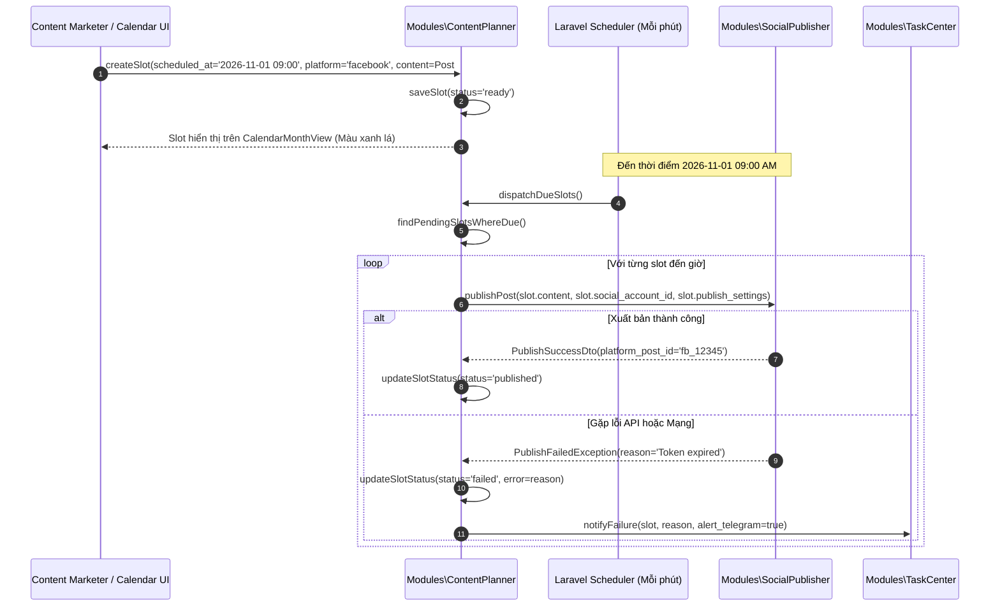

# Module Specification: ContentPlanner (`Modules/ContentPlanner`)

## 1. Tổng quan Module (Overview)
- **Tên Module:** `ContentPlanner`
- **Namespace:** `Modules\ContentPlanner`
- **Vị trí tầng:** Tầng 3 (Domain Deliverables & Application)
- **Mục đích:** Hệ thống quản lý kế hoạch nội dung tổng thể (Editorial Calendar & Content Campaign). Điều phối ma trận lịch phát hành đa nền tảng (Facebook Fanpage, Kênh YouTube, Tài khoản TikTok, Website Blog). Cho phép tạo chiến dịch (`Campaign`), phân bổ các khung giờ đăng bài (`ContentPlanSlot`), tự động kích hoạt sinh nội dung từ AI và ra lệnh cho `SocialPublisher` xuất bản bài đúng giờ hẹn.

---

## 2. Cấu trúc thư mục (Directory Structure)
```
Modules/ContentPlanner/
├── app/
│   ├── Actions/
│   │   ├── CreateCampaignAction.php
│   │   ├── GenerateRecurringSlotsAction.php
│   │   ├── AssignContentToSlotAction.php
│   │   └── DispatchDueSlotsAction.php
│   ├── DTOs/
│   │   ├── CampaignDto.php
│   │   ├── SlotScheduleDto.php
│   │   └── SlotDispatchResultDto.php
│   ├── Enums/
│   │   ├── SlotStatus.php           // empty, drafting, review, scheduled, publishing, published, failed
│   │   ├── TargetPlatform.php       // facebook, youtube, tiktok, blog
│   │   └── ContentFormat.php        // long_form_video, short_reel, article, carousel_image, single_post
│   ├── Events/
│   │   ├── SlotScheduled.php
│   │   └── SlotPublishedSuccessfully.php
│   ├── Http/
│   │   ├── Controllers/
│   │   │   ├── CampaignController.php
│   │   │   ├── ContentSlotController.php
│   │   │   └── CalendarViewController.php
│   │   └── Requests/
│   │       ├── StoreCampaignRequest.php
│   │       └── StoreSlotRequest.php
│   ├── Jobs/
│   │   └── CheckAndDispatchDueSlotsJob.php  // Chạy định kỳ mỗi phút
│   ├── Models/
│   │   ├── ContentCampaign.php
│   │   └── ContentPlanSlot.php
│   ├── Services/
│   │   ├── EditorialCalendarService.php
│   │   └── SlotSchedulerService.php
│   └── Providers/
│       ├── ContentPlannerServiceProvider.php
│       └── RouteServiceProvider.php
├── config/
│   └── content-planner.php
├── database/
│   └── migrations/
│       ├── 2026_10_29_000060_create_content_campaigns_table.php
│       └── 2026_10_29_000061_create_content_plan_slots_table.php
├── resources/
│   └── js/
│       ├── components/
│       │   ├── CalendarMonthView.vue
│       │   ├── CalendarWeekTimeline.vue
│       │   ├── ContentSlotCard.vue
│       │   └── QuickSlotAssignDialog.vue
│       ├── views/
│       │   ├── ContentCalendarDashboard.vue
│       │   └── CampaignManager.vue
│       └── routes.js
└── module.json
```

---

## 3. Database Schema (Bảng dữ liệu & Quan hệ)

### `content_campaigns`
Chiến dịch nội dung theo tuần, tháng hoặc chủ đề:
| Column | Type | Nullable | Mô tả |
| :--- | :--- | :--- | :--- |
| `id` | bigIncrements | No | Khóa chính |
| `name` | string(255) | No | Tên chiến dịch (vd: "Chiến dịch Ra mắt Sản phẩm Quý 1") |
| `slug` | string(255) | No | Unique slug |
| `description` | text | Yes | Mục tiêu và định hướng nội dung |
| `channel_group_id`| foreignId | Yes | FK `channel_groups.id` gom cụm các kênh triển khai |
| `start_date` | date | No | Ngày bắt đầu |
| `end_date` | date | No | Ngày kết thúc |
| `status` | string(30) | No | `planning`, `active`, `completed`, `archived` |

### `content_plan_slots`
Các slot đăng bài cụ thể trên lịch phát sóng:
| Column | Type | Nullable | Mô tả |
| :--- | :--- | :--- | :--- |
| `id` | bigIncrements | No | Khóa chính |
| `campaign_id` | foreignId | Yes | FK `content_campaigns.id` |
| `title` | string(255) | No | Tiêu đề slot (vd: "Thứ 2: Tip tối ưu chi phí quảng cáo") |
| `target_platform` | string(30) | No | Enum: `facebook`, `youtube`, `tiktok`, `blog` |
| `content_format` | string(30) | No | Enum: `long_form_video`, `short_reel`, `article`, `carousel_image` |
| `scheduled_at` | timestamp | No | Khung giờ xuất bản chính xác |
| `status` | string(30) | No | Enum: `empty`, `drafting`, `ready`, `publishing`, `published`, `failed` |
| `contentable_type` | string(255) | Yes | Morph type (`Post`, `VideoScript`, `VideoRender`, `SocialPost`) |
| `contentable_id` | unsignedBigInteger | Yes | Morph ID |
| `social_account_id`| foreignId | Yes | FK tài khoản đích trong `social_accounts` |
| `publish_settings` | json | Yes | Cấu hình riêng khi publish (bình luận đầu tiên, gắn thẻ hashtag) |
| `last_error` | text | Yes | Log lỗi nếu thất bại khi dispatch |

---

## 4. Flow Sequence Diagram (Lập lịch và Tự động Xuất bản bài)



---

## 5. Ma trận Lịch Phát hành Đa Kênh (Matrix Publishing Rules)

Hệ thống hỗ trợ áp dụng quy tắc xoay vòng phân phối (Content Repurposing Matrix):
- **1 Kịch bản Video dài (YouTube 16:9)** -> Tự động cắt thành **3 Clip ngắn (Shorts/TikTok/Reels 9:16)**.
- **1 Bài viết Blog chuyên sâu** -> Tự động sinh ra **1 Bài tóm tắt kèm ảnh Carousel cho Facebook Fanpage**.
- Mỗi slot trên Calendar có thể tự động liên kết (Parent-Child) với các slot vệ tinh trên các kênh khác nhau, đảm bảo phủ sóng đồng loạt nhưng thời gian đăng được làm lệch nhẹ (Jitter 15-30 phút) để tránh bị thuật toán nền tảng nghi ngờ spam.

---

## 6. API Endpoints

| Method | Endpoint | Quyền hạn | Mô tả |
| :--- | :--- | :--- | :--- |
| `GET` | `/api/v1/content-planner/calendar` | `planner.view` | Lấy danh sách slots theo khoảng ngày (cho Vue Calendar) |
| `POST` | `/api/v1/content-planner/slots` | `planner.create` | Tạo mới slot đăng bài thủ công hoặc hàng loạt |
| `PUT` | `/api/v1/content-planner/slots/{id}` | `planner.edit` | Kéo thả đổi giờ đăng trên Calendar hoặc đổi nội dung |
| `POST` | `/api/v1/content-planner/slots/{id}/dispatch-now` | `planner.publish` | Kích hoạt xuất bản ngay lập tức bỏ qua thời gian hẹn |
| `GET` | `/api/v1/content-planner/campaigns` | `planner.view` | Danh sách các chiến dịch marketing |

---

## 7. Frontend UI Specs (Vuetify 3 / Vuexy)
- **`CalendarMonthView.vue`**: Giao diện Lịch toàn màn hình theo chuẩn Vuexy với bộ lọc đa kênh (Filter theo Facebook, YouTube, TikTok). Mỗi ô ngày hiển thị các pill đại diện cho slot kèm icon nền tảng, màu sắc trạng thái (Xám: trống, Cam: đang soạn, Xanh lá: đã sẵn sàng, Xanh dương: đã đăng thành công, Đỏ: lỗi).
- **`CalendarWeekTimeline.vue`**: Xem chi tiết theo tuần dạng lưới giờ 24/7. Hỗ trợ kéo thả (Drag and drop) để đổi khung giờ đăng cực kỳ mượt mà.
- **`QuickSlotAssignDialog.vue`**: Dialog cho phép gán nhanh bài viết từ `Blog` hoặc video từ `VideoStudio` vào slot chỉ với 2 click chuột.

---

## 8. Chuẩn Comment & Quy ước Code
```php
/**
 * CHỨC NĂNG FILE: Quét và giải phóng các slot nội dung đã đến giờ xuất bản.
 *
 * INPUT: DispatchDueSlotsAction quét bảng content_plan_slots với điều kiện scheduled_at <= now() và status = ready.
 * OUTPUT: SlotDispatchResultDto thống kê số lượng slot đã gửi lệnh và số lượng thất bại.
 * SIDE EFFECT: Gọi SocialPublisher service và ghi log lịch sử trong task center.
 * EXCEPTION/TRANSACTION: Mỗi slot được bọc trong try/catch độc lập để lỗi của slot này không gián đoạn slot khác.
 */
```
Path: [14-content-planner.md](file:///e:/Web/makerting-app/docs/modules/14-content-planner.md)
