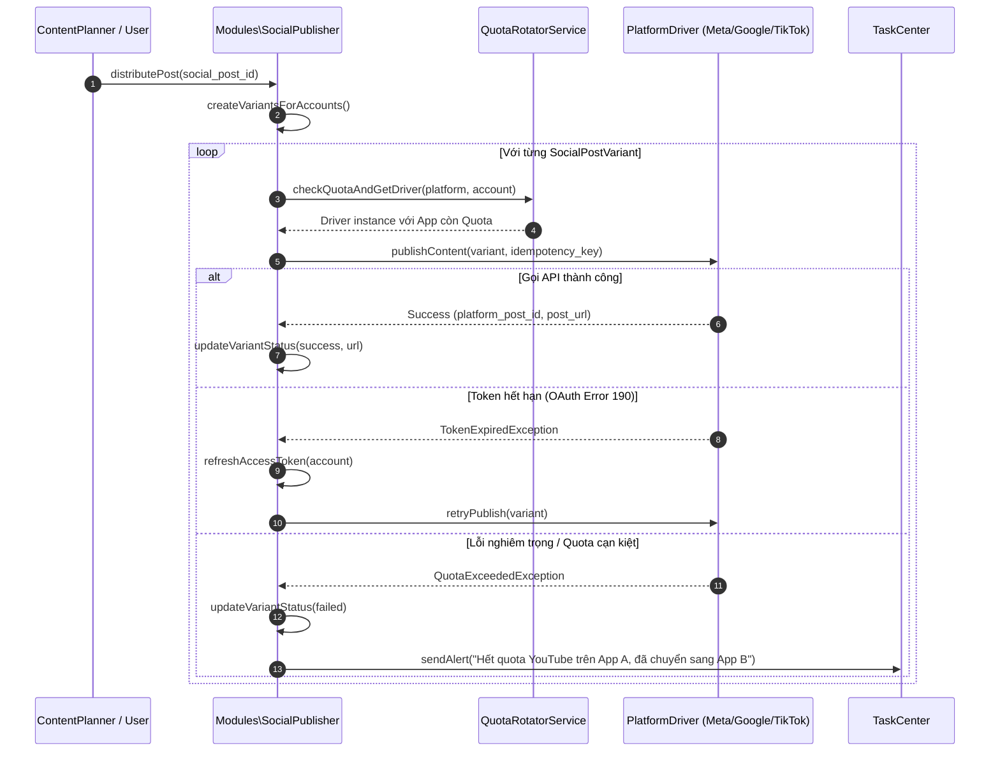

# Module Specification: SocialPublisher (`Modules/SocialPublisher`)

## 1. Tổng quan Module (Overview)
- **Tên Module:** `SocialPublisher`
- **Namespace:** `Modules\SocialPublisher`
- **Vị trí tầng:** Tầng 3 (Domain Deliverables & Application)
- **Mục đích:** Động cơ xuất bản và phân phối nội dung tự động lên ma trận mạng xã hội (Facebook Fanpages, Kênh YouTube, Tài khoản TikTok). Quản lý kết nối OAuth đa ứng dụng (`oauth_client_apps`) cho phép xoay vòng ứng dụng vượt hạn mức quota YouTube hàng ngày, tự động làm mới Access Token, phân bổ bài đăng đa biến thể (`SocialPostVariant`), điều tốc chống spam (`AccountRateLimiter` & `JitterScheduler`) và bảo đảm tính duy nhất không đăng trùng (`IdempotencyKey`).

---

## 2. Cấu trúc thư mục (Directory Structure)
```
Modules/SocialPublisher/
├── app/
│   ├── Actions/
│   │   ├── ConnectSocialAccountAction.php
│   │   ├── RefreshTokenAction.php
│   │   ├── PublishToFacebookAction.php
│   │   ├── PublishToYoutubeAction.php
│   │   ├── PublishToTiktokAction.php
│   │   └── DistributePostMatrixAction.php
│   ├── Contracts/
│   │   ├── SocialPlatformDriverContract.php
│   │   └── TokenRefresherContract.php
│   ├── DTOs/
│   │   ├── SocialPayloadDto.php
│   │   ├── PublishResponseDto.php
│   │   └── QuotaStatusDto.php
│   ├── Drivers/
│   │   ├── FacebookGraphDriver.php
│   │   ├── YoutubeDataDriver.php
│   │   └── TiktokContentDriver.php
│   ├── Enums/
│   │   ├── SocialPlatform.php       // facebook, youtube, tiktok
│   │   ├── AccountType.php          // facebook_page, youtube_channel, tiktok_business
│   │   └── PublishStatus.php        // queued, publishing, success, failed, token_expired
│   ├── Events/
│   │   ├── PostPublishedToSocial.php
│   │   └── SocialPublishFailed.php
│   ├── Http/
│   │   ├── Controllers/
│   │   │   ├── SocialAccountController.php
│   │   │   ├── OAuthCallbackController.php
│   │   │   ├── OAuthClientAppController.php
│   │   │   └── SocialPostController.php
│   │   └── Requests/
│   │       ├── CreateSocialPostRequest.php
│   │       └── StoreOAuthAppRequest.php
│   ├── Jobs/
│   │   └── PublishSocialVariantJob.php  // Queue: social-publish
│   ├── Models/
│   │   ├── OAuthClientApp.php
│   │   ├── SocialAccount.php
│   │   ├── SocialPost.php
│   │   └── SocialPostVariant.php
│   ├── Services/
│   │   ├── AccountRateLimiter.php
│   │   ├── JitterScheduler.php
│   │   └── QuotaRotatorService.php
│   └── Providers/
│       ├── SocialPublisherServiceProvider.php
│       └── RouteServiceProvider.php
├── config/
│   └── social-publisher.php
├── database/
│   └── migrations/
│       ├── 2026_10_29_000070_create_oauth_client_apps_table.php
│       ├── 2026_10_29_000071_create_social_accounts_table.php
│       ├── 2026_10_29_000072_create_social_posts_table.php
│       └── 2026_10_29_000073_create_social_post_variants_table.php
├── resources/
│   └── js/
│       ├── components/
│       │   ├── SocialAccountCard.vue
│       │   ├── QuotaUsageGauge.vue
│       │   ├── PlatformVariantEditor.vue
│       │   └── OAuthAppManagerDialog.vue
│       ├── views/
│       │   ├── SocialAccountsMatrix.vue
│       │   └── SocialPublishLog.vue
│       └── routes.js
└── module.json
```

---

## 3. Database Schema (Bảng dữ liệu & Quan hệ)

### `oauth_client_apps`
Bảng lưu trữ thông tin App đăng ký trên Meta Developer, Google Cloud Console, TikTok Developer:
| Column | Type | Nullable | Mô tả |
| :--- | :--- | :--- | :--- |
| `id` | bigIncrements | No | Khóa chính |
| `platform` | string(30) | No | Enum: `facebook`, `youtube`, `tiktok` |
| `app_name` | string(100) | No | Tên phân biệt ("Google Cloud Project A", "Meta App Production") |
| `client_id` | string(255) | No | OAuth Client ID |
| `client_secret` | text | No | Mã hóa bằng Laravel `Crypt` |
| `daily_quota_limit`| integer | No | Giới hạn đơn vị quota trong ngày (vd: 10,000 units của YouTube) |
| `daily_quota_used` | integer | No | Đơn vị quota đã tiêu thụ trong ngày |
| `quota_resets_at` | timestamp | Yes | Thời điểm quota reset về 0 (0:00 PST cho Google) |
| `is_active` | boolean | No | Bật / Tắt app này |

### `social_accounts`
Danh sách các Fanpage, Kênh YouTube và Tài khoản TikTok đang kết nối:
| Column | Type | Nullable | Mô tả |
| :--- | :--- | :--- | :--- |
| `id` | bigIncrements | No | Khóa chính |
| `oauth_client_app_id`| foreignId | No | FK `oauth_client_apps.id` cascade |
| `platform` | string(30) | No | Enum: `facebook`, `youtube`, `tiktok` |
| `account_type` | string(30) | No | `facebook_page`, `youtube_channel`, `tiktok_account` |
| `platform_account_id`| string(100) | No | ID từ mạng xã hội (Page ID, Channel ID) |
| `name` | string(255) | No | Tên kênh / Fanpage |
| `avatar_url` | text | Yes | Ảnh đại diện kênh |
| `access_token` | text | No | Access Token đã mã hóa |
| `refresh_token`| text | Yes | Refresh Token đã mã hóa |
| `token_expires_at` | timestamp | Yes | Hạn dùng của token |
| `channel_group_id` | foreignId | Yes | FK `channel_groups.id` |
| `is_active` | boolean | No | Trạng thái sẵn sàng đăng bài |

### `social_posts` & `social_post_variants`
- `social_posts`: Bài đăng gốc chứa tiêu đề, nội dung chung, liên kết nguồn (`Post`, `VideoRender`).
- `social_post_variants`: Phiên bản tùy biến cho từng tài khoản cụ thể:
  - `social_account_id` (tài khoản đích)
  - `custom_content` (hashtag, text đã tối ưu riêng cho nền tảng)
  - `media_asset_ids` (JSON mảng ID ảnh/video kèm theo)
  - `scheduled_at`, `published_at`
  - `platform_post_id`, `platform_post_url` (Link bài viết thật sau khi đăng thành công)
  - `status` (`queued`, `publishing`, `success`, `failed`, `token_expired`)
  - `idempotency_key` (Chuỗi SHA256 chống đăng lặp lại khi retry)

---

## 4. Quản lý Quota & Cơ chế Điều tốc (Rate Limiter & Jitter)

### 1. Kỹ thuật Xoay vòng Quota YouTube (YouTube Quota Multi-App Rotation)
Mỗi ứng dụng Google Cloud mặc định chỉ có 10,000 units quota/ngày. Một lần upload video YouTube tiêu tốn xấp xỉ 1,600 units (tối đa 6 video/app/ngày).
`QuotaRotatorService` kiểm tra `daily_quota_used` trước khi upload:
- Nếu App A sắp đạt ngưỡng (>9,000 units), tự động xoay chuyển tài khoản upload qua App B hoặc App C.
- Tự động reset bộ đếm lúc 14:00 giờ Việt Nam (0:00 PST).

### 2. Thuật toán Jitter Scheduler (Chống trùng lặp & Chống khóa tài khoản)
- Khi phát hành 1 bài viết lên đồng loạt 10 Fanpages, hệ thống không gọi API đồng thời tại giây thứ 0.
- `JitterScheduler` tự động thêm một khoảng ngẫu nhiên từ 30 đến 180 giây giữa các tài khoản:
  $$\text{ScheduledTime} = \text{BaseTime} + \text{random}(30, 180) \times \text{index}$$
- Tránh việc Meta hoặc TikTok phát hiện hành vi bot phát sóng đồng loạt cùng một thời điểm.

---

## 5. Flow Sequence Diagram (Quy trình xuất bản đa nền tảng)



---

## 6. API Endpoints

| Method | Endpoint | Quyền hạn | Mô tả |
| :--- | :--- | :--- | :--- |
| `GET` | `/api/v1/social/accounts` | `social.account.view` | Danh sách các Fanpages, Kênh YouTube, TikTok đang kết nối |
| `POST` | `/api/v1/social/oauth/{platform}/redirect` | `social.account.manage`| Bắt đầu luồng xác thực OAuth 2.0 |
| `GET` | `/api/v1/social/oauth/{platform}/callback` | `social.account.manage`| Nhận Auth Code từ mạng xã hội và lưu Access Token |
| `POST` | `/api/v1/social/publish` | `social.post.publish` | Lên lịch hoặc xuất bản ngay một chùm bài đa nền tảng |
| `GET` | `/api/v1/social/oauth-apps` | `social.admin` | Danh sách và quota của các OAuth Client Apps |
| `POST` | `/api/v1/social/oauth-apps` | `social.admin` | Thêm mới OAuth App để mở rộng hạn mức quota |

---

## 7. Frontend UI Specs (Vuetify 3 / Vuexy)
- **`SocialAccountsMatrix.vue`**: Bảng điều khiển quản lý toàn bộ ma trận tài khoản mạng xã hội. Phân nhóm theo `ChannelGroup`, hiển thị trạng thái Token (Xanh: Còn hạn, Cam: Sắp hết hạn, Đỏ: Cần xác thực lại), kèm nút "Kết nối thêm Fanpage / Kênh YouTube / TikTok".
- **`QuotaUsageGauge.vue`**: Thanh đo hạn mức quota tiêu thụ trong ngày của từng ứng dụng Google / Meta / TikTok theo thời gian thực.
- **`PlatformVariantEditor.vue`**: Giao diện soạn thảo đa kênh thông minh. Người dùng viết nội dung 1 lần, sau đó có thể bấm tab "Facebook", "YouTube", "TikTok" để xem và tinh chỉnh riêng (Thêm hashtag thịnh hành cho TikTok, chỉnh tiêu đề SEO cho YouTube, chỉnh văn bản tóm tắt cho Fanpage).

---

## 8. Chuẩn Comment & Quy ước Code
```php
/**
 * CHỨC NĂNG FILE: Driver tương tác với YouTube Data API v3 để tải video lên kênh.
 *
 * INPUT: PublishToYoutubeAction nhận SocialPostVariant chứa file video mp4 và siêu dữ liệu (title, tags, thumbnail).
 * OUTPUT: PublishResponseDto trả về YouTube Video ID (`https://youtu.be/...`) và số unit quota đã tiêu thụ.
 * SIDE EFFECT: Trừ điểm trong bộ đếm daily_quota_used của oauth_client_apps tương ứng.
 * EXCEPTION/TRANSACTION: Bắt QuotaExceededException để kích hoạt chuyển sang App dự phòng tiếp theo.
 */
```
Path: [15-social-publisher.md](file:///e:/Web/makerting-app/docs/modules/15-social-publisher.md)
