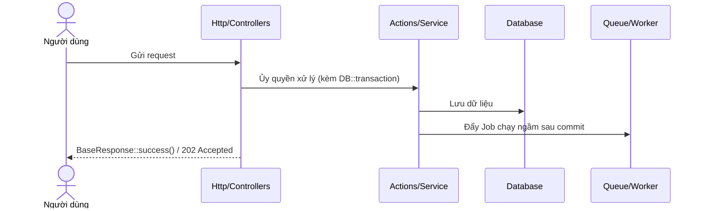

# Mẫu Tài Liệu Đặc Tả Module (`TEMPLATE.md`)

> **Quy định:** Mỗi khi bắt đầu lập trình hoặc hoàn thiện một Module trong thư mục `Modules/<ModuleName>`, developer/AI **bắt buộc** cập nhật file tài liệu tương ứng trong `docs/modules/<module-name>.md` theo mẫu chuẩn dưới đây để người khác vào đọc là nắm được toàn bộ cấu trúc và luồng xử lý.

---

# Module: [Tên Module] (`Modules/[ModuleName]`)

- **Tầng kiến trúc:** Tầng [0 / 1 / 2 / 3]
- **Trách nhiệm chính:** [Mô tả ngắn gọn trong 1 - 2 câu trách nhiệm cốt lõi của module]
- **Phụ thuộc vào các module:** `Modules/[A]`, `Modules/[B]` (nếu có)
- **Cung cấp cho các module:** `Modules/[X]`, `Modules/[Y]` (nếu có)

---

## 1. Cấu Trúc File & Thư Mục
Liệt kê các class, action, contract, DTO quan trọng của module:

```text
Modules/[ModuleName]/
├── app/
│   ├── Actions/          # Ca nghiệp vụ (Create/Update/Process...)
│   ├── Contracts/        # Interface công khai xuất khẩu cho module khác
│   ├── DTOs/             # Data Transfer Objects vào/ra chuẩn hóa
│   ├── Enums/            # Các enum nghiệp vụ
│   ├── Events/           # Sự kiện phát ra
│   ├── Http/
│   │   ├── Controllers/
│   │   ├── Requests/     # Validate form request
│   │   └── Resources/    # Định hình JSON BaseResponse
│   ├── Jobs/             # Xử lý hàng đợi ngầm
│   ├── Models/           # Eloquent Models + Scopes + Relations
│   ├── Providers/        # ServiceProvider & RouteServiceProvider
│   ├── Registries/       # Registry mở rộng (nếu có)
│   ├── Services/         # Dịch vụ xử lý logic chính
│   └── Traits/           # Trait dùng chung (nếu có)
├── config/
├── database/
│   ├── migrations/
│   └── seeders/
├── resources/
│   └── js/               # Giao diện Vue 3 của module
│       ├── pages/        # Trang route tự động nạp
│       ├── views/        # Component giao diện con, dialog
│       ├── services/     # API Client gọi backend
│       └── stores/       # Pinia store
└── routes/
    └── api.php           # Route API (/api/v1/admin/...)
```

---

## 2. Thiết Kế Cơ Sở Dữ Liệu (Database Schema)

### 2.1. Bảng `[table_name]`
- `id` (bigint PK)
- `[column_1]` (varchar, ràng buộc...)
- `[column_2]` (json...)
- `timestamps`, `softDeletes`...
- **Khóa ngoại / Quan hệ:** `foreignKey` trỏ tới bảng nào...
- **Chỉ mục (Indexes / Unique):** ...

---

## 3. Hợp Đồng Giao Tiếp (Contracts, DTOs & Traits)

### 3.1. DTO Đầu vào / Đầu ra
```php
namespace Modules\[ModuleName]\DTOs;

final readonly class [SampleRequestDto]
{
    public function __construct(
        public string $title,
        public array $options = [],
    ) {}
}
```

### 3.2. Contract Công Khai (Interface)
```php
namespace Modules\[ModuleName]\Contracts;

interface [SampleServiceContract]
{
    public function handle(SampleRequestDto $dto): SampleResponseDto;
}
```

---

## 4. Các Luồng Xử Lý Chính (Business Flows)

### 4.1. Luồng [Tên Luồng Nghiệp Vụ Chính 1]
Mô tả tóm tắt nghiệp vụ, sau đó vẽ sơ đồ luồng (Sequence diagram hoặc Flowchart):



### 4.2. Luồng [Tên Luồng Nghiệp Vụ Chính 2]
[Mô tả chi tiết bước 1, 2, 3...]

---

## 5. Danh Sách API Endpoints

| Phương thức | Đường dẫn API | Chức năng | Phân quyền (Permission) |
| :--- | :--- | :--- | :--- |
| `GET` | `/api/v1/admin/[resource]` | Danh sách (DataTableServer) | `[module].view` |
| `POST` | `/api/v1/admin/[resource]` | Tạo mới | `[module].create` |
| `GET` | `/api/v1/admin/[resource]/{id}` | Chi tiết | `[module].view` |
| `PUT` | `/api/v1/admin/[resource]/{id}` | Cập nhật | `[module].edit` |
| `DELETE` | `/api/v1/admin/[resource]/{id}` | Xóa | `[module].delete` |
| `GET` | `/api/v1/admin/[resource]/options`| Danh sách nhẹ cho dropdown | `[module].view` |

---

## 6. Sự Kiện & Lắng Nghe (Events & Listeners)
- **Events phát ra:** `[EventName]` (kèm dữ liệu gì, phát ra khi nào).
- **Listeners lắng nghe:** Lắng nghe sự kiện nào từ các module khác.

---

## 7. Hướng Dẫn Kiểm Thử & Chạy Thử
- **Lệnh test backend:**
  ```bash
  php artisan test Modules/[ModuleName]/tests
  ```
- **Lệnh chạy hàng đợi liên quan:**
  ```bash
  php artisan queue:listen --queue=[queue-name]
  ```
