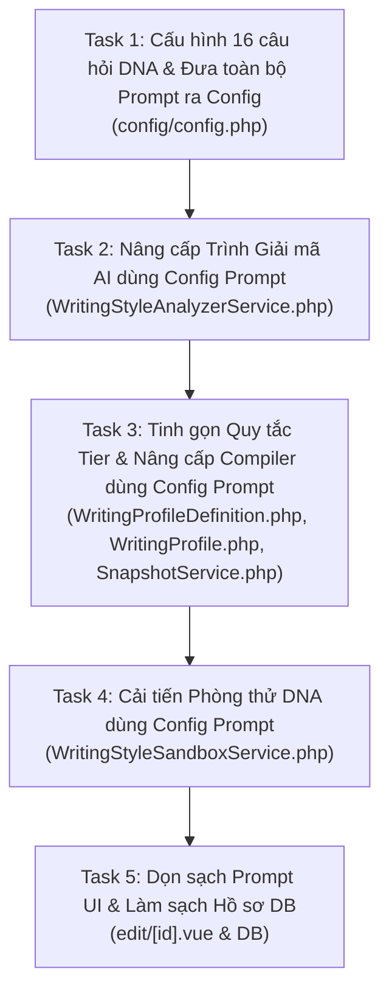

# Kế hoạch Kỹ thuật: Nâng Cấp Prompt Văn Phong & Tách Chất Liệu DNA

> **Mã kế hoạch:** `PLAN-WRITING-STYLE-PROMPT-V2`  
> **Trạng thái:** Đã hoàn thành & Kiểm chứng (Completed & Verified)  
> **Mục tiêu:** 
> 1. Chuyển đổi toàn diện cơ chế giải mã và sinh văn bản từ **"Bám dính câu chữ bài mẫu (Content Overfitting)"** sang **"Chỉ trích xuất Chất liệu & Thủ pháp Văn phong (Style Material Extraction)"**.
> 2. **Tinh gọn bộ quy tắc theo từng Tier độ dài (Tier-Aware Rule Filtering)** (7 $\rightarrow$ 10 $\rightarrow$ 14 $\rightarrow$ 15 quy tắc), loại bỏ hoàn toàn nhiễu `uncertainties` khi viết bài.
> 3. **Tập trung hóa toàn bộ Prompt vào Config (`config/config.php`)**: Đưa 100% câu chữ Prompt (từ Analyzer, Compiler đến Sandbox) ra file config để sau này dễ dàng tinh chỉnh câu từ tiếng Việt mà không cần can thiệp code PHP.

---

## 1. Bối cảnh & Vấn đề Cốt lõi

### 1.1. Hiện trạng (Bug "10 lần như 1" & Prompt bị phân tán, sơ sài)
- **Lặp lại 10/10 lần:** Với hồ sơ `status nhẹ` (ID #6), khi thử nghiệm trong Phòng thử DNA với các chủ đề hoàn toàn khác nhau (như *"cafe sữa thơm buổi sáng"* hay *"trà đào cam sả hoàng hôn"*), AI đều mở đầu bằng câu:
  > *"Ngoài hiên mưa cứ rơi rả rích, còn bên trong Mộc lại ngập tràn mùi hương cà phê mới xay ấm sực... Đôi khi..."*
- **Văn bản bị gượng ép, đanh cứng:** Mẫu `micro` (1–3 câu) bị ép tuân thủ tới 12 quy tắc và bị nhét cả đoạn ghi chú `uncertainties` dài dòng vào System Prompt.
- **Prompt phân tán & hardcode trong code PHP:**
  - `system` prompt trong `WritingStyleAnalyzerService.php` viết cộc lốc một câu (*"Bạn là chuyên gia phân tích văn phong. Chỉ trả JSON đúng schema, không thêm lời dẫn."*).
  - Các chỉ dẫn phân tích trong `buildPrompt()`, các chỉ dẫn sáng tác trong `WritingProfileSnapshotService::compilePrompt()`, và User Prompt trong `WritingStyleSandboxService::buildUserPrompt()` đều bị **hardcode rải rác trong code PHP**. Khi muốn tinh chỉnh câu chữ, người dùng phải đọc code backend và can thiệp file mã nguồn.

### 1.2. Nguyên nhân kỹ thuật
1. **Config 16 câu hỏi (`config/config.php`):** Hỏi kiểm kê từ ngữ bài mẫu thay vì hỏi thủ pháp, khiến AI bê nguyên danh từ/bối cảnh (*"mưa ngoài hiên"*, *"rả rích"*, *"ấm sực"*, *"Đôi khi"*, *"☕🌧️"*) vào `rules_json`.
2. **Prompt phân tích sơ sài & hardcode (`WritingStyleAnalyzerService.php`):** Thiếu rào cản ngăn AI chép từ vựng riêng của bài mẫu vào quy tắc; thiếu khung hướng dẫn AI biên soạn `style_instructions` sâu sắc.
3. **Quá tải quy tắc theo Tier độ dài (`WritingProfileDefinition.php` & `WritingProfile.php`):** Status `micro` (1–3 câu) đang phải gánh tới **12 quy tắc**, bao gồm cả `opening`, `transitions`, `technical_terms`, `examples`. Ép 2–3 câu ngắn phải thỏa mãn chừng đó quy tắc khiến văn bản bị công thức hóa và đanh cứng.
4. **Nhiễu từ trường `uncertainties` trong System Prompt (`WritingProfileSnapshotService.php`):** `uncertainties` vốn là ghi chú báo cáo cho người dùng xem lúc phân tích, nhưng lại bị compiler nhúng thẳng vào System Prompt sinh bài: `"- uncertainties: headings: không áp dụng ở văn bản micro..."`, làm loãng sự tập trung của LLM.
5. **Compiler thiếu quyền tự do sáng tạo (`WritingProfileSnapshotService.php`):** Dùng lệnh máy móc (*"Hãy viết đúng 100%..."*), ép AI phải dùng toàn bộ từ ngữ trong `rules_json`.
6. **Sandbox Service (`WritingStyleSandboxService.php`):** Cố định `temperature = 0.7` và User Prompt quá gò bó, khiến AI luôn chọn nhánh an toàn nhất (sao chép cấu trúc bài cũ).
7. **Xung đột UI Edit (`edit/[id].vue`):** Nhân đôi khối `TONE CALIBRATION` trong prompt gửi AI.

---

## 2. Kiến trúc Mới: Tập trung hóa Prompt vào `config/config.php`

Toàn bộ câu chữ điều khiển AI được gom về mảng `'prompts'` trong [`Modules/WritingStyle/config/config.php`](file:///e:/Web/makerting-app/Modules/WritingStyle/config/config.php):

```php
'prompts' => [
    // 1. Giai đoạn Giải mã bài mẫu (WritingStyleAnalyzerService)
    'analyzer' => [
        'system' => 'Bạn là chuyên gia giải phẫu phong cách viết và phê bình văn học hàng đầu. Nhiệm vụ của bạn là bóc tách trọn vẹn "LINH HỒN & THỦ PHÁP" của tác giả (nhịp điệu, tâm thế, cách xử lý giác quan) và KHÔNG BAO GIỜ bị bám dính vào nội dung cụ thể của bài mẫu. Chỉ trả JSON đúng schema, không thêm lời dẫn.',
        'intro' => [
            'Hãy giải mã DNA văn phong của bài mẫu dưới đây theo phương pháp CONTENT-AGNOSTIC (Tách rời nội dung sự vật, chỉ giữ lại thủ pháp hành văn).',
            'NGUYÊN TẮC QUAN TRỌNG VỀ RULES_JSON:',
            '- Chỉ đúc kết thành nguyên lý, công thức nhịp điệu và thủ pháp gợi cảm xúc mở.',
            '- TUYỆT ĐỐI CẤM đưa tên riêng, bối cảnh bài mẫu (mưa, nắng, cà phê...), hoặc các từ đơn lẻ trong ngoặc kép vào rules_json.',
            '- Trả lời ngắn gọn, cô đọng theo từng khía cạnh dưới đây:',
        ],
        'evidence_instruction' => 'Với mỗi khía cạnh, trích 1 câu NGUYÊN VĂN trong bài mẫu làm bằng chứng (evidence_json[].excerpt) — PHẢI là chữ có thật trong bài, không được suy diễn.',
        'style_instructions_guide' => 'Hãy biên soạn một Bản chỉ dẫn phong cách (style_instructions) sâu sắc gồm: (1) Chân dung người kể chuyện (Persona Archetype); (2) Thủ pháp khơi gợi giác quan (Show, Don\'t Tell); (3) Sự tiết chế sang trọng (Quiet Luxury); (4) Khoảng cách đối thoại và cách tạo dư âm.',
    ],

    // 2. Giai đoạn Biên dịch System Prompt viết bài (WritingProfileSnapshotService)
    'compiler' => [
        'role_template' => 'Bạn là người viết nội dung có văn phong "{name}".',
        'task_template' => 'Hãy viết {sentence_hint} mang trọn vẹn linh hồn, khẩu khí và nhịp thở của văn phong này.',
        'anti_plagiarism' => 'TUYỆT ĐỐI không sao chép nguyên văn bất kỳ câu nào từ bài mẫu — chỉ kế thừa chất liệu và thủ pháp hành văn.',
        'transformation_directives' => [
            'NGUYÊN TẮC SÁNG TÁC (GIỮ CHẤT LIỆU — ĐỔI BỐI CẢNH):',
            '- Kế thừa trọn vẹn: Nhịp thở câu văn, độ sâu cảm xúc, cách xưng hô và thủ pháp gợi tả giác quan.',
            '- Làm mới hoàn toàn: Nếu trong quy tắc có nhắc từ ngữ hay hình ảnh ví dụ từ bài gốc (như mưa rơi, thức uống cụ thể, từ nối ví dụ...), đó CHỈ là minh họa cho thủ pháp. TUYỆT ĐỐI KHÔNG lặp lại khung cảnh hay từ vựng ví dụ đó; hãy tự sáng tạo bối cảnh, âm thanh, ánh sáng và cách mở câu mới phù hợp 100% với chủ đề được yêu cầu.',
        ],
    ],

    // 3. Giai đoạn Phòng thử DNA (WritingStyleSandboxService)
    'sandbox' => [
        'temperature' => 0.85,
        'user_prompt_template' => "Chủ đề: {topic}\n\nHãy viết {sentence_hint} về chủ đề trên theo đúng chất liệu văn phong và tâm thế trong hướng dẫn hệ thống.\nHãy tự do sáng tạo hình ảnh giác quan, bối cảnh và cách mở đầu mới mẻ bám sát chủ đề này (không lặp lại cảnh vật hay từ ngữ ví dụ của bài mẫu).\nChỉ trả văn bản hoàn chỉnh, không thêm lời dẫn hay chú thích.",
    ],
],
```

---

## 3. Danh sách 5 Task Thực thi



---

### Task 1: Cấu hình 16 câu hỏi DNA & Đưa toàn bộ Prompt Templates ra `config/config.php`
* **File tác động:** `Modules/WritingStyle/config/config.php`
* **Mục tiêu:** 
  1. Trừu tượng hóa 16 câu hỏi giải mã DNA theo hướng "Thủ pháp & Chất liệu".
  2. Bổ sung mảng `'prompts'` (chứa đầy đủ prompt template của Analyzer, Compiler, Sandbox).
  3. Bổ sung cấu hình danh sách quy tắc loại bỏ theo từng tier (`tier_drop_rules`).
* **Chi tiết thay đổi:**
  * Sửa 16 câu hỏi trong `'rules'`:
    - `tone`: Trích xuất tâm thế đối thoại (thân tình, quiet luxury, hóm hỉnh tự trào, đanh thép...).
    - `pronouns`: Cặp đại từ xưng hô và trợ từ làm mềm câu (*nhé, nghen, nha...*).
    - `emotion`: Dư âm cảm xúc chủ đạo (vỗ về, kích thích tò mò, chiêm nghiệm lắng đọng...).
    - `opening`: **Thủ pháp mở bài tổng quát** (tương phản giác quan/không gian, khung hình điện ảnh, đặt nghịch lý) — *cấm nêu lại thời tiết hay sự vật cụ thể của bài mẫu*.
    - `sentence_rhythm`: Nhịp thở câu văn (nhịp chậm êm ái, câu ghép nhiều vế ngắt bằng dấu phẩy, câu ngắn xen dài) — *không đếm cứng số chữ của câu mẫu*.
    - `transitions`: Nghệ thuật chuyển ý (từ ngoại cảnh vào nội tâm, chuyển mạch cảm xúc tự nhiên không dùng từ nối công nghiệp).
    - `vocabulary`: **Chất liệu từ vựng & Thủ pháp giác quan (*Show, Don't Tell*)** (từ láy tượng thanh/tượng hình, tính từ xúc giác/nhiệt độ, phong cách chọn emoji theo ngữ cảnh).
    - `ending`: Triết lý kết bài (lời mời ân cần che chở, khoảng lặng lắng đọng, câu hỏi gợi mở, hay CTA trực diện).
  * Thêm mảng `'prompts'` tập trung (như thiết kế ở §2).
  * Thêm cấu hình quy tắc loại bỏ theo Tier:
    ```php
    'tier_drop_rules' => [
        'micro'  => ['headings', 'bullets', 'paragraph_rhythm', 'structure_patterns', 'opening', 'transitions', 'technical_terms', 'examples'],
        'short'  => ['headings', 'bullets', 'structure_patterns', 'technical_terms', 'examples'],
        'medium' => ['headings'],
        'long'   => [],
    ],
    ```
* **Tiêu chí nghiệm thu:**
  * Toàn bộ câu từ của Prompt được quản lý tập trung trong file config, giữ nguyên 16 `rule_keys`.

---

### Task 2: Nâng cấp Trình Giải mã AI đọc Prompt từ Config (`WritingStyleAnalyzerService.php`)
* **File tác động:** `Modules/WritingStyle/app/Services/WritingStyleAnalyzerService.php`
* **Mục tiêu:** Xóa bỏ chuỗi hardcode, đọc prompt từ `config('writingstyle.prompts.analyzer')`, ép AI trích xuất chất liệu độc lập nội dung (*Content-Agnostic*).
* **Chi tiết thay đổi:**
  1. Trong `analyze()`: Đọc `system` prompt từ `config('writingstyle.prompts.analyzer.system')`.
  2. Trong `buildPrompt()`:
     - Lấy mảng `intro` từ `config('writingstyle.prompts.analyzer.intro')`.
     - Duyệt các rule câu hỏi qua `WritingProfileDefinition::ruleQuestion($key)`.
     - Lấy `evidence_instruction` từ config.
     - Lấy `style_instructions_guide` từ config.
     - Đính kèm bài mẫu.
* **Tiêu chí nghiệm thu:**
  * Không còn chuỗi text prompt hardcode trong `WritingStyleAnalyzerService.php`.
  * AI phân tích trả về `rules_json` là các nguyên lý trừu tượng, không chứa từ ngữ chết của bài mẫu.

---

### Task 3: Tinh gọn Quy tắc theo Tier & Nâng cấp Compiler đọc Prompt từ Config
* **Files tác động:**
  * `Modules/WritingStyle/app/Services/WritingProfileDefinition.php`
  * `Modules/WritingStyle/app/Models/WritingProfile.php`
  * `Modules/WritingStyle/app/Services/WritingProfileSnapshotService.php`
* **Mục tiêu:** 
  1. Phân bổ đúng số lượng quy tắc theo Tier (7 $\rightarrow$ 10 $\rightarrow$ 14 $\rightarrow$ 15 quy tắc) thông qua `config('writingstyle.tier_drop_rules')`.
  2. Loại bỏ hoàn toàn trường `uncertainties` khỏi System Prompt khi viết bài (chỉ giữ trên UI để xem báo cáo).
  3. Đọc template biên dịch System Prompt từ `config('writingstyle.prompts.compiler')`.
* **Chi tiết phân bổ Quy tắc theo Tier:**

| Tier | Độ dài | Số quy tắc cũ | **Số quy tắc mới** | Các quy tắc được giữ lại (Tập trung đúng bản chất độ dài) | Các quy tắc lược bỏ khi sinh bài |
| :--- | :--- | :---: | :---: | :--- | :--- |
| **`micro`** | 1–3 câu | 12 | **7 quy tắc** | **Hồn & Nhịp câu:** `tone`, `pronouns`, `emotion`, `sentence_rhythm`, `vocabulary`, `ending`, `avoid`. | `headings`, `bullets`, `paragraph_rhythm`, `structure_patterns`, `opening`, `transitions`, `technical_terms`, `examples`, `uncertainties`. |
| **`short`** | 4–10 câu | 13 | **10 quy tắc** | 7 quy tắc micro + **Dẫn dắt ngắn:** `opening`, `transitions`, `paragraph_rhythm`. | `headings`, `bullets`, `structure_patterns`, `technical_terms`, `examples`, `uncertainties`. |
| **`medium`** | 11–30 câu | 16 | **14 quy tắc** | 10 quy tắc short + **Cấu trúc & Dẫn chứng:** `bullets`, `structure_patterns`, `technical_terms`, `examples`. | `headings`, `uncertainties`. |
| **`long`** | > 30 câu | 16 | **15 quy tắc** | Đầy đủ 15 quy tắc cấu trúc toàn bài (bật thêm `headings`). | `uncertainties` (không nhúng vào prompt sinh bài). |

* **Chi tiết nâng cấp `compilePrompt()`:**
  1. Đọc các câu lệnh từ `config('writingstyle.prompts.compiler.*')` để điền placeholder `{name}` và `{sentence_hint}`.
  2. Tuyệt đối không chèn `uncertainties` vào danh sách gạch đầu dòng quy tắc.
  3. Giữ các từ khóa chuẩn (`$profile->name`, `$sentenceHint`, `không sao chép nguyên văn`) để bảo toàn độ tương thích với Unit Tests.
  4. Tránh lặp lại khối `TONE CALIBRATION` khi frontend đã gửi kèm.
* **Tiêu chí nghiệm thu:**
  * `WritingProfileDefinition::applicableKeys('micro')` trả về đúng 7 keys cốt lõi (không tính uncertainties).
  * System Prompt cho `micro` chỉ dài vừa đủ, không bị rườm rà hay chứa dòng `uncertainties`.
  * Unit tests `WritingProfileDefinitionTest` và `WritingProfileSnapshotServiceTest` chạy qua 100% (Green).

---

### Task 4: Cải tiến Phòng thử DNA đọc Config (`WritingStyleSandboxService.php`)
* **File tác động:** `Modules/WritingStyle/app/Services/WritingStyleSandboxService.php`
* **Mục tiêu:** Đọc `temperature` và template User Prompt từ `config('writingstyle.prompts.sandbox')`.
* **Chi tiết thay đổi:**
  1. Đọc `temperature` từ config (mặc định **`0.85`**) khi gọi AI Gateway.
  2. Viết lại `buildUserPrompt()` bằng cách thế biến `{topic}` và `{sentence_hint}` vào `config('writingstyle.prompts.sandbox.user_prompt_template')`.
* **Tiêu chí nghiệm thu:**
  * Người dùng có thể điều chỉnh câu lệnh thử nghiệm của Sandbox trực tiếp từ file config.
  * Unit test `WritingStyleSandboxServiceTest` chạy qua 100%.

---

### Task 5: Dọn sạch Prompt UI Edit & Làm sạch Hồ sơ DB
* **Files tác động:**
  * `Modules/WritingStyle/resources/js/pages/writing-profiles/edit/[id].vue`
  * Dữ liệu Database (Hồ sơ ID #6 - `status nhẹ`)
* **Chi tiết thay đổi:**
  1. **Frontend `edit/[id].vue`:**
     * Trong `sandboxStyleInstructions`: Dọn bỏ đoạn tự động ghép chuỗi `6. HIỆU CHỈNH SẮC THÁI...` ở phía client để tránh bị nhân đôi với phần `tone_overrides` do Backend tự render.
  2. **Database Record (Profile #6 `status nhẹ`):**
     * Cập nhật lại `rules_json` và `style_instructions` của hồ sơ `#6` sang bản chất liệu chuẩn đã được làm sạch (loại bỏ các từ cứng *"rả rích"*, *"ấm sực"*, *"Đôi khi"*, *"mưa ngoài hiên"*).
* **Tiêu chí nghiệm thu:**
  * System Prompt hiển thị trong debug box của Sandbox chỉ có 1 khối `TONE CALIBRATION` duy nhất.
  * Bấm thử nghiệm ngay trên hồ sơ `#6` với các chủ đề khác nhau (nắng sớm, hoàng hôn, trà chiều) $\rightarrow$ 100% không còn câu *"Ngoài hiên mưa cứ rơi rả rích"*.

---

## 4. Kế hoạch Kiểm chứng (Verification Matrix)

| Bước | Nội dung kiểm tra | Kết quả kỳ vọng |
| :--- | :--- | :--- |
| **V1: Unit Tests** | Chạy `php artisan test Modules/WritingStyle` | Tất cả unit/feature test đều PASS (Green), bao gồm test lọc quy tắc theo tier (7 / 10 / 14 / 15 keys) và không có `uncertainties` trong prompt. |
| **V2: Tinh chỉnh qua Config** | Sửa thử một câu trong `config/config.php` | Prompt sinh ra trong Sandbox/Compiler lập tức cập nhật theo config mới mà không cần sửa code PHP. |
| **V3: Sandbox Nắng Sớm** | Test với chủ đề: *"cafe sữa thơm buổi sáng nắng nhẹ"* | Sinh ra cảnh nắng sớm, ánh sáng, ly sữa, không có mưa, câu chữ mềm mại tự nhiên, đúng 7 quy tắc micro. |
| **V4: Sandbox Hoàng Hôn** | Test với chủ đề: *"ly trà đào cam sả buổi chiều hoàng hôn"* | Sinh ra cảnh chiều tà, ráng chiều, vị trà thanh mát, giữ trọn vẹn chất Quiet Luxury của Mộc. |
| **V5: Tone Calibration** | Đổi preset sang *"Hóm hỉnh & Gần gũi"* và gạt slider | Văn bản đổi khẩu khí vui vẻ, tự nhiên hơn, phản ánh đúng hiệu chỉnh, không bị lặp khối tone. |

---

## 5. Nhật ký Triển khai
*(Đã hoàn thành và kiểm chứng toàn bộ 5 Task)*
- [x] Task 1: Cấu hình 16 câu hỏi DNA & Đưa toàn bộ Prompt ra Config (`config/config.php`)
- [x] Task 2: Nâng cấp Trình Giải mã AI đọc Prompt từ Config (`WritingStyleAnalyzerService.php`)
- [x] Task 3: Tinh gọn Quy tắc Tier & Nâng cấp Compiler đọc Prompt từ Config (`WritingProfileDefinition.php`, `WritingProfile.php`, `WritingProfileSnapshotService.php`)
- [x] Task 4: Cải tiến Phòng thử DNA đọc Config (`WritingStyleSandboxService.php`)
- [x] Task 5: Dọn sạch Prompt UI Edit & Làm sạch Hồ sơ DB (`edit/[id].vue` & DB)
