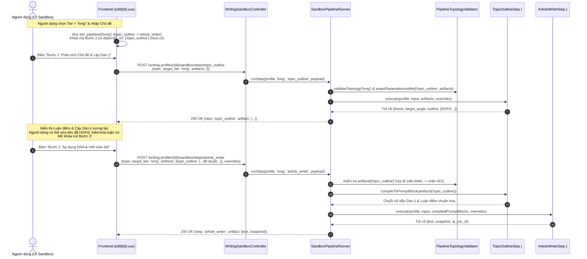

# Kế hoạch Kỹ thuật: Kiến trúc Modular Pipeline (Luồng Nhỏ Lắp Ghép & Ràng buộc Phụ thuộc) cho DNA Sandbox

> **Mã kế hoạch:** `PLAN-WRITING-STYLE-SANDBOX-PIPELINE`  
> **Module đích:** `Modules/WritingStyle`  
> **Chuẩn kiến trúc & Comment:** Tuân thủ nghiêm ngặt [`docs/architecture/VUEXY_LARAVEL_ARCHITECTURE_GUIDE.md`](file:///d:/web/makerting-app/docs/architecture/VUEXY_LARAVEL_ARCHITECTURE_GUIDE.md) (§2–3 về UI Vuexy, §7.2–7.5 về chuẩn Comment PHP/Vue/JS).

---

## 1. Mục tiêu & Tư duy Kiến trúc

1. **Tách quá trình sinh bài trong Phòng thử DNA thành các "Luồng nhỏ độc lập" (Modular Pipeline Steps):**
   - Mỗi luồng nhỏ là một class PHP độc lập ở Backend + một vùng/component hiển thị tương ứng ở Frontend.
   - Hiện tại triển khai ngay 2 luồng nền tảng:
     - **Luồng #1 (`topic_outline`)**: Phân tích chủ đề $\rightarrow$ Trích xuất Luận điểm cốt lõi (`thesis`), Góc tiếp cận (`target_angle`) và Cây dàn ý chủ đạo (`outline` H2/H3 + luận cứ + gợi ý dẫn chứng).
     - **Luồng #2 (`article_writer`)**: Nhận toàn bộ kết quả các bước phân tích đứng trước + Snapshot DNA Văn phong (quy tắc theo tier, Ô 1, Ô 2, 5 thanh trượt Chất văn, 8 thanh trượt Sắc thái, `temperature`) $\rightarrow$ Viết bài hoàn chỉnh.
   - Sẵn sàng mở rộng trong tương lai mà không sửa code cũ:
     - *Luồng #3 (`hook_analyzer`)*: Phân tích & tạo các biến thể câu Hook đăng Facebook.
     - *Luồng #4 (`section_expander`)*: Phân tách chi tiết các dàn ý nhỏ từ dàn ý chủ đạo.
2. **Lắp ghép theo từng cấp độ độ dài (`tier_pipelines`) kèm Ràng buộc Phụ thuộc 3 Lớp:**
   - Cấu hình linh hoạt từng Tier (`micro`, `short`, `medium`, `long`) chạy qua chuỗi bước nào ngay trong [`Modules/WritingStyle/config/config.php`](file:///d:/web/makerting-app/Modules/WritingStyle/config/config.php).
   - **Khóa chặt thứ tự & phụ thuộc (`stage`, `depends_on`, `is_terminal`)**:
     - Không bao giờ cho phép bước viết bài (`article_writer`) đứng trước bước phân tích (`topic_outline`).
     - Không cho phép chạy bước sau nếu bước phụ thuộc đứng trước (`depends_on`) chưa hoàn thành hoặc chưa có dữ liệu (`artifacts`).
3. **Cơ chế tự động truyền dữ liệu xuyên các bước (`compileToPromptBlock`)**:
   - Mỗi luồng phân tích tự biên dịch kết quả (`artifact` đã được người dùng duyệt/chỉnh sửa trên UI) thành một khối chỉ dẫn chuẩn (`PromptBlock`).
   - Bước viết bài cuối cùng (`article_writer`) tự động gom tất cả `PromptBlock` của mọi bước đứng trước nó theo đúng thứ tự trong pipeline. Nhờ đó, sau này chèn thêm bước #3 hay #4 vào trước cũng **không cần sửa code của `ArticleWriterStep`**.

---

## 2. Thiết kế Cấu hình & Comment Hướng dẫn trong `config/config.php`

Phần cấu hình `sandbox_steps` và `tier_pipelines` trong [`Modules/WritingStyle/config/config.php`](file:///d:/web/makerting-app/Modules/WritingStyle/config/config.php) sẽ được viết kèm **block comment hướng dẫn chi tiết** để bất kỳ lập trình viên nào đọc vào cũng hiểu ngay cách thêm luồng mới và quy tắc phụ thuộc:

```php
    /* =====================================================================
     * KIẾN TRÚC LUỒNG NHỎ LẮP GHÉP CHO PHÒNG THỬ DNA (SANDBOX PIPELINE)
     * =====================================================================
     *
     * Thay vì viết cứng 1 hàm sinh bài cho mọi cấp độ độ dài (LengthTier),
     * quá trình sáng tạo nội dung được chia thành các "Luồng nhỏ" (Step).
     * Mỗi Step là một class độc lập cài đặt `SandboxStepContract`.
     *
     * ---------------------------------------------------------------------
     * QUY TẮC THỨ TỰ TẦNG (STAGE) & PHỤ THUỘC (DEPENDS_ON):
     * ---------------------------------------------------------------------
     * Mỗi Step có một trọng số `stage` (số nguyên tăng dần từ 10 -> 100)
     * đại diện cho vị trí tự nhiên của nó trong tư duy viết bài:
     *   - Stage 10..19 (Tầng Mở đầu / Hook)     : vd `hook_analyzer` (#3)
     *   - Stage 20..29 (Tầng Dàn ý chủ đạo)     : vd `topic_outline` (#1)
     *   - Stage 30..49 (Tầng Phân rã chi tiết)  : vd `section_expander` (#4)
     *   - Stage 100    (Tầng Chấp bút viết bài) : vd `article_writer` (#2, is_terminal = true)
     *
     * Bộ kiểm định `PipelineTopologyValidator` sẽ tự động chặn và báo lỗi nếu:
     *   1. Sai thứ tự tầng: Bước có `stage` lớn hơn lại đặt TRƯỚC bước có
     *      `stage` nhỏ hơn (VD: đặt `article_writer` [100] trước `topic_outline` [20]).
     *   2. Vi phạm bước kết thúc: Bước có `is_terminal = true` (`article_writer`)
     *      không nằm ở vị trí cuối cùng của mảng pipeline.
     *   3. Thiếu bước phụ thuộc (`depends_on`): Bước sau khai báo phụ thuộc vào
     *      một bước trước (VD: `section_expander` cần `topic_outline`), nhưng
     *      bước đó chưa xuất hiện ở các vị trí đứng trước trong cùng Tier,
     *      hoặc khi chạy thực tế (runtime) mà client chưa gửi kèm kết quả
     *      (`artifacts`) của bước phụ thuộc đó.
     *
     * ---------------------------------------------------------------------
     * HƯỚNG DẪN CÁCH THÊM MỘT LUỒNG NHỎ MỚI TRONG TƯƠNG LAI (3 BƯỚC):
     * ---------------------------------------------------------------------
     * Ví dụ muốn thêm luồng #4 "Phân tách chi tiết các dàn ý nhỏ" (`section_expander`)
     * vào giữa luồng #1 (`topic_outline`) và luồng #2 (`article_writer`) của tier `long`:
     *
     *   - Bước 1: Tạo class `Modules\WritingStyle\Pipelines\Steps\SectionExpanderStep`
     *     implements `SandboxStepContract` (khai báo stage = 30, intrinsicDependsOn = ['topic_outline']).
     *   - Bước 2: Đăng ký `'section_expander' => SectionExpanderStep::class` vào mảng `sandbox_steps` bên dưới.
     *   - Bước 3: Chèn vào `tier_pipelines['long']` đúng vị trí sau `topic_outline`:
     *       ['step' => 'topic_outline',    'depends_on' => []],
     *       ['step' => 'section_expander', 'depends_on' => ['topic_outline']],
     *       ['step' => 'article_writer',   'depends_on' => ['topic_outline', 'section_expander']],
     *     (`article_writer` sẽ tự động gom PromptBlock của cả `topic_outline` và
     *     `section_expander` mà KHÔNG cần sửa code của `ArticleWriterStep`).
     * ===================================================================== */

    'sandbox_steps' => [
        // Luồng #1 (Stage 20): Phân tích chủ đề -> Luận điểm cốt lõi & Dàn ý H2/H3
        'topic_outline'  => \Modules\WritingStyle\Pipelines\Steps\TopicOutlineStep::class,

        // Luồng #2 (Stage 100 - Terminal): Áp dụng DNA Văn phong + Kết quả các bước trước -> Viết bài
        'article_writer' => \Modules\WritingStyle\Pipelines\Steps\ArticleWriterStep::class,

        // --- CÁC LUỒNG MỞ RỘNG TRONG TƯƠNG LAI (Bỏ comment khi triển khai class) ---
        // 'hook_analyzer'    => \Modules\WritingStyle\Pipelines\Steps\HookAnalyzerStep::class,    // Luồng #3 (Stage 10): Phân tích câu Hook FB
        // 'section_expander' => \Modules\WritingStyle\Pipelines\Steps\SectionExpanderStep::class, // Luồng #4 (Stage 30): Phân tách dàn ý nhỏ
    ],

    /* ---------------------------------------------------------------------
     * Cấu hình chuỗi luồng chạy (Pipeline) cho từng cấp độ độ dài (Tier).
     *
     * Cấu trúc mỗi phần tử trong mảng của 1 tier:
     *   - 'step'       : (string) Mã khóa đã đăng ký trong `sandbox_steps`.
     *   - 'depends_on' : (string[]) Danh sách mã `step` BẮT BUỘC phải chạy xong
     *                    và có dữ liệu (`artifacts[step]`) trước khi bước này
     *                    được phép kích hoạt.
     *
     * Lưu ý:
     *   - Mảng chạy tuần tự từ trên xuống dưới (index 0 -> N).
     *   - Phần tử cuối cùng của mọi tier BẮT BUỘC phải là bước kết thúc (`article_writer`).
     * --------------------------------------------------------------------- */
    'tier_pipelines' => [
        // Cấp độ Micro (1–3 câu): Sinh trực tiếp 1 bước
        'micro' => [
            [
                'step'       => 'article_writer',
                'depends_on' => [],
            ],
        ],

        // Cấp độ Short (4–10 câu): Hiện tại 1 bước (sau này có thể thêm 'hook_analyzer' lên trước)
        'short' => [
            [
                'step'       => 'article_writer',
                'depends_on' => [],
            ],
        ],

        // Cấp độ Medium (11–30 câu): Hiện tại 1 bước (sau này có thể thêm bước khung câu chuyện lên trước)
        'medium' => [
            [
                'step'       => 'article_writer',
                'depends_on' => [],
            ],
        ],

        // Cấp độ Long (> 30 câu, > 600 từ): Bắt buộc qua 2 bước tuần tự:
        // Bước 1: Phân tích chủ đề, lập dàn ý & luận điểm chủ đạo (`topic_outline`).
        // Bước 2: Nhận dàn ý đã duyệt từ Bước 1 + DNA văn phong để viết toàn bài (`article_writer`).
        'long' => [
            [
                'step'       => 'topic_outline',
                'depends_on' => [],
            ],
            [
                'step'       => 'article_writer',
                'depends_on' => ['topic_outline'],
            ],
        ],
    ],
```

---

## 3. Sơ đồ Kiến trúc & Luồng Dữ liệu



---

## 4. Danh sách 6 Task Triển khai Chi tiết

### Task 1: Cập nhật `config/config.php` — Khai báo `sandbox_steps`, `tier_pipelines` và Prompt Luồng #1 (`topic_outline`)
* **File tác động:**
  - [`Modules/WritingStyle/config/config.php`](file:///d:/web/makerting-app/Modules/WritingStyle/config/config.php)
* **Chi tiết thực hiện:**
  1. Bổ sung mảng `sandbox_steps` và `tier_pipelines` kèm toàn bộ block comment hướng dẫn chuẩn như mục §2.
  2. Bổ sung cấu hình prompt cho bước lập dàn ý tại `prompts.steps.topic_outline`:
     - `temperature`: `0.4` (ưu tiên tư duy logic, cấu trúc chặt chẽ).
     - `system`: Đóng vai Giám đốc Chiến lược Nội dung & Tổng biên tập phân tích chủ đề, tìm góc nhìn sắc bén (`thesis`) và lập dàn ý H2/H3 thực chiến.
     - `user_prompt_template`: Nhận `{topic}`, `{tier_label}`, `{sentence_hint}`, `{profile_name}` để phân tích chủ đề phù hợp với tầm vóc của hồ sơ văn phong.
  3. Bổ sung nhãn ghép nối các khối kết quả phân tích trước vào prompt viết bài trong `prompts.sandbox.upstream_blocks_header`.

---

### Task 2: Xây dựng Bộ khung Pipeline & Bộ kiểm định Phụ thuộc (`Contracts`, `Exceptions`, `Validator`, `Runner`)
* **Files tạo mới:**
  - `Modules/WritingStyle/app/Pipelines/Contracts/SandboxStepContract.php`
  - `Modules/WritingStyle/app/Pipelines/Exceptions/InvalidPipelineException.php`
  - `Modules/WritingStyle/app/Pipelines/PipelineTopologyValidator.php`
  - `Modules/WritingStyle/app/Pipelines/SandboxPipelineRunner.php`
* **Chi tiết thực hiện:**
  1. **`SandboxStepContract`**:
     - `key(): string` — Mã định danh của bước (VD: `'topic_outline'`).
     - `stage(): int` — Trọng số thứ tự tầng (`10..100`).
     - `isTerminal(): bool` — Có phải bước chấp bút kết thúc chuỗi không (`true` với `article_writer`).
     - `intrinsicDependsOn(): array` — Các bước phụ thuộc nội tại của bản thân step này.
     - `meta(): array` — `{ key, label, description, icon, stage, is_terminal }` để trả về qua API `GET /options` cho Frontend.
     - `validateArtifact(array $artifact): bool` — Kiểm tra dữ liệu đầu ra của bước này có hợp lệ không (dùng khi bước sau kiểm tra `depends_on`).
     - `compileToPromptBlock(array $artifact): string` — Biến kết quả JSON của bước này thành khối văn bản chỉ đạo để nhúng vào User Prompt của các bước đứng sau.
     - `execute(WritingProfile $profile, string $topic, string $targetTier, array $upstreamPromptBlocks, array $overrides = []): array` — Thực thi bước và trả về kết quả.
  2. **`PipelineTopologyValidator`**:
     - Kiểm tra tính hợp lệ của `tier_pipelines[$tier]`:
       - Mọi `step` phải tồn tại trong `sandbox_steps`.
       - `stage()` phải tăng dần nghiêm ngặt theo thứ tự mảng (chặn đứng lỗi đặt `article_writer` trước `topic_outline`).
       - Bước có `isTerminal() === true` chỉ được đứng ở cuối mảng; phần tử cuối mảng bắt buộc phải là `isTerminal() === true`.
       - Mọi khóa trong `depends_on` (cả trong config lẫn `intrinsicDependsOn()`) phải nằm ở vị trí đứng trước bước hiện tại trong pipeline của tier đó.
  3. **`SandboxPipelineRunner`**:
     - `describePipelines(): array` — Trả sơ đồ pipeline đã chuẩn hóa của cả 4 tier (gồm `step`, `label`, `description`, `icon`, `stage`, `is_terminal`, `depends_on`) cho endpoint `GET /options`.
     - `runStep(WritingProfile $profile, string $targetTier, string $stepKey, string $topic, array $artifacts = [], array $overrides = []): array`:
       - Gọi `PipelineTopologyValidator::validateTierPipeline($targetTier)`.
       - Kiểm tra `$stepKey` có nằm trong pipeline của `$targetTier` không.
       - Kiểm tra mọi bước trong `depends_on` của `$stepKey` đã có mặt trong `$artifacts` và thỏa mãn `$depStep->validateArtifact($artifacts[$depKey])`. Nếu thiếu $\rightarrow$ ném `InvalidPipelineException` (mã HTTP 422) với thông báo tiếng Việt tường minh.
       - Thu thập `compileToPromptBlock()` của tất cả các bước đứng trước `$stepKey` trong pipeline, truyền vào `$step->execute(...)`.

---

### Task 3: Triển khai 2 Module Luồng Nhỏ Đầu tiên (`TopicOutlineStep` #1 & `ArticleWriterStep` #2)
* **Files tạo mới / cập nhật:**
  - `Modules/WritingStyle/app/Pipelines/Steps/TopicOutlineStep.php` (mới)
  - `Modules/WritingStyle/app/Pipelines/Steps/ArticleWriterStep.php` (mới)
  - [`Modules/WritingStyle/app/Services/WritingStyleSandboxService.php`](file:///d:/web/makerting-app/Modules/WritingStyle/app/Services/WritingStyleSandboxService.php) (cập nhật tích hợp với `ArticleWriterStep`)
* **Chi tiết thực hiện:**
  1. **`TopicOutlineStep` (`key = 'topic_outline'`, `stage = 20`, `isTerminal = false`)**:
     - Gọi `CoreAiGatewayContract::executeStructured` với JSON Schema nghiêm ngặt (`additionalProperties: false`, `required` đầy đủ):
       - `thesis` (string): Luận điểm cốt lõi xuyên suốt.
       - `target_angle` (string): Góc tiếp cận độc giả mục tiêu.
       - `outline` (array of objects): `[{ tag: 'H2'|'H3', title: string, key_points: string[], suggested_evidence: string }]`.
     - `validateArtifact($artifact)`: Kiểm tra `thesis` không rỗng và `outline` là mảng có ít nhất 1 mục có `title`.
     - `compileToPromptBlock($artifact)`: Biên dịch `thesis`, `target_angle` và từng mục `H2/H3` + `key_points` + `suggested_evidence` thành khối chỉ dẫn dàn ý rõ ràng cho AI viết bài.
  2. **`ArticleWriterStep` (`key = 'article_writer'`, `stage = 100`, `isTerminal = true`)**:
     - Sử dụng `WritingProfileSnapshotService::buildSnapshot` để tạo System Prompt DNA (loại bỏ `evidence_json`, lọc quy tắc theo tier, nhúng Ô 1, Ô 2, 5 thanh trượt Chất văn, 8 thanh trượt Sắc thái).
     - Ghép toàn bộ `$upstreamPromptBlocks` (VD: khối Dàn ý & Luận điểm từ `TopicOutlineStep`, và sau này là bất kỳ bước nào khác đứng trước) vào User Prompt.
     - Gọi `CoreAiGatewayContract::executeStructured` (`schema: null`) sinh văn bản hoàn chỉnh, trả về `{ text, target_tier, snapshot, ai_run_id }`.
  3. **Giữ tương thích ngược cho `WritingStyleSandboxService::sandbox()`**:
     - Cho phép truyền thêm `$upstreamPromptBlocks` hoặc gọi trực tiếp qua `ArticleWriterStep`, đảm bảo các unit test cũ của `WritingStyleSandboxServiceTest` vẫn chạy xanh 100%.

---

### Task 4: Mở Endpoint Thực thi Step & Cập nhật Options API
* **Files tác động:**
  - `Modules/WritingStyle/app/Http/Requests/RunSandboxStepRequest.php` (mới)
  - [`Modules/WritingStyle/app/Http/Requests/SandboxRequest.php`](file:///d:/web/makerting-app/Modules/WritingStyle/app/Http/Requests/SandboxRequest.php)
  - [`Modules/WritingStyle/app/Http/Controllers/WritingSandboxController.php`](file:///d:/web/makerting-app/Modules/WritingStyle/app/Http/Controllers/WritingSandboxController.php)
  - [`Modules/WritingStyle/app/Http/Controllers/WritingProfileController.php`](file:///d:/web/makerting-app/Modules/WritingStyle/app/Http/Controllers/WritingProfileController.php)
  - [`Modules/WritingStyle/routes/api.php`](file:///d:/web/makerting-app/Modules/WritingStyle/routes/api.php)
* **Chi tiết thực hiện:**
  1. Trong `WritingProfileController::options()`: Trả thêm khóa `'pipelines' => $pipelineRunner->describePipelines()` bên cạnh `'tiers'` và `'rules'`.
  2. Trong `routes/api.php` & `WritingSandboxController`:
     - Thêm route `POST writing-profiles/{writing_profile}/sandbox/steps/{step}` (`permission:writing.evaluate`) trỏ tới `WritingSandboxController::runStep()`.
     - Nếu `SandboxPipelineRunner` ném `InvalidPipelineException` (do vi phạm thứ tự hoặc chưa chạy bước `depends_on`), trả về `BaseResponse::error($e->getMessage(), 422)`.

---

### Task 5: Xây dựng Giao diện Dynamic Pipeline trên Frontend (`writingStyleApi.js`, `writingStyle.js`, `edit/[id].vue`)
* **Files tác động:**
  - [`Modules/WritingStyle/resources/js/services/writingStyleApi.js`](file:///d:/web/makerting-app/Modules/WritingStyle/resources/js/services/writingStyleApi.js)
  - [`Modules/WritingStyle/resources/js/stores/writingStyle.js`](file:///d:/web/makerting-app/Modules/WritingStyle/resources/js/stores/writingStyle.js)
  - `Modules/WritingStyle/resources/js/components/sandbox-steps/StepTopicOutlineEditor.vue` (mới — component hiển thị & chỉnh sửa Luận điểm + Cây dàn ý H2/H3)
  - [`Modules/WritingStyle/resources/js/pages/writing-profiles/edit/[id].vue`](file:///d:/web/makerting-app/Modules/WritingStyle/resources/js/pages/writing-profiles/edit/[id].vue)
* **Chi tiết thực hiện:**
  1. **Service & Store**:
     - Thêm `writingStyleApi.runSandboxStep(profileId, stepKey, payload)`.
     - Trong `useWritingStyleStore`: thêm getter `tierPipelines` đọc từ `state.options.pipelines` (kèm fallback an toàn nếu chưa gọi `options`), và action `runSandboxStep(profileId, stepKey, payload)`.
  2. **Component `StepTopicOutlineEditor.vue`**:
     - Hiển thị & cho phép chỉnh sửa trực tiếp:
       - Ô **Luận điểm cốt lõi (`thesis`)** và **Góc tiếp cận độc giả (`target_angle`)**.
       - Danh sách các mục trong **Cây dàn ý (`outline`)**: chọn tag `H2` / `H3`, sửa tiêu đề mục, sửa các luận cứ (`key_points`), gợi ý dẫn chứng (`suggested_evidence`), thêm/xóa mục hoặc di chuyển thứ tự lên/xuống.
  3. **Tích hợp vào Tab 9 "Phòng thử DNA" của `edit/[id].vue`**:
     - Tự động đọc danh sách bước của `sandboxForm.targetTier` từ `tierPipelines[sandboxForm.targetTier]`:
       - Hiển thị **Thanh tiến trình Pipeline (Pipeline Stepper Badges)** thể hiện rõ các bước của Tier đang chọn và trạng thái từng bước (*Sẵn sàng / Đã hoàn thành / Đang khóa vì chờ bước trước*).
       - **Khi chọn Tier `long`** (có 2 bước `topic_outline` $\rightarrow$ `article_writer`):
         - **Bước 1**: Nút **"Bước 1: Phân tích Chủ đề & Lập Dàn ý"** $\rightarrow$ Khi bấm sẽ gọi step `topic_outline`, hiển thị `StepTopicOutlineEditor` với dữ liệu AI trả về.
         - **Bước 2**: Nút **"Bước 2: Áp dụng DNA & Viết toàn bài"** bị khóa (`disabled`) kèm chú thích *"Cần hoàn thành Bước 1 trước"* cho đến khi Bước 1 có dàn ý hợp lệ. Khi bấm sẽ gửi `artifacts: { topic_outline }` + thông số sliders lên step `article_writer` để sinh bài viết hoàn chỉnh.
       - **Khi chọn Tier `micro`, `short`, `medium`** (chỉ có 1 bước `article_writer`):
         - Hiển thị gọn 1 nút **"Viết thử với DNA"** chạy thẳng `article_writer`.
       - Khi người dùng đổi `topic` sang nội dung khác $\rightarrow$ tự động đánh dấu cần phân tích lại hoặc cho phép bấm *"Phân tích lại dàn ý"*.

---

### Task 6: Viết Unit Tests & Feature Tests Toàn diện
* **Files tạo mới / cập nhật:**
  - `Modules/WritingStyle/tests/Unit/SandboxPipelineTopologyTest.php` (mới)
  - [`Modules/WritingStyle/tests/Feature/WritingStyleApiTest.php`](file:///d:/web/makerting-app/Modules/WritingStyle/tests/Feature/WritingStyleApiTest.php) (cập nhật)
* **Các kịch bản kiểm thử bắt buộc:**
  1. **Kiểm thử Thứ tự & Phụ thuộc (`SandboxPipelineTopologyTest`)**:
     - Cấu hình đúng thứ tự (`topic_outline` [20] $\rightarrow$ `article_writer` [100]) $\rightarrow$ Hợp lệ.
     - Cấu hình ngược thứ tự (`article_writer` [100] đứng trước `topic_outline` [20]) $\rightarrow$ Ném `InvalidPipelineException`.
     - Cấu hình thiếu bước kết thúc (`is_terminal`) ở cuối $\rightarrow$ Ném `InvalidPipelineException`.
     - Cấu hình bước sau có `depends_on` trỏ tới bước chưa khai báo phía trước $\rightarrow$ Ném `InvalidPipelineException`.
     - Gọi chạy `article_writer` ở tier `long` khi chưa truyền `artifacts['topic_outline']` $\rightarrow$ Bị chặn bởi Runtime Dependency Guard.
     - Khi truyền đủ `artifacts['topic_outline']` $\rightarrow$ `ArticleWriterStep` nhận được khối prompt dàn ý (chứa `thesis` và các tiêu đề `H2`) trong User Prompt gửi tới AI Gateway.
  2. **Kiểm thử HTTP API (`WritingStyleApiTest`)**:
     - `GET /writing-profiles/options` trả về cấu trúc `data.pipelines` cho 4 tier.
     - `POST /writing-profiles/{id}/sandbox/steps/topic_outline` trả về 200 kèm `thesis`, `target_angle`, `outline`.
     - `POST /writing-profiles/{id}/sandbox/steps/article_writer` với `target_tier = 'long'` nhưng thiếu `artifacts.topic_outline` $\rightarrow$ Trả về `422`.
     - `POST /writing-profiles/{id}/sandbox/steps/article_writer` với `target_tier = 'long'` có đủ `artifacts.topic_outline` $\rightarrow$ Trả về `200` kèm văn bản sinh ra.
     - Toàn bộ test cũ trong `Modules/WritingStyle/tests` tiếp tục PASS 100%.
